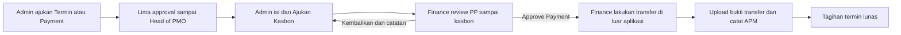

# Pengajuan kasbon Admin, review Finance dan inbox otomatis

Otoritas pengguna, 11 November 2026: pembuat kasbon adalah Admin Konstruksi setelah approval pembayaran selesai sampai Head of PMO. Finance mereview dokumen PP sampai kasbon sebelum memproses pembayaran. Bagian ini menggantikan aturan pembuat kasbon oleh Finance pada implementasi awal [FINANCE_KASBON](FINANCE_KASBON.md); aturan jumlah, bank, file privat, versi, APM, volume dan riwayat lainnya tetap.

## Alur yang berjalan

- Parsial tetap **Ajukan Termin**, Final **Ajukan Payment**. Lima pengguna terpilih dan urutannya tetap PM, Admin Area, Mgr Project Support, Mgr Deployment, Head of PMO. Pengajuan kasbon bukan approval keenam dari Admin.
- Setelah kelima keputusan aktual lengkap, **Ajukan Kasbon** muncul pada detail Pembayaran. Inbox Admin Konstruksi/Superadmin juga menampilkan antrean Pengajuan Kasbon, maksimal20baris/halaman. Akun Superadmin boleh menjalankan kewenangan Admin; pembuat tetap tercatat sebagai akun/peran sebenarnya.
- Form memakai struktur template yang sudah diberikan: Cost Center, WBS, Jenis Kegiatan, rincian No Akun/Nama Akun/Teks/Amount1–20baris. Jumlah rincian harus tepat sama dengan tagihan aktual termin; tidak membuat potongan/angka baru. ID Project/nama PP, nomor PP/SPK/termin, nama Mandor dan penerima/rekening/bank berasal dari record yang terkait.
- Nama pembuat dan `finance_kasbons.issued_by` mengikuti akun Admin yang benar-benar mengajukan, bukan akun Finance, pembuat PP lain atau data dari client. Lima penandatangan pekerjaan diambil dari keputusan aktual termin. EVP/Business Support tetap penandatangan fisik, tanpa role/approval aplikasi baru.
- Inbox Finance menerima kasbon yang telah diajukan dan belum dibayar/dikembalikan. Scan yang menunggu verifikasi juga tetap menjadi tugas Finance, termasuk scan susulan setelah lunas. Finance tidak menerbitkan/mengisi kasbon baru melalui POST. Finance dapat mengembalikan kasbon dengan catatan; Admin membuat versi pengajuan berikutnya, tanpa mengulang lima approval pekerjaan.
- Finance melakukan **Approve Payment** setelah review, melakukan transfer di luar aplikasi, upload bukti transfer privat, kemudian mencatat nomor APM. Proof terikat ID kasbon saat antrean diterima; APM atomik melunasi seluruh tagihan. Alur scan tersedia-wajib-verifikasi, scan boleh menyusul, maksimal3termin/Final, pelunasan sebelumnya, BA PP/release dan harga/ledger tetap.
- Status SQL/snapshot `Kasbon Terbit` dipertahankan agar otoritas pembayaran lama kompatibel; UI kasbon menyebutnya **Kasbon Diajukan · Review Finance**. Tidak mengubah SQL history agar tampak seolah dokumen lama dibuat Admin.

## Default dan berkas kasbon

Default form pertama dan fallback server ketika field belum dikirim:

| Field | Nilai default yang diminta pengguna |
|---|---|
| Lokasi di atas TTD Mandor | Surabaya |
| Tanggal | Tanggal pengajuan baru menurut kalender aplikasi Asia/Jakarta; dapat dikonfirmasi Admin |
| EVP Area Jawa Bali | I GEDE WAHYU DANYNDRA |
| Mgr Business Support | ARIZA ARBA'ATUS S |

Default dapat diedit sebelum pengajuan. Field yang sengaja dikosongkan tetap gagal validasi; server tidak mengarang Cost Center/WBS/No Akun. Koreksi memulai tanggal pengajuan baru dan mempertahankan isian sebelumnya sebagai prefill, tanpa menulis ulang versi lama.

Snapshot baru memakai `templateVersion:2`/`issuerRole` di `finance_kasbons.private_data` serta `issuedRole` pada ringkasan kasbon workflow. Lokasi/tanggal dicetak tepat di atas area TTD fisik Ketua Mandor. Nama Mandor aktual dan area kosong ditambahkan; empat maker/reviewer serta tiga pejabat fisik tetap memakai area TTD kosong. Versi awal tanpa marker tetap menampilkan maker Finance dan susunan lama; GET tidak mengisi nama/tanggal hari ini pada arsip. Preview/cetak HTML tersedia, bukan export kasbon native XLSX/DOCX atau integrasi transfer bank.

## Penguncian penerima dan versi yang direview

Form memuat profil Mandor privat hanya ketika dibuka. Admin melihat penerima/rekening/bank dan versi yang sedang digunakan; PII tidak masuk localStorage/boot/ekspor umum. `payeeVersion` wajib pada pengajuan. Laravel memeriksa versi terhadap profil SPK terbaru di bawah workspace lock. Perubahan rekening selama form terbuka mengembalikan409, meskipun revisi workspace sudah dimuat ulang. Admin harus menekan **Muat ulang data penerima**, memeriksa bank/rekening, kemudian mengajukan lagi secara eksplisit.

Di review Finance, identitas/rekening dan foto default adalah **snapshot penerima pada kasbon**, termasuk versi dan file pilihan saat pengajuan. Tombol **Lihat Data SPK Terkini** memuat referensi terbaru secara terpisah; perubahan SPK tidak diam-diam mengganti tujuan transfer dokumen terbit. Riwayat rekening/kasbon/proof dan idempotensi hash-bound UUID tetap.

Keputusan Finance pada kasbon baru wajib membawa ID versi kasbon yang tampil pada panel review (argumen keempat `decideFinancePayment`). Jika berubah, server menolak tanpa keputusan/pembayaran. Versi historis tanpa `issuedRole` tetap menerima kontrak API lama; client baru juga mengikat keputusan historis ke ID yang ditampilkan. Pengamanan ini tidak menambah query atau mengganti keputusan lama.

## Review berkas dan BOQ Mandor

Tombol **Review Berkas Swakelola** pada Finance membuka daftar preview untuk:

1. Project Plan dan tabel lampirannya.
2. BOQ TA - Mandor dari anggaran PP tersimpan.
3. BA KH dan Lampiran BA KH.
4. SPK dan Lampiran SPK.
5. BA Rekonsiliasi Pekerjaan – Termin dan Lampiran Rekonsiliasi.
6. Eviden pekerjaan dan scan TTD jika tersedia.
7. Identitas/rekening/foto Mandor dan Form Kasbon.

Dokumen memakai komponen preview yang sudah ada dan hubungan **termin → SPK → BA KH → PP yang dipilih**. Tidak mengambil PP pertama/anggaran root lain. Kasbon dan scan yang belum ada ditandai belum tersedia; membuka preview tidak otomatis mengesahkan dokumen atau menyatakan berkas sesuai. Pembayaran historis juga mendapat tombol review; kasbon tetap belum tersedia jika belum pernah dibuat, tanpa memaksa adopsi alur baru.

Tombol **Preview BOQ TA Mandor** tersedia pada Inbox PP, panel approval PP, detail Pembayaran dan Inbox approval Pembayaran untuk semua tahap. Model hanya menggunakan `planBudget.mandor` pada PP terkait, termasuk PP lanjutan; root BOQ/KHS dipakai untuk metadata designator/uraian/satuan. Volume dan harga Material/Jasa independen, pembulatan sama dengan anggaran, nol tetap terlihat, komponen excluded kosong. Dokumen historis tanpa rincian menampilkan keterangan belum tersedia; tidak menebak harga dari KHS/Owner. Seluruh preview baca-saja. Konfirmasi keputusan PP/Pembayaran baru memberi toast sukses setelah server mengonfirmasi.

## Inbox otomatis dan perlindungan isian

Browser terautentikasi memeriksa `GET /api/prototype/revision` setiap15detik ketika tab terlihat dan halaman daftar aktif. Endpoint membaca satu counter workspace akun resmi, tanpa membuat workspace atau menerima kepemilikan dari query client. ActiveAccount/Branch assignment, its-only guard, private/no-store dan throttle60/menit berlaku. Tidak mengembalikan dokumen, private paths, rekening atau katalog master.

Data Branch-scoped dari endpoint state yang sudah ada diambil hanya ketika revisi server meningkat. Tidak ada polling full aggregate pada setiap tick. Request tunggal, focus/route wake minimal3detik, tab tersembunyi berhenti, kegagalan dibackoff30/60/120detik. Browser tidak melakukan POST/retry approval secara otomatis.

Sinkronisasi berlangsung pada Inbox/dashboard/daftar PP/SPK/Pembayaran/BA PP/laporan. Editor/detail dokumen, modal/native dialog, isian catatan/APM/file aktif pada Inbox, dan transaksi yang sedang disimpan menjeda sinkronisasi. Sesudah dialog ditutup/isian diselesaikan, pemeriksaan berikutnya berlanjut otomatis. Respons ditolak jika pengguna sudah pindah halaman/mulai menulis/menyimpan, revisi lokal berubah, respons lebih lama atau bentuk payload tidak valid. Draft/cache tidak dibersihkan. Perlindungan ini mempertahankan revisi form lama untuk konflik server; halaman editor tidak diam-diam menyimpan input lama memakai revisi hasil polling baru.

Daftar tugas PP dan Pembayaran dibatasi20baris per halaman; relasi daftar pembayaran diindeks sekali. Antrean kasbon Admin juga20baris, tanpa request private per baris. Payload aggregate lama tetap ada pada refresh yang benar-benar diperlukan; fitur ini bukan penggantian arsitektur aggregate atau jaminan kecepatan untuk seluruh beban produksi.

## Arsitektur, SQL dan deployment

Tidak ada tabel/kolom/migration baru. `finance_kasbons` menyimpan actor Admin dan snapshot baru di kolom yang sudah ada; `payment_terms.document_data` memegang status/ringkasan, `apm_settlements` tetap otoritas same-term kasbon/proof. Workspace lock/revisi, receipts/audit, harga/volume, private queue, selected users dan archive tetap.

Query pengajuan memakai account context yang sudah diotorisasi, join target dan pengambilan profil server secara internal tanpa mengulangi join scope SPK/katalog harga. GET profil `?profile_only=1` dan kasbon `?documents_only=1` melewati daftar file yang tidak diperlukan; perilaku GET default tetap kompatibel. Field yang dibaca dibatasi, versi kasbon10/file20 atau10 tetap bounded, file hanya dimuat saat dipilih. Identitas/berkas privat tetap hanya Admin/Superadmin/Finance pada Branch PP yang ditugaskan, termasuk ketika UUID diketahui approver lain.

Deploy semua kode dan hasil build, lalu bersihkan route/config cache aplikasi sesuai prosedur server; jangan mengganti `.env`/APP_KEY. Tidak memerlukan migration tambahan untuk perubahan ini, tetapi migration kasbon sebelumnya `2026_11_11_000001_create_finance_kasbon_workflow` tetap harus tersedia bila instalasi belum memilikinya. Restart hanya worker its bila memuat kode lama; tidak menyentuh program/database Dompis. Tidak menjalankan rencana koreksi Head PP0002 secara otomatis sebagai bagian deployment ini.

## Bukti dan batas

- Backup tabel/data/triggers its lokal sebelum perubahan: `its-before-admin-kasbon-20261111-072634.sql`, 2.118.857byte, SHA256 `37dcb8d564517d06f1cab64df2eec71419dc9a1132ca8c9cba62f1137325d764`. Satu percobaan sandbox gagal ditandai.failed; backup sukses diverifikasi ulang. Stored routines tidak termasuk, restore belum diuji. Backup ini bukan cadangan server pengguna.
- PHP memakai SQLite memory fail-closed/fake disk; frontend memakai fixture/mock transport/SSR dan build. Pengujian aktual serta total akhir dicatat pada LARAVEL_QA dan [bukti terstruktur](qa/admin-kasbon-review-sync-20261111.json).
- Fixture pengajuan satu termin44query HTTP (budget75), APM44; profil lengkap5 termasuk workspace fixture, lazy profil/dokumen masing-masing3service queries; revision probe1service/2HTTP pada auth/session test fixture. Tidak ada SQL baru untuk BOQ/HTML review/gerbang versi, tidak ada penulisan PP/BOQ/approval/ledger saat pengajuan kasbon. Angka ini bukan benchmark latency/throughput produksi.
- Fixture500baris BOQ dan1000tugas membuktikan indexed lookup/batas20DOM, bukan load browser nyata. Native dialog, account click, responsif/fokus, aaPanel/proxy/route cache/worker, MySQL correction/financial transaction dan cetak fisik belum diverifikasi pada server.
- Tidak menambah data simulasi ke runtime, tidak mengubah transaksi/arsip/akun/master its aktif, .env, APP_KEY, permission atau Dompis; tidak commit/push/deploy server oleh agen. Transfer bank, pemeriksaan berkas dan tanda tangan tetap dilakukan manusia. Dokumen kasbon lama/keputusan/APM tidak diregenerasi.
