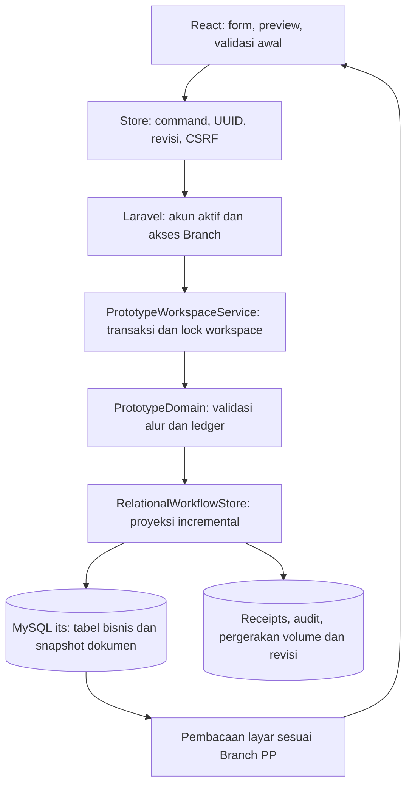

# Arsitektur aplikasi it's Area 3

Catatan ini menjelaskan struktur runtime aktif dan keputusan perubahan. Baca bersama [MYSQL_RUNTIME.md](MYSQL_RUNTIME.md), [buku saku relasi tabel](DATABASE_RELATIONS.md), AGENTS.md dan [CHANGELOG.md](CHANGELOG.md). Kode Laravel merupakan otoritas validasi dan status tersimpan; dokumentasi SQL konseptual lama tidak menggantikan executable migrations atau runtime.

## Aliran perintah dan penyimpanan

- resources/js/area3/domain.ts memberi feedback form/preview yang konsisten dengan app/Services/PrototypeDomain.php. Client tidak dapat mengganti seluruh state, identitas workspace, penanggung jawab approval atau path privat.
- PrototypeWorkspaceService mengunci workspace, memeriksa revisi/idempotensi dan menjalankan domain di server. Setelah valid, RelationalWorkflowStore.write menerima state sebelum/sesudah agar hanya dokumen terkait dan ledger root terdampak yang ditulis. Proyeksi silang BA KH/SPK tetap konsisten. Revisi, SQL bisnis, receipts dan audit akun nyata atomik.
- Sumber runtime adalah baris bisnis dan document_data per dokumen. prototype_workspaces.state adalah arsip yang tidak ditulis ulang dan tidak menjadi fallback. Master dan akun dibaca dari SQL. Satu ID Project dapat memiliki banyak PP; pembatasan Branch menggunakan Branch PP masing-masing.
- File upload asli berada di storage privat; document_files menyimpan metadata/path server. Antrean database memproses BOQ dan eviden, memeriksa ulang pemilik/Branch/status dan menjaga idempotensi serta cleanup. Lihat [UPLOAD_QUEUE_PERFORMANCE.md](UPLOAD_QUEUE_PERFORMANCE.md).
- Lima approval mengikuti PM → Admin Area → Mgr Project Support → Mgr Deployment → Head of PMO. Identitas/keputusan historis dibekukan, urutan runtime mencari peran pertama yang belum menyetujui. Pembayaran memerlukan lima keputusan sebelum cetak/scan TTD fisik, lalu Finance dan APM. Lihat [PROJECT_SUPPORT_APPROVAL.md](PROJECT_SUPPORT_APPROVAL.md).
- Preview/Word memakai data berizin yang sudah dimuat. Word BA KH dimuat sesuai kebutuhan dan dibuat lokal, tanpa query/mutasi server. Tidak ada tanda tangan yang dibuat otomatis. Lihat [BAKH_WORD_EXPORT.md](BAKH_WORD_EXPORT.md).

## Keputusan 7 November 2026: pengesahan tanpa referensi teks

Permintaan pengguna menghapus isian referensi bukti pada BA KH, SPK dan BA PP. Form, preview generik dan timeline tidak menampilkan referensi itu. Laravel serta domain React tidak lagi mewajibkan teks evidence. Ini perubahan syarat pengesahan dokumen Admin; tidak mengubah rantai approval atau menggantikan upload privat Pembayaran.

| Lapisan | Keputusan |
| --- | --- |
| Form dan command | Hapus input/notice referensi; attestBapp mengirim ID dan nomor |
| Domain PHP/TS | Abaikan input evidence usang, pertahankan nilai historis tersimpan; semua guard selain kewajiban teks tetap berlaku |
| SQL | Snapshot evidence dan kolom nullable evidence_reference dipertahankan untuk riwayat; BA PP baru tanpa referensi memproyeksikan NULL; tanpa migration atau backfill |
| Performa | Normalisasi murni tanpa query baru; Map BOQ/KHS sekali per render BA PP menggantikan pencarian katalog berulang |
| Audit dan keamanan | Lock, revisi, idempotensi, audit ID akun, Branch, snapshot terbit dan ledger tetap melalui layanan yang sama |

Regresi domain membuktikan nol query untuk matriks BA KH/SPK. Fixture HTTP memakai 51–58 query termasuk revision read dan dibatasi maksimal 60, tanpa write ulang tabel PP/BOQ/approval/berkas. Angka terbatas pada fixture kecil SQLite memory, bukan tolok ukur kapasitas MySQL. Rincian perilaku, backup, hasil tes dan batas verifikasi: [DOCUMENT_ATTESTATION.md](DOCUMENT_ATTESTATION.md), [bukti QA](qa/document-attestation-20261107.json).

## Keputusan 7 November 2026: pencarian ID Project sebelum negosiasi

Negosiasi Baru menggunakan pencarian ID Project → tabel PP → konfirmasi pilihan → form. Dua endpoint GET read-only melalui ActiveAccount/Branch menyediakan metadata pilihan maksimal 20 per halaman. NegotiationProjectCatalog memakai project_plans.branch_id, label snapshot PP dan batch saldo/alokasi; tidak membaca aggregate global, master KHS, arsip atau riwayat approval untuk mencari pilihan. Layanan pencarian 2 query, daftar PP 3–4 query, tanpa N+1. PP lanjutan memakai alokasi snapshot sendiri dikurangi penugasan BA KH, bukan saldo available root atau tabel proyeksi lanjutan yang belum menjadi sumber runtime.

Pencarian tidak memesan volume atau memberi kewenangan simpan. Lanjut Negosiasi menyegarkan state melalui endpoint yang sudah ada, dan command lama tetap memeriksa semua invariant dalam transaksi. Existing document/deep link mempertahankan PP yang dipilih, tanpa memindahkan dokumen. Tidak ada schema/migration/mutasi live. Shared boot/refreshState masih menggunakan aggregate Branch yang ada; perubahan ini membatasi katalog pencarian, belum mengganti pemuatan seluruh aplikasi. Contains-search JSON/LIKE dan performa serentak tetap batas verifikasi.

Rincian endpoint, UX, autentikasi, query-budget 120 PP, pemeriksaan baca saja MySQL dan batas browser: [NEGOTIATION_PROJECT_PICKER.md](NEGOTIATION_PROJECT_PICKER.md), qa/negotiation-project-picker-20261107.json.

## Keputusan 7 November 2026: tindak lanjut SPK pada daftar BA KH

Kolom Tindak Lanjut SPK diturunkan di React dari BA KH dan SPK tersimpan yang sudah dimuat dalam state berizin. BA KH Sah tanpa SPK memunculkan Menunggu Pengajuan SPK dan tautan Buat SPK untuk Admin/Superadmin. SPK yang ada menampilkan status/nomor dan tautan dokumen yang tepat; tidak menawarkan pembuatan duplikat. Tidak ada status baru yang dipersistensikan, query/endpoint/migration, perubahan domain atau transaksi live. Link memakai alur SPK yang sudah tervalidasi, bukan auto-submit/pengesahan.

Indeks Map PP/BA KH/SPK sekali per render menggantikan find koleksi per baris; relasi memakai ID BA KH, bukan kode Project bersama. Tes markup mencakup status, role, dua PP pada satu ID Project, sumber immutable dan larangan find per baris; bukan pengukuran latensi atau browser. Detail dan batas: [NEGOTIATION_PROJECT_PICKER.md](NEGOTIATION_PROJECT_PICKER.md), qa/contract-follow-up-20261107.json.

## Keputusan 7 November 2026: surat SPK Mandor dan Word native

Preview SPK utama memakai SpkDocument dengan model spk-content dari prop berizin PP/BA KH/SPK, sebelum lookup root/KHS generik. Word mengisi slot teks pada paket salinan template sumber yang sudah disiapkan, mempertahankan header/logo/font/style/halaman dan tabel native, tanpa nama/tanggal/nilai contoh atau tanda tangan rekaan. Identitas dan periode memakai SPK tersimpan/form; harga berasal dari kesepakatan Mandor, dengan total pembulatan domain tetap sama.

Generator/template dimuat saat unduh (sekitar91,32kB/gzip13,22kB), ZIP bersama kini mendukung gambar biner. Logo asli dilayani sebagai aset statis publik dengan resolusi prefix Apache subfolder; satu GET logo saat unduh, tanpa request data bisnis/SQL baru. Tidak ada backend/migration/mutasi DB, snapshot/approval/harga/volume atau batas Branch yang berubah. Download membuat salinan lokal dan tidak menyimpan/mengesahkan transaksi. Runtime tidak bergantung pada sumber Downloads/Python/Word desktop.

Dua output aplikasi (normal dan panjang) lolos CRC/XML/relasi serta preservasi 8 bagian; render1+1 halaman diperiksa seluruhnya. Bukti 203 PHP/176 frontend/build, pemetaan, pembulatan sen, adaptasi whitespace serta batas browser/Microsoft Word/cetak: [SPK_TEMPLATE_WORD.md](SPK_TEMPLATE_WORD.md), qa/spk-template-word-20261107.json. Angka bundle bukan klaim beban/latensi umum.

## Pencatatan setiap pembaruan

Setiap fitur/perubahan berikutnya harus mencatat dampak pada otoritas domain, aliran command/read, tabel/snapshot/berkas, otorisasi/concurrency dan biaya query/lookup. Jika tidak berubah, tulis secara eksplisit bahwa tidak ada perubahan arsitektur/query beserta alasan dan bukti yang relevan. Catat keputusan ringkas di sini atau tautkan dokumen perilakunya; tambahkan audit kronologis pada CHANGELOG.md, WORKPLAN.md dan hasil nyata di LARAVEL_QA.md. Jangan menimpa keputusan historis atau mengklaim pengujian browser/load/cetak yang belum dilakukan.

Seluruh artisan test harus tetap fail-closed pada SQLite :memory:, termasuk ketika konfigurasi tercache. Backup its sebelum perubahan workflow; jangan menjalankan pengujian/migration/reset atau menanam data contoh pada database pengguna tanpa otorisasi yang sesuai. Aplikasi Dompis Prov tidak termasuk ruang lingkup proyek ini.

## Keputusan 7 November 2026: grid Lampiran SPK dan volume komponen

Model presentasi spk-appendix-content mengindeks metadata BOQ root/KHS sekali, lalu mengambil qm/qs/pm/ps hanya dari kesepakatan SPK yang dipilih. SpkAppendixTable dipakai pada form dan preview khusus yang mendahului kalkulasi generik; tidak ada API/SQL/perintah baru. Grid sebelas kolom memuat Nama Proyek/Vol, Total Vol, nilai M/J/Jumlah dan recap template. Volume M/J berbeda menghasilkan dua baris komponen, tanpa agregasi lintas unit atau pergeseran harga/volume/ledger; pembulatan sen konsisten dengan surat utama. Penandatangan dari snapshot SPK dan TTD fisik kosong. Landscape terbatas pada lampiran, portrait main SPK/Word serta list BA KH tanpa garis dipertahankan.

Review query:0 tambahan; Maps menggantikan nested find form, dibuktikan fixture1000 baris tanpa find per baris. Tidak ada perubahan penyimpanan/schema/workflow/live its.203 PHP/182 frontend/build lulus; browser localhost ditolak, visual/responsif/print belum diverifikasi. Pemetaan lengkap, sumber workbook SHA dan batas: [SPK_APPENDIX_TEMPLATE.md](SPK_APPENDIX_TEMPLATE.md), qa/spk-appendix-template-20261107.json.

## Keputusan 7 November 2026: Head PP menjadi sumber penandatangan SPK baru/draf

BakhSigner::projectIdentity/projectHeadIdentity dipakai bersama BA KH dan SpkSigner/syncSpkSigner. Kebijakan snapshot SPK berdiri sendiri: baru/draf v3 memakai Head terpilih dari PP tepat yang direferensikan BA KH (keputusan matchingID→signatureUsers matchingID→akun terpilih), sedangkan Terbit/Sah tetap identitas tersimpan. Backend menimpa incoming signer/position/identity dan menyimpannya pada work_orders.document_data, proyeksi kontrak serta audit/receipt atomik yang sudah ada; tidak mengubah arsip/schema. Missing NIK tetap kosong, missing valid Head menolak formal issuance, dan tidak ada identity lookup berdasarkan nama/global Head.

Preview/Word memakai props SPK yang disinkronkan tanpa save pada read. Header lampiran langsung nama kegiatan/VOL. Surat tetap source-derived portrait dengan slot NIK; ekspor lampiran native landscape menggunakan model tabel sama dan helper word-ooxml yang diekstrak dari BA KH. Lazy chunks terpisah, semua teks di-escape, tidak ada arbitrary path/network, tanda tangan rekaan atau command saat download.0 tambahan SQL resolver,HTTP fixture≤60 query termasuk revisi,1000-row indexed export; ini bukan klaim throughput umum.208 PHP/187 frontend/build/Pint lulus;4 output Word dirender dan7 PNG diperiksa. Detail backup,SQL mapping,ukuran chunk dan batas browser/Word desktop/cetak: [SPK_SIGNER_WORD.md](SPK_SIGNER_WORD.md),qa/spk-head-word-20261107.json.
