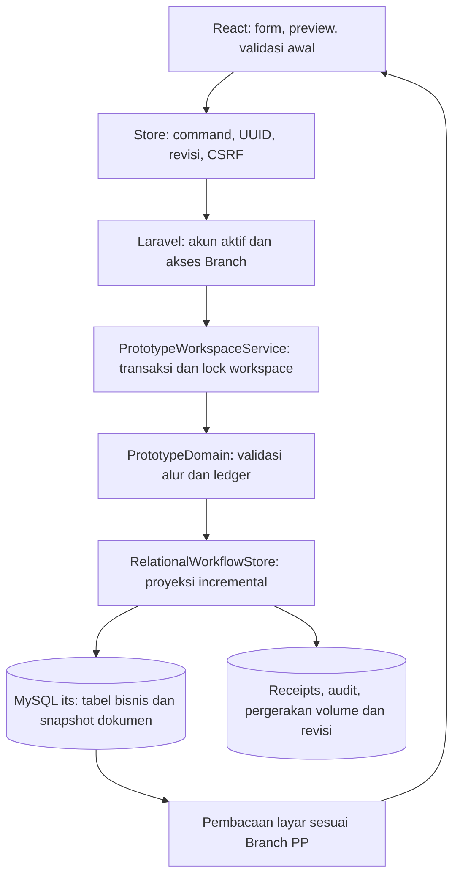

# Arsitektur aplikasi it's Area 3

## 12 November 2026 — Pemotongan nominal tersimpan dan audit konversi satu kali

Otoritas [TRUNCATE_STORED_MONEY](TRUNCATE_STORED_MONEY.md) mengganti half-up dengan idr-trunc-v1; bcdiv(...,0)/Math.trunc/BigInt division menghilangkan pecahan. HALF policy lama tetap terpisah. Data migration000001a mendahului type migration000002 dan juga berlaku bila type migration sudah terpasang. TruncateStoredMoney menyusun/validasi rencana SQL+active JSON/BOQ/budget/KHS/request/encrypted kasbon sebelum UPDATE; tidak memakai aggregate writer untuk meregenerasi child/ledger/decisions. Total anggaran/header otomatis dari sumber terpotong, pembayaran aktual hanya dipotong dan identitas/status/file tetap. Konflik aktif/zero-positive dihentikan, bukan dihapus.

currency_conversion_runs dan currency_conversion_changes (run_id FK) menyimpan idempotence key, jumlah perubahan dan encrypted before/after+hash. Apply satu transaksi dengan lock workspace/revision; late SQL failure rollback audit/data/revisi dan bisa retry. Archive/receipt/audit lama tetap. CLI default read-only/its-only, tanpa endpoint baru. Baca maintenance dipaginasi200 dan workspace20/kolom terpilih, lookup indexed; query/write meningkat sesuai record, bukan janji throughput. Web save/preview0query tambahan, katalog SPK tetap4query. Rincian bukti/backup/server limits pada QA; belum apply/migrate aktif atau deploy server.

## 11 November 2026 — Kebijakan rupiah bulat, tipe uang dan matrix drilldown

[WHOLE_RUPIAH_DASHBOARD_DETAILS](WHOLE_RUPIAH_DASHBOARD_DETAILS.md) menjadi otoritas baru untuk uang operasional. Marker moneyPolicy=idr-whole-v1 dipasang server pada explicit editable/new save; BCMath/BigInt membulatkan half-up setiap M/J per baris. Formatter/terbilang rupiah bulat dipakai konten bersama layar/Word. Locked legacy tanpa marker mempertahankan rumus/keputusan/paid/history; tidak bulk rewrite snapshot/arsip/source Excel. Harga asli tetap dicek terhadap ceiling sebelum normalisasi. Angka quantity/percent dipisahkan dari uang.

Migration its-only14kolom/10tabel ke BIGINT didahului pemeriksaan seluruh kolom dan pending snapshot bill dalam halaman200, gagal sebelum DDL bila ada cents. CLI pemeriksaan tanpa write. Baseline11SELECT; tidak berjalan pada web. SQLite rebuild memulihkan trigger termasuk settlement XOR, relasi/null tetap. MySQL DDL perlu maintenance/backup terpisah karena nontransactional; belum diterapkan live. Pemilih SPK memakai policy contract pada agregasi component dalam query yang sama, tetap4servicequeries; tidak ada lookupmaster/per-row. Runtime lainnya0query baru.

Model dashboard menyimpan proyeksi metadata PP/payment contributors dari data Branch-scoped yang sudah dimuat; Map/Set/index dan memo tetap. Klik enam angka per scope, search/page20/drill kode→PP tidak memuat SQL/archive/katalog/private identity atau mengubah state. Route dari exact record; OPEN/CLOSE global visible siblings sebelum filter, root total dedup. Fixture1000rows/20DOM dan original query budgets bukan loadtest. Aggregate boot lama tetap. Bukti275PHP/5837assertions/279FE/build; browser/MySQL/Word/physical print/server belum diverifikasi.

## 11 November 2026 — Pengajuan kasbon Admin, Finance review dan revision probe

Otoritas terbaru [ADMIN_KASBON_REVIEW_SYNC](ADMIN_KASBON_REVIEW_SYNC.md) mengganti pembuat kasbon menjadi Admin Konstruksi/Superadmin setelah lima actual payment approvals; Finance hanya review/return/approve/proof/APM. FinanceDocuments memeriksa akun/Branch/PP dan eligibility di bawah workspace lock, mempertahankan server-derived canonical bill, encrypt private snapshot, versioned bank/photos dan actual issued_by. payeeVersion mengikat preview bank pada pengajuan; expectedKasbonId mengikat Finance decision pada versi review. Konflik tidak retry/menimpa rekening/keputusan diam-diam. Snapshot versi2 menambah makerRole/defaults dan area TTD Mandor; versi lama/SQL marker Kasbon Terbit/APM/history tetap kompatibel. Tidak ada schema/migration atau bulk rewrite.

Review Finance mengikuti exact term→SPK→contract→PP, memakai preview dokumen yang sudah dimuat; identitas default frozen kasbon, profil kini dimuat eksplisit. Bank/KTP/files hanya role privat/Branch, tidak boot/localStorage. includeFiles=false pada GET profil/dokumen melewati daftar yang tidak dipakai; target/account authorization dipakai ulang secara internal, field/query bounded. Fixture pengajuan44HTTP/budget75 (awal47), APM44; default profil5, lazy profil/kasbon3service masing-masing. Bukan universal performance claim. BOQ Mandor preview memakai selected saved budget dan indexed metadata/root references tanpa harga pengganti;0SQL baru/per-row catalog searches. Task relations Maps,20DOM/page untuk PP/payment/kasbon.

Authenticated GET revision membaca1counter workspace resmi tanpa create/aggregate/archive (2HTTPquery pada fixture session/auth). Poll15detik hanya visible safe lists, state Branch-scoped diambil ketika counter naik; satu in-flight request, focus minimum3detik, error backoff30/60/120. Editor/detail/dialog/native dialog/isian catatan/APM/file/pending command menjeda. Store mengecek eligibility/revision/local mutation lagi setelah respons, mengabaikan stale/invalid/aborted responses tanpa menyentuh draft/cache atau advancing editor revision. Tidak ada auto-POST/retry keputusan. Satu changed refresh tetap membaca aggregate lama; bukan pengganti relational read-model atau load benchmark.

269PHP/5771assertions/270frontend/build/check-assets terverifikasi secara terisolasi; detail query/race/role/version/render evidence dan batas server/browser pada QA/bukti terstruktur. Migration kasbon sebelumnya tetap prasyarat; tidak mengubah its/Dompis/env/APP_KEY atau menerapkan koreksi Head PP0002. Deploy kode/build lengkap dilakukan operator terpisah.

## 11 November 2026 — Koreksi administratif Head tanpa menghapus keputusan

[PP_HEAD_CORRECTION](PP_HEAD_CORRECTION.md) menjelaskan perintah CLI dan rencana spesifik PP0002 yang dipersiapkan setelah hasil SQL pengguna lengkap. ProjectHeadCorrection memeriksa shared workspace, Superadmin/Branch/Head aktif, revisi/keputusan/graf belum dibayar; backup privat diverifikasi sebelum incremental write+revision+audit+receipt atomik. Tidak ada endpoint/schema/migration/reset/archive fallback atau replacement state. Service membaca business snapshots serta target SQL, tidak bind ulang seluruh katalog master. Hash-bound request mencegah koreksi ganda.

Marker headApprovalReopen server-owned menyimpan batas history dan referensi empat keputusan aktual; ProjectHeadReopen.cycles mempertahankan siklus asli lalu memproyeksikan satu siklus administratif dengan keputusan yang dibawa. Tidak membuat aksi persetujuan baru oleh empat pengguna atau menimpa Head lama. Head mengambil keputusan baru lewat command normal; penolakan/resubmission berikutnya tetap restart lima tahap. Writer membandingkan keputusan secara strict setelah normalisasi urutan key JSON, menjaga nilai/tipe/audit immutable.

Domain execute menahan mutasi keturunan marker selama PP belum Sah, berdasarkan hubungan tersimpan; recorder React memberi feedback sama sebelum optimistis. Baca/preview dokumen historis tetap; timeline/approval memberi konteks pembukaan ulang dan Head stamp memakai approval aktif saja. Metadata marker disalin dari saved server saat revisi PP, tidak dari client. Tidak mengubah data BA KH/SPK/termin/BOQ/biaya/ledger/arsip ketika koreksi dilakukan.

Fixture84query apply satu PP, budget140/no catalog/no write proyeksi turunan; tambahan0SQL pada gerbang HTTP.263PHP/5597assertions/257frontend/build/check-assets lulus. Bukti dan batas browser/engine/server ada pada QA/dokumen perilaku; belum apply pada server/live its. Setelah marker diterapkan, deploy kode yang memahami siklus koreksi secara lengkap; jangan rollback kode parsial.

### Bukti tambahan PP0002 — 11 November 2026

Hasil SELECT dari pengguna menunjukkan BA KH/SPK Sah, termin1 Final ditolak dan APM/settlement NULL pada baris yang dibagikan. Tidak ada perubahan rancangan/runtime; konfirmasi tersebut tidak menambahkan kemampuan pencabutan keputusan. Identitas/revisi dan approval SQL masih diperiksa sebelum koreksi, tanpa menurunkan status dokumen turunan atau menghapus riwayat.

## 11 November 2026 — Review koreksi approval Head PP0002 dengan dokumen turunan

Pengguna mengonfirmasi BA KH/SPK ada dan pembayaran ditolak. Target pending Head dengan empat keputusan sebelumnya bukan command Kembalikan/resubmit normal. Domain validateDeal membutuhkan PP Sah/BOQ Final, sedangkan writer SQL mempertahankan keputusan immutable dari history; edit snapshot/status saja tidak menyediakan pencabutan yang konsisten. Tidak ada command pencabutan Head yang diterapkan. Diperlukan pemeriksaan SELECT-only identitas/revisi, dokumen turunan/APM dan run/step/decision aktual sebelum rancangan koreksi terkoordinasi. Ini review saja: tidak ada perubahan endpoint/domain/schema/query runtime, penghapusan keputusan, rewrite dokumen turunan/arsip atau koneksi server. Batas verifikasi dicatat pada LARAVEL_QA dan WORKPLAN.

## 11 November 2026 — Compatibility fix untuk upload BOQ/eviden

UploadQueue INSERT kini menambahkan `context_id` hanya pada bukti transfer. BOQ/evidence tidak bergantung pada schema kasbon, sehingga schema sebelum kasbon tetap menerima task/job yang tervalidasi. Private upload menambah satu registry lookup dan menolak503 sebelum staging jika migration belum selesai; tidak auto-migrate atau menghilangkan binding kasbon. Query lama tidak bertambah (fixture dua enqueue24query), hak/Branch/status/UUID/queue/private paths/receipts tetap. Tidak ada DDL/perubahan workflow/data live. Penyebab SQL1054 lokal, regresi real worker memory dan batas remote ada pada [UPLOAD_QUEUE_PERFORMANCE](UPLOAD_QUEUE_PERFORMANCE.md#11-november-2026--upload-eviden-sebelum-migration-kasbon) dan qa/evidence-schema-compatibility-20261111.json.

## 11 November 2026 — Private Mandor / immutable Finance kasbon

[FINANCE_KASBON](FINANCE_KASBON.md) mencatat pemetaan template, state machine, tiga tabel baru, extension upload context dan XOR APM/composite-term references. FinanceDocuments menyimpan ciphertext/metadata terpisah; tidak menambah PII ke workspace aggregate/boot/export/localStorage. Internal commands dan existing workspace lock membuat versi profil/issuance/file/settlement, revision/receipt/audit atomik; semua pembacaan dibatasi role serta PP Branch/workspace. Default server untuk v3 baru, adopsi lama eksplisit, marker tidak dapat dihapus melalui submit/legacy Partial request. Transfer-proof terikat kasbon saat enqueue dan saat APM; reissue memerlukan bukti baru. Tidak menambah approval EVP/Business Support atau membuat TTD.

Query minimal per dokumen; profil/file batched dan terbatas, issuance47/APM44 HTTP fixture satu termin, private payee5 termasuk workspace read. Issuance tidak menulis ulang PP/BOQ/actual/approval/file/ledger. Picker memakai proyeksi JSON tambahan pada query yang sama; laporan/timeline memakai state publik. Existing full aggregate/catalog reads tetap; tidak mengklaim throughput umum. Migration disiapkan saja; no live its/archive/env/master/Dompis changes. Bukti serta batas SQLite/browser/MySQL/print/server di LARAVEL_QA dan qa/finance-kasbon-20261111.json.

## Same-origin workspace transport — 10 November 2026

[SAME_ORIGIN_TRANSPORT](SAME_ORIGIN_TRANSPORT.md) memisahkan alamat publik browser dari alamat upstream Laravel. PrototypeController.show menghasilkan path named route + request baseUrl tanpa scheme/host; workspaceUrl menyusun path endpoint dikenal pada frontend. Command/state/recovery/CSV/backup tidak lagi memakai boot absolute URL yang dapat mengarah HTTP/host internal. Account URLs fresh boot juga relatif. Tidak mengubah proxy trust/CORS/.env atau menambah host situs hardcoded.

Network/timeout dibedakan dari response non-JSON dan validasi; rejection promise PP kini memakai pesan persistenceError yang menjelaskan hasil belum terkonfirmasi. Success/clear/navigation tetap setelah respons server; response-lost-after-save menjalankan recovery GET lama tanpa duplicate POST. Cache draf existing tetap, tidak menciptakan shared new-PP cache/auto-save.

0 SQL/endpoint/poll/dependency/request tambahan: normal save1POST, failure1POST+1GET, CSRF/revisi/UUID/Branch/auth/ledger/domain/Finance/schema unchanged. Runtime aggregate/reference cost tetap; bukan latency/load improvement claim. NewPHP boot mock covers root/subfolder/http-upstream, frontend integration covers oldHTTPboot/path/errors/uncertainty and existing upload query counts remain. 240PHP/4963assertions,244frontend/build/check:assets/Pint/diffcheck pass.

Role Operation dari pulled commit3e397b8 dipertahankan; satu assertion migrations mengikuti64. No live its/env/permission/migration/Dompis changes, no archive fallback. Server https://its.telkomakses-area3.id/ belum diakses lewat sesi autentikasi/Console/Network; root cause remote dan deployment belum diklaim terbukti. Audit qa/same-origin-transport-20261110.json.

## Katalog role akun Operation — 10 November 2026

Tujuh kode role Operation ditambahkan sebagai nilai valid pada `AccountAccess::ROLES`, `PrototypeDomain::ROLES`, dan union role TypeScript; migration guarded menambahkannya ke tabel referensi SQL `roles`. Akun tetap diikat ke satu role aktif dan Branch melalui `user_assignments`, dengan validasi penempatan yang sama. Identitas role baru tidak mengubah permission, approver chain, inbox, Finance/APM atau akses Branch; seluruh otorisasi tetap melalui pemeriksaan per fitur. Tidak ada endpoint/query request baru. Migration hanya melakukan lookup kode per role saat deploy, dan rollback menolak identitas yang telah dipakai.

Perilaku/mapping: [ACCOUNT_ROLES.md](ACCOUNT_ROLES.md). Perubahan belum diuji pada its aktif dan migration tidak dijalankan.

Catatan ini menjelaskan struktur runtime aktif dan keputusan perubahan. Baca bersama [MYSQL_RUNTIME.md](MYSQL_RUNTIME.md), [buku saku relasi tabel](DATABASE_RELATIONS.md), AGENTS.md dan [CHANGELOG.md](CHANGELOG.md). Kode Laravel merupakan otoritas validasi dan status tersimpan; dokumentasi SQL konseptual lama tidak menggantikan executable migrations atau runtime.

## Asset preload relatif untuk root/subfolder — 9 November 2026

Shared confirmation CSS diekstrak Vite ke chunk bersama auth/main. Generated helper sebelumnya membentuk /build/<dependency> dari origin root, sementara @vite dan import JS mengikuti URL modul aplikasi. Pada Apache subfolder, CSS diminta di luar application public dan lazy page gagal. base ./ sekarang menghasilkan resolusi new URL(dependency, importerUrl) serta meneruskan import.meta.url; @vite tetap memilih entry melalui manifest. Tidak memakai env/path hardcoded, tidak mengubah rute backend.

Review performa: 0 SQL/fetch/poll aplikasi baru, tidak menambahkan fallback download/reload otomatis, duplikasi katalog atau dependency runtime. CSS yang memang sudah diperlukan memakai path yang benar dan preload dedup Vite tetap. tools/check-build-assets.mjs memeriksa manifest/file dan mengeksekusi helper preload produksi dengan fake DOM pada root/Apache subfolder/CDN: 30 file references, 23 deps, 3 profiles lulus. 243 frontend dan TypeScript/Vite build lulus. Bukan real-browser/HTTP/CDN/load test; server pengguna belum diakses.

Build assets ignored by Git tetap membutuhkan build target/deployment lengkap dan refresh halaman lama. Tidak ada mutation its, migration, perubahan account/Branch/domain/ledger/.env/permission atau Dompis. Detail ACTION_CONFIRMATION.md dan qa/confirmation-css-base-20261109.json.

## Konfirmasi tindakan YA / TIDAK — 9 November 2026

[Confirmation UI](ACTION_CONFIRMATION.md) menambah lapisan client sebelum callback Button/ActionLink, upload berbasis file input dan submit akun/master. Shared confirmation.ts membuat satu native dialog saat aksi diminta; YA menjalankan jalur lama, selain itu tidak ada efek. Form submit/Enter mempertahankan validasi browser dan CSRF; logout belum membersihkan draf sebelum YA. Konfirmasi konteks yang sudah ada distandardisasi labelnya, tanpa dialog kedua.

Tidak mengubah otoritas Laravel, command/snapshot/revisi/receipt, SQL/storage/ledger, approval/scan/Finance/APM atau worker. **0 SQL/endpoint/poll/package/migration tambahan**; tidak membaca database untuk membangun dialog. Kontrol asal diperiksa kembali sesudah YA, klik ganda tidak mengantrekan aksi, pesan textContent dan modal native di atas Modal React dengan Escape terisolasi. Validasi backend tetap wajib karena dialog bukan kontrol otorisasi.

239 PHP/4.944 assertions, 243 frontend, build/diff check lulus; enam regresi fake DOM/AST mencakup aksi batal/sekali, disabled, route, literal text, submit/Enter dan entry points. Existing query-budget tests tetap lulus; tanpa klaim latency/load baru. Tidak ada live its/env/permission/Dompis changes. Browser native focus/keyboard/visual/download/print dan remote deployment belum diverifikasi. Bukti qa/action-confirmation-20261109.json.

## Payment Parsial sebelum berkas lengkap — 9 November2026

[PARTIAL_PAYMENT](PARTIAL_PAYMENT.md) mendefinisikan tiga command baru yang tetap melewati controller/SQL account/Branch, lock/revisi/receipt/audit: Admin request setelah lima approval, Finance verification, Finance APM/full settlement. Marker partial-payment-v1 dan nominal/ID/cycle/aktor server-owned, tidak diterima saveTerm; tidak ada read-time adopsi/history rewrite. Scan financeApproval terpisah dari request decision. Late private scan upload/verifikasi setelah APM hanya untuk marker ini, tanpa mengubah settlement atau menyetujui pekerjaan lagi. Kasbon secara eksplisit ditunda pengguna, tidak ada form/prasyarat/kolom spekulatif.

Normalized partial_payment_requests menyimpan siklus/keputusan/dokumentasi saat request/payment bersama snapshot payment_terms. APM menambah nullable payment_request_id, scan nullable dan XOR CHECK serta kedua composite-term FK; legacy scan authority tetap. Migration guarded its/rollbackhistory tersedia namun belum di-deploy agen. Detail relasi/kolom, mermaid dan preservation tersedia pada dokumen perilaku. Arsip unchanged; no master/account/env/permission/live transaction changes.

Proyeksi term membandingkan bagian actual/approval/file/workEvidence sebelum write; request/cycle sebelumnya diindeks dan unchanged skipped. Three-action onePP/oneTerm HTTP fixture including revision54/55/57queries (budget75),2existingpricecatalogreads and no actual/approval/scan/ledger rewrites. Payment list memo/indexed relationships and20DOMrowpage,1000rowfixture; new picker skips unused list calculations. Catalog adds2JSONprojections in existing bounded batch, no extra per-row query. Aggregate/global validation and scan projection old costs remain; not throughput/load claim.

239PHP/4944assertions,237frontend,build/Pint/diffcheck pass; HTTP no-scan settlement/next term/late scan, financialreturncycle/roles/Branch/Head/forgedmetadata/APMrollback/replay/XOR/FK/legacyupgrade and independent status tested in fail-closed memory. MariaDB10.4 private empty socket schema63 migrations/repeat passed,0users; not live migration or full MariaDB payment-flow test. Backup2.084.634byte/hash verified. Browser/click/responsif/keyboard/bank/load not claimed. See qa/partial-payment-20261109.json and deployment instructions.

## Progres semua upload file — 9 November 2026

[UPLOAD_PROGRESS](UPLOAD_PROGRESS.md) mendefinisikan model fase dan transport XHR multipart bersama untuk BOQ/eviden/scan serta preview/commit master. Browser upload events menentukan persen byte; unknown total tetap indeterminate dan request 100% masih menunggu konfirmasi. BOQ/eviden memakai task server queued/processing/completed/failed dengan bar worker tanpa angka rekaan, termasuk setelah reload. Scan/master tetap sinkron dan master preview tidak menjadi write. Multi-evidence merender per file dan menolak callback batch lama.

Kontrak POST/response lama tetap: CSRF/credentials/UUID/revisi/hash/status/authorization/private file/workflow audit. Tidak ada perubahan PHP/SQL/schema/job/worker/.env/permission/data, sehingga tidak ada backup workflow baru atau migration deployment. Handler dan abort listener dibersihkan; timeout 60s / scan20s, tidak ada POST auto-retry. XHR event dideduplikasi per persen bulat/fase;0 request/SQL baru untuk persen. Polling/batas queue lama tetap, termasuk biaya waiter dan daftar bersamaan; tidak mengklaim request queue terhapus atau throughput universal. Integrasi fakeXHR semua jalur memeriksa tepat7 GET lama/0 progressGET; seluruh suite230 PHP/4473 assertions dan231 frontend/build/diffcheck lulus. Browser/aaPanel/Apache/jaringan nyata/responsif/load belum diperiksa manual. Lihat qa/upload-progress-20261109.json.

## Header → BOQ dan harga KHS otomatis — 9 November 2026

[PP_HEADER_BOQ_KHS](PP_HEADER_BOQ_KHS.md) menjadi authority terbaru untuk PP induk v3 editable: canonical SQL KHS m/s/version di setiap explicit save, metadata khs-auto-v1/catatan sistem, total Header dari BOQ dan Draft Rp0 sebelum upload. Header/BOQ bertukar posisi; field total baca saja. Excel/provenance tetap manifest privat server, snapshot diajukan/Sah/lanjutan/v1/v2 tetap. Tidak ada read-time transaction rewrite, endpoint baru atau migration data; migration 2026_11_09_000001 hanya mengganti CHECK budget secara atomik, guard its dan rollback nol fail-closed. Belum di-deploy agen ke live.

Map/array_column/Set mengindeks KHS/sumber/ID BOQ/Owner/Mandor sebelum iterasi; tidak ada lookup SQL per baris tambahan. Fixture domain500row PHP0SQL/TS melarang repeated linear KHS lookup. HTTP26row dibatasi220 query termasuk revision read+normalized write, katalog harga tepat2; ledger/write masih tumbuh terhadap jumlah item, aggregate/catalog boot dan render tetap ada. Ini bukti regresi scoped, bukan load test/latency universal. Snapshot SQL, private source hash/manifest dan archive teruji tidak berubah selain dokumen yang disimpan. Lihat QA/qa/pp-header-boq-khs-20261109.json untuk hasil suite dan batas browser/MySQL migration verification.

## Registrasi CLI pada Supervisor server yang sudah aktif — 9 November 2026

Klarifikasi pengguna meminta langsung paste ke Terminal aaPanel. Runbook menyediakan resep heredoc mandiri memakai generator Artisan yang sudah di-deploy, tanpa upload script baru. Resep menjaga active daemon/include dan scope satu program; syntax AST/scope diperiksa, bukan dijalankan terhadap service nyata. Script reusable di bawah tetap alternatif. Tidak ada jalur request/SQL baru pada alternatif operasional ini.

User mengonfirmasi Supervisor menjalankan worker Dompis/wibsy dan meminta menambah its saja. `deploy/register-upload-worker.py` adalah alat root Linux terpisah dari web: memeriksa project/user/akses/PHP-config its, menjalankan generator sebagai user PHP-FPM, membatasi hasil satu program/command/user/folder/log, memverifikasi PID/config dari supervisorctl aktif dan memilih include *.ini/*.conf. Penulisan satu file atomik0600/idempotent dengan backup revisi; konflik foreign program/group/config utama ditolak. `reread` hanya membaca, `update area3-uploads`/start/status dibatasi program sendiri, tanpa daemon/service/package baru atau restart all. Worker tetap non-root dan memakai lock/heartbeat lama.

Tidak ada API/job/domain/schema/.env/permission/data/workflow rewrite. Preflight bootstrap membaca config/guard target dan izin, bukan query baris bisnis; tidak ada query request/upload baru. Script bekerja pada jumlah include config lokal yang tersedia, bukan memuat graph workflow/master. Delapan tes offline memakai subprocess palsu/temp dirs, termasuk pembatasan update serta file/program Dompis/wibsy, injeksi dan konflik, active PID, idempotency/backup dan preflight failure. 225 PHP/4382 assertions,218 frontend/build dan lint PHP embedded lulus. Supervisor nyata/PHP user/server uploads belum diverifikasi; tidak mengklaim root/service integration atau throughput. [Runbook](SERVER_UPLOAD_WORKER.md), qa/supervisor-cli-registration-20261109.json.

## Konfigurasi worker upload server aaPanel — 9 November 2026

`UploadSupervisorConfig` menghasilkan konfigurasi melalui `deploy/supervisor/area3-uploads.conf.stub` memakai base/storage path dan PHP_BINARY runtime CLI. User OS wajib eksplisit dan non-root; karakter injeksi/interpolasi/comment serta path ambigu ditolak. CLI hanya menampilkan teks, tanpa DB, command shell, file write atau proses worker. Supervisor menjalankan perintah `area3:work-uploads` yang sudah ada, mempertahankan lock/heartbeat/private identity/queue uploads→area3-uploads. Web autostart dinonaktifkan di server oleh operator, tidak diubah agen di `.env` lokal. Tidak ada API/migration/perubahan data/job/SQL/workflow.

Satu proses, autorestart termasuk exit normal, SIGTERM/group shutdown dengan 120s > timeout90s < retry180s, umask0077 dan log10MB/5 backup menjaga operasi server sesuai model upload lama. Supervisor service boot, include path aaPanel, binary/extension dan user PHP-FPM tetap harus diterapkan/diverifikasi operator; `root@dompis` bukan identity worker. Generator0 SQL/0 process; 225 PHP/4382 assertions,218 frontend/build/Pint dan independent INI parse lulus. Tidak mengklaim throughput atau worker remote sudah aktif. [SERVER_UPLOAD_WORKER.md](SERVER_UPLOAD_WORKER.md) dan qa/server-upload-worker-20261109.json mencatat langkah/batas, termasuk heartbeat lama yang dapat stale saat job panjang.

## Matriks dashboard Region → Branch — 9 November 2026

`AuthenticatedWorkspace.bind` memperkaya query referensi Branch yang sudah ada dengan left join Region/kolom eksplisit, lalu scope akun tetap per Branch PP. RelationalWorkflowStore/state authorized adalah sumber angka; tidak ada endpoint, migration atau penulisan snapshot/arsip. `dashboard-matrix` mengindeks PP→BA KH→SPK→termin dan ID Project, memakai `termTotalForDeal` yang sama dengan rumus `termTotal` lama. Memoisasi memisahkan toggle tampilan dari kalkulasi data. Region null/deleted ditandai belum ditetapkan; tidak menebak teks legacy.

ID unik dihitung terpisah untuk Branch/Region/global. CLOSE memerlukan semua PP visible pada ID selesai final dan seluruh tagihan terkait lunas/APM; klasifikasi sebelum filter Branch menghindari CLOSE palsu karena sibling visible yang belum selesai. Uang/jumlah PP mengikuti filter. Realisasi adalah `paid` tersimpan, bukan approved amount; BOQ hanya induk tersimpan tanpa menghitung ulang continuation. Tidak mengubah gate transaksi/Finance/volume.

Direct bind tetap 5 query pada katalog awal/+200 Branch dan Region, tepat satu query Branch/Region tanpa per-row SQL. Fixture 1000 PP/SPK/termin melarang collection find dan memeriksa total; aggregate boot/reference reads yang sudah ada tetap, bukan klaim latency/load umum. 222 PHP/4332 assertions, 218 frontend/build/Pint lulus; browser/dark/responsive/keyboard/load belum langsung. Definisi lengkap, file dan batas pada [DASHBOARD_MATRIX.md](DASHBOARD_MATRIX.md), bukti qa/dashboard-matrix-20261109.json.

## Pekerjaan BARP dan ledger Lampiran Rekonsiliasi — 9 November 2026

`BarpTemplate` menetapkan `barp.version=2/job` dari PP dan menangkap dua identitas Manager sesuai assignee pembayaran. Properti client/cache diabaikan; draf lama mengadopsi hanya melalui penyimpanan eksplisit. `payment_terms.document_data` dan riwayat per pengajuan tetap memakai transaksi yang ada, tanpa migration, backfill atau penulisan arsip. Metadata version2 bukan perubahan workflowVersion/approval scheme.

`term-volume.ts` membagi satu model per komponen antara editor dan lampiran: SPK, aktual termin, accepted, sisa, harga dan nilai dengan pembulatan domain. Root BOQ/KHS/previous terms diindeks sekali; tidak ada nested find per baris atau penggabungan volume Material/Jasa. `barp-appendix-content` membagi model tabel, rekap dan lima penandatangan untuk HTML/Word landscape. Historical identity fallback hanya keputusan/snapshot sesuai ID; tidak mengambil akun terkini yang bisa mengganti identitas lama. Surat utama portrait tetap terpisah.

`barp-file.ts` memisahkan filename/MIME sehingga download appendix tidak mengunduh template utama. Export native lazy tanpa endpoint/network/catalog tambahan; hanya metadata authorized yang telah dimuat. Main model membedakan PEKERJAAN versi2 dengan LOKASI historis versi1. Word tetap setelah diajukan/review-marked; official print/scan/Finance/APM/ledger tidak berubah.

Resolver 0 SQL, fixture HTTP satu PP tetap 59 queries termasuk GET revisi (batas 60, dua catalog reads bawaan), unrelated writes/arsip ditolak pengujian. Fixture 1000 baris memeriksa indexing dan ekspor utuh; aggregate boot/commands tetap dan angka ini bukan uji beban. Pemetaan visual, adaptasi screenshot, snapshot/history, 219 PHP/208 frontend, empat Word/8 PNG, serta batas browser/Word desktop/cetak fisik tercatat pada [BARP_APPENDIX.md](BARP_APPENDIX.md) dan qa/barp-appendix-20261109.json.

## BARP pembayaran: form → snapshot → preview/Word — 8 November 2026

`createTerm` menangkap identitas Waspang SPK/Mandor/Head sesuai assignment termin lewat `BarpTemplate`; `saveTerm` memvalidasi metadata editable dan menambah `barpHistory` hanya saat pengajuan. Seluruh data memakai `payment_terms.document_data`, transaksi workspace/revisi/receipts/audit yang sama; tidak ada migration atau backfill arsip. Laravel membatasi tanggal/periode SPK/teks/Homepass dan mengabaikan pemalsuan identitas/riwayat. Draf lama mengadopsi lewat penyimpanan Admin, dokumen historis tanpa metadata tetap utuh.

`barp-content.ts` menyatukan model surat untuk HTML/native DOCX: judul tahap, nominal aktual term saja, M/J/terbilang, tabel sumber, signoff fisik kosong. Cabang preview BARP melewati kalkulasi generik root/KHS/riwayat tagihan; ekspor source-derived OOXML lazy tanpa API/SQL/CLI baru. Tabel form memakai Map BOQ/KHS/previous/accepted sekali, bukan pencarian berulang per komponen. Resolver0 SQL; fixture HTTP satu PP59 queries termasuk read revisi, batas60 dan dua reference reads bawaan, unrelated writes dilarang. Batas aggregate runtime/benchmark/browser tetap dinyatakan, bukan klaim semua query sudah optimal.

Otorisasi unduh yang diminta pengguna: Word tersedia Diajukan/Disetujui, berpenanda review sampai semua keputusan akun/peran lengkap. Print resmi tetap setelah seluruh approval, demikian pula scan/Finance/APM. Lima keputusan tetap wajib walau blok TTD surat mengikuti tiga penandatangan pada template. Bukti serta batas ada di [BARP_TEMPLATE_WORD.md](BARP_TEMPLATE_WORD.md) dan qa/barp-template-word-20261108.json.

## Aliran perintah dan penyimpanan

- resources/js/area3/domain.ts memberi feedback form/preview yang konsisten dengan app/Services/PrototypeDomain.php. Client tidak dapat mengganti seluruh state, identitas workspace, penanggung jawab approval atau path privat.
- PrototypeWorkspaceService mengunci workspace, memeriksa revisi/idempotensi dan menjalankan domain di server. Setelah valid, RelationalWorkflowStore.write menerima state sebelum/sesudah agar hanya dokumen terkait dan ledger root terdampak yang ditulis. Proyeksi silang BA KH/SPK tetap konsisten. Revisi, SQL bisnis, receipts dan audit akun nyata atomik.
- Sumber runtime adalah baris bisnis dan document_data per dokumen. prototype_workspaces.state adalah arsip yang tidak ditulis ulang dan tidak menjadi fallback. Master dan akun dibaca dari SQL. Satu ID Project dapat memiliki banyak PP; pembatasan Branch menggunakan Branch PP masing-masing.
- File upload asli berada di storage privat; document_files menyimpan metadata/path server. Antrean database memproses BOQ dan eviden, memeriksa ulang pemilik/Branch/status dan menjaga idempotensi serta cleanup. Lihat [UPLOAD_QUEUE_PERFORMANCE.md](UPLOAD_QUEUE_PERFORMANCE.md).
- Lima approval mengikuti PM → Admin Area → Mgr Project Support → Mgr Deployment → Head of PMO. Identitas/keputusan historis dibekukan, urutan runtime mencari peran pertama yang belum menyetujui. Pembayaran memerlukan lima keputusan sebelum cetak/scan TTD fisik, lalu Finance dan APM. Lihat [PROJECT_SUPPORT_APPROVAL.md](PROJECT_SUPPORT_APPROVAL.md).
- Preview/Word memakai data berizin yang sudah dimuat. Word BA KH dimuat sesuai kebutuhan dan dibuat lokal, tanpa query/mutasi server. Tidak ada tanda tangan yang dibuat otomatis. Lihat [BAKH_WORD_EXPORT.md](BAKH_WORD_EXPORT.md).

## Keputusan 7 November 2026: pengesahan tanpa referensi teks

Permintaan pengguna menghapus isian referensi bukti pada BA KH, SPK dan BA PP. Form, preview generik dan timeline tidak menampilkan referensi itu. Laravel serta domain React tidak lagi mewajibkan teks evidence. Ini perubahan syarat pengesahan dokumen Admin; tidak mengubah rantai approval atau menggantikan upload privat Pembayaran.

| Lapisan | Keputusan |
| --- | --- |
| Form dan command | Hapus input/notice referensi; attestBapp mengirim ID dan nomor |
| Domain PHP/TS | Abaikan input evidence usang, pertahankan nilai historis tersimpan; semua guard selain kewajiban teks tetap berlaku |
| SQL | Snapshot evidence dan kolom nullable evidence_reference dipertahankan untuk riwayat; BA PP baru tanpa referensi memproyeksikan NULL; tanpa migration atau backfill |
| Performa | Normalisasi murni tanpa query baru; Map BOQ/KHS sekali per render BA PP menggantikan pencarian katalog berulang |
| Audit dan keamanan | Lock, revisi, idempotensi, audit ID akun, Branch, snapshot terbit dan ledger tetap melalui layanan yang sama |

Regresi domain membuktikan nol query untuk matriks BA KH/SPK. Fixture HTTP memakai 51–58 query termasuk revision read dan dibatasi maksimal 60, tanpa write ulang tabel PP/BOQ/approval/berkas. Angka terbatas pada fixture kecil SQLite memory, bukan tolok ukur kapasitas MySQL. Rincian perilaku, backup, hasil tes dan batas verifikasi: [DOCUMENT_ATTESTATION.md](DOCUMENT_ATTESTATION.md), [bukti QA](qa/document-attestation-20261107.json).

## Keputusan 7 November 2026: pencarian ID Project sebelum negosiasi

Negosiasi Baru menggunakan pencarian ID Project → tabel PP → konfirmasi pilihan → form. Dua endpoint GET read-only melalui ActiveAccount/Branch menyediakan metadata pilihan maksimal 20 per halaman. NegotiationProjectCatalog memakai project_plans.branch_id, label snapshot PP dan batch saldo/alokasi; tidak membaca aggregate global, master KHS, arsip atau riwayat approval untuk mencari pilihan. Layanan pencarian 2 query, daftar PP 3–4 query, tanpa N+1. PP lanjutan memakai alokasi snapshot sendiri dikurangi penugasan BA KH, bukan saldo available root atau tabel proyeksi lanjutan yang belum menjadi sumber runtime.

Pencarian tidak memesan volume atau memberi kewenangan simpan. Lanjut Negosiasi menyegarkan state melalui endpoint yang sudah ada, dan command lama tetap memeriksa semua invariant dalam transaksi. Existing document/deep link mempertahankan PP yang dipilih, tanpa memindahkan dokumen. Tidak ada schema/migration/mutasi live. Shared boot/refreshState masih menggunakan aggregate Branch yang ada; perubahan ini membatasi katalog pencarian, belum mengganti pemuatan seluruh aplikasi. Contains-search JSON/LIKE dan performa serentak tetap batas verifikasi.

Rincian endpoint, UX, autentikasi, query-budget 120 PP, pemeriksaan baca saja MySQL dan batas browser: [NEGOTIATION_PROJECT_PICKER.md](NEGOTIATION_PROJECT_PICKER.md), qa/negotiation-project-picker-20261107.json.

## Keputusan 7 November 2026: tindak lanjut SPK pada daftar BA KH

Kolom Tindak Lanjut SPK diturunkan di React dari BA KH dan SPK tersimpan yang sudah dimuat dalam state berizin. BA KH Sah tanpa SPK memunculkan Menunggu Pengajuan SPK dan tautan Buat SPK untuk Admin/Superadmin. SPK yang ada menampilkan status/nomor dan tautan dokumen yang tepat; tidak menawarkan pembuatan duplikat. Tidak ada status baru yang dipersistensikan, query/endpoint/migration, perubahan domain atau transaksi live. Link memakai alur SPK yang sudah tervalidasi, bukan auto-submit/pengesahan.

Indeks Map PP/BA KH/SPK sekali per render menggantikan find koleksi per baris; relasi memakai ID BA KH, bukan kode Project bersama. Tes markup mencakup status, role, dua PP pada satu ID Project, sumber immutable dan larangan find per baris; bukan pengukuran latensi atau browser. Detail dan batas: [NEGOTIATION_PROJECT_PICKER.md](NEGOTIATION_PROJECT_PICKER.md), qa/contract-follow-up-20261107.json.

## Keputusan 7 November 2026: surat SPK Mandor dan Word native

Preview SPK utama memakai SpkDocument dengan model spk-content dari prop berizin PP/BA KH/SPK, sebelum lookup root/KHS generik. Word mengisi slot teks pada paket salinan template sumber yang sudah disiapkan, mempertahankan header/logo/font/style/halaman dan tabel native, tanpa nama/tanggal/nilai contoh atau tanda tangan rekaan. Identitas dan periode memakai SPK tersimpan/form; harga berasal dari kesepakatan Mandor, dengan total pembulatan domain tetap sama.

Generator/template dimuat saat unduh (sekitar91,32kB/gzip13,22kB), ZIP bersama kini mendukung gambar biner. Logo asli dilayani sebagai aset statis publik dengan resolusi prefix Apache subfolder; satu GET logo saat unduh, tanpa request data bisnis/SQL baru. Tidak ada backend/migration/mutasi DB, snapshot/approval/harga/volume atau batas Branch yang berubah. Download membuat salinan lokal dan tidak menyimpan/mengesahkan transaksi. Runtime tidak bergantung pada sumber Downloads/Python/Word desktop.

Dua output aplikasi (normal dan panjang) lolos CRC/XML/relasi serta preservasi 8 bagian; render1+1 halaman diperiksa seluruhnya. Bukti 203 PHP/176 frontend/build, pemetaan, pembulatan sen, adaptasi whitespace serta batas browser/Microsoft Word/cetak: [SPK_TEMPLATE_WORD.md](SPK_TEMPLATE_WORD.md), qa/spk-template-word-20261107.json. Angka bundle bukan klaim beban/latensi umum.

## Pencatatan setiap pembaruan

Setiap fitur/perubahan berikutnya harus mencatat dampak pada otoritas domain, aliran command/read, tabel/snapshot/berkas, otorisasi/concurrency dan biaya query/lookup. Jika tidak berubah, tulis secara eksplisit bahwa tidak ada perubahan arsitektur/query beserta alasan dan bukti yang relevan. Catat keputusan ringkas di sini atau tautkan dokumen perilakunya; tambahkan audit kronologis pada CHANGELOG.md, WORKPLAN.md dan hasil nyata di LARAVEL_QA.md. Jangan menimpa keputusan historis atau mengklaim pengujian browser/load/cetak yang belum dilakukan.

Seluruh artisan test harus tetap fail-closed pada SQLite :memory:, termasuk ketika konfigurasi tercache. Backup its sebelum perubahan workflow; jangan menjalankan pengujian/migration/reset atau menanam data contoh pada database pengguna tanpa otorisasi yang sesuai. Aplikasi Dompis Prov tidak termasuk ruang lingkup proyek ini.

## Keputusan 7 November 2026: grid Lampiran SPK dan volume komponen

Model presentasi spk-appendix-content mengindeks metadata BOQ root/KHS sekali, lalu mengambil qm/qs/pm/ps hanya dari kesepakatan SPK yang dipilih. SpkAppendixTable dipakai pada form dan preview khusus yang mendahului kalkulasi generik; tidak ada API/SQL/perintah baru. Grid sebelas kolom memuat Nama Proyek/Vol, Total Vol, nilai M/J/Jumlah dan recap template. Volume M/J berbeda menghasilkan dua baris komponen, tanpa agregasi lintas unit atau pergeseran harga/volume/ledger; pembulatan sen konsisten dengan surat utama. Penandatangan dari snapshot SPK dan TTD fisik kosong. Landscape terbatas pada lampiran, portrait main SPK/Word serta list BA KH tanpa garis dipertahankan.

Review query:0 tambahan; Maps menggantikan nested find form, dibuktikan fixture1000 baris tanpa find per baris. Tidak ada perubahan penyimpanan/schema/workflow/live its.203 PHP/182 frontend/build lulus; browser localhost ditolak, visual/responsif/print belum diverifikasi. Pemetaan lengkap, sumber workbook SHA dan batas: [SPK_APPENDIX_TEMPLATE.md](SPK_APPENDIX_TEMPLATE.md), qa/spk-appendix-template-20261107.json.

## Keputusan 7 November 2026: Head PP menjadi sumber penandatangan SPK baru/draf

BakhSigner::projectIdentity/projectHeadIdentity dipakai bersama BA KH dan SpkSigner/syncSpkSigner. Kebijakan snapshot SPK berdiri sendiri: baru/draf v3 memakai Head terpilih dari PP tepat yang direferensikan BA KH (keputusan matchingID→signatureUsers matchingID→akun terpilih), sedangkan Terbit/Sah tetap identitas tersimpan. Backend menimpa incoming signer/position/identity dan menyimpannya pada work_orders.document_data, proyeksi kontrak serta audit/receipt atomik yang sudah ada; tidak mengubah arsip/schema. Missing NIK tetap kosong, missing valid Head menolak formal issuance, dan tidak ada identity lookup berdasarkan nama/global Head.

Preview/Word memakai props SPK yang disinkronkan tanpa save pada read. Header lampiran langsung nama kegiatan/VOL. Surat tetap source-derived portrait dengan slot NIK; ekspor lampiran native landscape menggunakan model tabel sama dan helper word-ooxml yang diekstrak dari BA KH. Lazy chunks terpisah, semua teks di-escape, tidak ada arbitrary path/network, tanda tangan rekaan atau command saat download.0 tambahan SQL resolver,HTTP fixture≤60 query termasuk revisi,1000-row indexed export; ini bukan klaim throughput umum.208 PHP/187 frontend/build/Pint lulus;4 output Word dirender dan7 PNG diperiksa. Detail backup,SQL mapping,ukuran chunk dan batas browser/Word desktop/cetak: [SPK_SIGNER_WORD.md](SPK_SIGNER_WORD.md),qa/spk-head-word-20261107.json.

## Keputusan 7 November 2026: pemilihan sumber pembayaran per ID Project/SPK Sah

Pengajuan Baru memakai dua GET metadata pada PaymentProjectCatalog: Project group lalu20 SPK Sah perhalaman. Workspace dan project_plans.branch_id membatasi group, sibling matching, counts dan listing;projects.branch_id tidak menjadi otoritas. Querysearch2,list4 dengan batch≤60term dan nilai SQL dua tingkat (round per sumberBOQ→sum kontrak),tanpa per-rowSQL/arsip/master/berkas/actuals/approvalhistory. Metadata adalah routinghint, bukan izin create; kontrol domain tidak dipindah ke client.

PaymentSelection PHP/payment-selection.ts dengan13vectors memilih create/open/blocked. Newsource memerlukan pilihan/summary eksplisit; existingDraft/returned/rejectedv3/active/Finance/APM/Final langsung dibuka. Store startPaymentFromSpk me-refresh stateberizin, re-evaluasi SPK/term/approver,gates lama lalu memakai createTerm dan menunggu konfirmasi; onerror tidak navigate ke IDoptimistis, retries usai responsehilang membuka existing. Backend lock/revision/receipt tetap mencegah duplikasi; tidak mengubah aturan approval/penolakan/Finance/APM/volume/status historis atau schema.

Helper offline berindeks dan transport dipisah dari core routing untuk menjaga UIpencarian di chunkPayments. Evidence215PHP/196frontend/build/Pint,120orderquerybudget dan1liveProject/1liveSPK readonly2/4queries. Sharedbootstrap/refresh aggregate belum diubah;manualbrowser/responsif/loadtest belum. Pemetaan API/data/backup dan batas: [PAYMENT_PROJECT_PICKER.md](PAYMENT_PROJECT_PICKER.md),qa/payment-project-picker-20261107.json.
