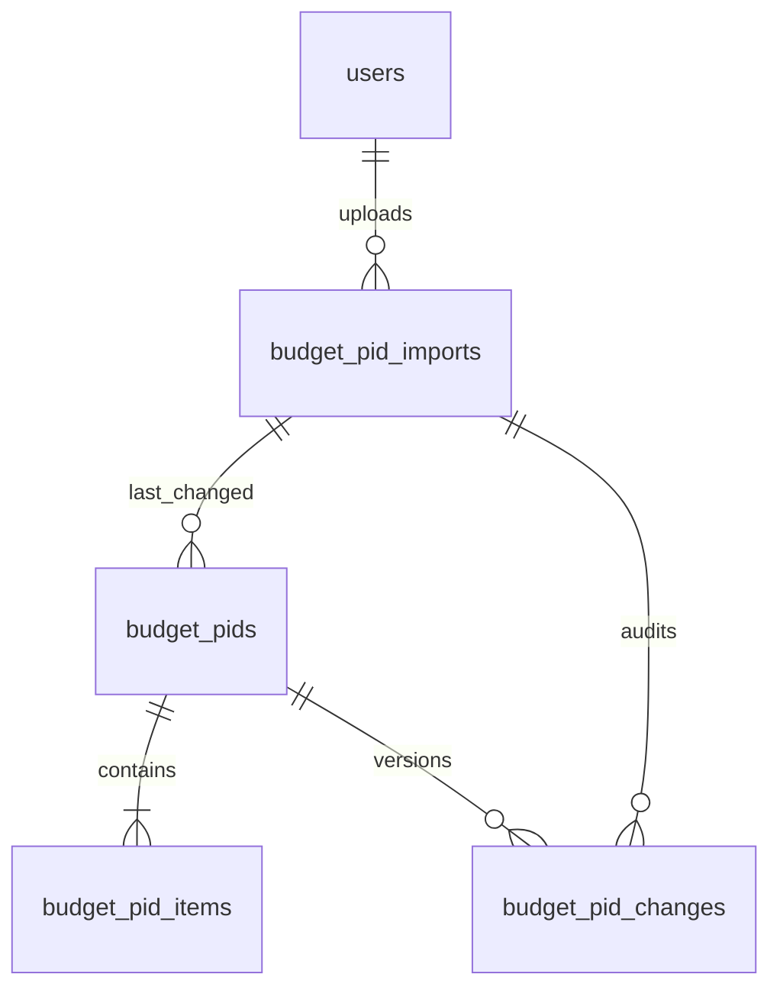

# Master Budgeting PID — 24 November 2026

## Tahapan dan keputusan pengguna

Tahap 1 mengimplementasikan master SQL, impor Excel, pemilihan unit, pratinjau, daftar/rincian dan riwayat perubahan. **Belum menghubungkan PP ke master, memblokir BOQ, mereservasi budget atau menghitung sisa setelah transaksi aplikasi.** Halaman menyebutkan batas tahap ini. Dokumen/approval/paid/ledger lama tidak diadopsi atau ditulis ulang.

Keputusan yang menjadi kontrak tahap berikutnya:

- Satu PID hanya milik Konstruksi atau Operation. Finance/Superadmin wajib menentukan unit saat impor; seluruh file menggunakan pilihan tersebut. File campuran harus dipisah. Kode/prefix PID tidak menentukan unit secara otomatis.
- Finance dan Superadmin saja yang dapat mengelola master. Mgr Finance & Settlement tidak mendapat hak unggah. Pembatasan unit akun tetap berlaku. Master ini administrasi unit, bukan penugasan Branch baru; izin PP/Branch/Region tidak berubah. Branch tidak ditebak/dibuat dari Title.
- Level 02 Title = PID; Description = Nama Kegiatan/LOP. Level 04 dihubungkan melalui Title induk (`PID-xx-xx`), bukan urutan baris. Available Excel = Release − Tot.cst.cm − Act.costs.
- Material Level 04 akan dibandingkan Material BOQ Owner; Non Material dengan Jasa BOQ Owner; Operasional dengan BOP PP. Total BOQ Owner (Material + Jasa) dibandingkan Available Level 02, bukan total Header/COGS. Tidak menjumlahkan induk dan rincian. Tenaga Kerja/Depresiasi tidak menjadi item validasi, tetapi tetap disimpan sebagai sumber audit dan pemeriksaan selisih.
- **Excel belum mencakup transaksi aplikasi.** Tahap berikutnya memerlukan ledger alokasi terpisah: available aplikasi = available Excel − alokasi PP lain. Draf simulasi; pengajuan atomik mereservasi; revisi menghitung selisih dan tidak mengurangi diri dua kali; Cancel melepaskan; paid tetap terpakai. Tidak boleh otomatis melepaskan karena pembayaran selesai. Update Excel tidak menghapus alokasi lokal. Aturan rekonsiliasi wajib dikonfirmasi ulang bila sumber Excel kelak mencakup transaksi aplikasi.
- PID tidak terdaftar: warning, manual nama kegiatan, sementara boleh sampai pengajuan. PID sudah digunakan: konfirmasi PP mandor berbeda dan sisa budget. Satu PID boleh banyak PP jika masih cukup; over-budget memblokir pengajuan, draf tetap dapat diperbaiki. Semua ini masih tahap integrasi berikutnya.

## Penggunaan tahap 1

Login Finance/Superadmin → **Master Budgeting PID** → **Import Excel** → pilih Unit Kerja → pilih `.xlsx` → Periksa File → YA → tinjau hasil → Simpan Impor → YA. Pratinjau belum menyimpan. Hasil dibedakan Tambah/Perbarui/Tetap, dengan nomor baris dan warning.

Daftar mempunyai pencarian PID/nama, filter unit sesuai akses dan pagination SQL 20+1. Rincian menampilkan Release, Tot.cst.cm, Act.costs dan Available untuk Total/Material/Non Material/Operasional. Riwayat Impor memuat setiap batch termasuk batch tanpa perubahan, pengunggah/waktu WIB/unit/nama file/ringkasan; buka batch untuk daftar PID berubah, lalu nilai sebelum/sesudah. PID yang tidak disertakan dalam unggahan baru **tetap disimpan**, tidak dihapus/dinonaktifkan.

Nilai defisit tidak diubah menjadi nol. Selisih Level 02 dengan jumlah lima rincian ditandai warning; angka sumber tetap. Tidak ada koreksi otomatis atau perhitungan alokasi aplikasi pada tahap ini.

## Kontrak workbook

Satu sheet; header baris 1 sesuai contoh `master-PID.xlsx`, kolom A:T. Wajib B=Level, C=Description, D=Title, I=Release, K=Tot.cst.cm, M=Act.costs; J/L/N berisi IDR. Kolom Budget/ProCstPlan/Act.revs tidak menggantikan Release atau rumus available. Wajib satu Level 02 dan lima Level 04 (Material, Non Material, Tenaga Kerja, Depresiasi, Operasional) per PID. Level numeric 2/4 dinormalisasi 02/04; Title dikapitalisasi untuk identitas konsisten.

Maksimal **20 MB / 60.000 baris data / 10.000 PID**. Batas ini khusus budgeting, tidak mengubah batas Designator/KHS 1.000 baris atau BOQ. Rupiah bulat bertanda, setiap nilai sumber maksimal absolut Rp1 triliun; pecahan/kosong/error/teks tak numerik ditolak tanpa pembulatan. Teks Description di-escape saat ditampilkan; karakter penghubung format Unicode dan simbol `<>` dalam nama asli diperbolehkan sebagai teks, bukan HTML.

Parser membaca row-wise dengan XMLReader dan DOM kecil per baris, shared strings/inline string, batas ZIP 300 bagian/96 MiB total/64 MiB per bagian, alamat sel dan jumlah PID. DTD/entity, macro, externalLinks, duplikat, orphan, kategori hilang, sheet/relasi rusak dan XML terpotong ditolak. Rumus hanya pada I/K/M dengan cache hasil angka valid; tidak mengevaluasi rumus atau membuka tautan luar. Workbook asli tidak diubah. Upload sementara tidak diarsipkan permanen; hash, sumber baris/kode dan snapshot angka disimpan dalam riwayat. Simpan file sumber sendiri untuk arsip administrasi.

## API, transaksi dan penyimpanan

GET `/api/budgeting-pid?unit=Konstruksi&page=1&q=...`; `history=1` menampilkan batch, `history=1&import_id=UUID` menampilkan PID berubah. Hanya Finance/Superadmin, unit diperiksa; response `private,no-store`, 120/menit. POST `/api/budgeting-pid/import`: multipart file/unit/stage preview atau commit; commit wajib version/preview_hash/request_id UUID, CSRF/sesi aktif, 10/menit. Format field mengikuti browser string; version dikonversi integer.

Parse file sebelum lock. Dalam transaksi, lock satu `budget_pid_controls` dan actor SQL aktif; role/assignment/unit diperiksa kembali. Preview menghasilkan HMAC berbasis actor/unit/SHA-256 file/version menggunakan APP_KEY tanpa menyimpannya. Commit memeriksa HMAC/version terbaru; perubahan setelah preview menghasilkan409 dan perlu periksa ulang. UUID batch mengikat actor, unit, file dan fingerprint; retry eksplisit yang identik mengembalikan hasil lama sebelum cek versi, tanpa menulis kedua kali. UUID berbeda/payload lain tidak dapat menggunakan receipt yang sama.

Import atomik: satu kegagalan membatalkan seluruh batch, termasuk versi/audit. PID yang sudah berada pada unit berbeda memblokir seluruh file sebelum penulisan. Identitas PID/item tetap pada update; hanya yang berubah di-upsert dan mendapat before/after audit. Batch tanpa perubahan tetap tercatat. Lock/version master ini terpisah dari workspace, sehingga tidak memuat graph workflow atau mengubah revision/arsip PP. Tidak ada delete/reassign-unit/restore/seed melalui fitur ini.

| Tabel | Primary key | Isi |
|---|---|---|
| budget_pid_controls | id_budget_control | Lock global dan versi impor |
| budget_pid_imports | id_budget_import | UUID permintaan/receipt, actor, unit, nama/hash file, HMAC, versi, ringkasan, waktu |
| budget_pids | id_budget_pid | PID unik global, nama, unit, batch perubahan terakhir |
| budget_pid_items | id_budget_item | Enam baris per PID: TOTAL dan lima kategori; kode/baris sumber, tiga nilai dan available |
| budget_pid_changes | id_budget_change | Batch/PID unik, aksi, snapshot sebelum/sesudah |

Semua identitas menggunakan UUID kecuali singleton control. FK melindungi actor/import/PID dan penghapusan. `budget_pids.pid` unik global; item unik PID+kategori; perubahan unik batch+PID. Uang memakai BIGINT signed agar defisit tetap tersimpan, tanpa perubahan kolom uang tabel lama.

## Optimasi dan pemulihan UI

Lookup existing PID/item per kelompok maksimal500, bukan perbaris; write buffer100PID/600item, upsert item50 dan audit100. Data tetap tidak ditulis ulang. Tidak membaca PP/approval/payment/workspace archive. Daftar20+1 SQL; item satu query batched untuk halaman yang tampil. Pratinjau menerima metadata semua PID terbatasi, DOM hanya20 dengan pagination lokal; ini bukan SQL pagination preview. Halaman lazy-loaded, tanpa poller baru dan tanpa katalog dimasukkan ke boot/localStorage.

GET abort ketika scope/filter/tab berubah, response terikat kunci unit/pencarian/halaman/mode/batch/refresh; data jenis tab sebelumnya tidak dirender sebagai jenis baru. Upload progress adalah byte transfer; validasi/simpan menunggu server, tidak ada persentase parsing fiktif atau worker BOQ yang dipakai. Impor sinkron, timeout klien120detik; sesuaikan batas PHP/server bila diperlukan, jangan mengklaim 100% byte sebagai data telah tersimpan.

Hasil network/5xx commit belum pasti: input file/unit dikunci, retry eksplisit memakai UUID yang sama; tidak ada retry otomatis. Bisa tutup dengan YA dan periksa Riwayat Impor.409 menghapus preview/UUID lama dan mengharuskan pemeriksaan baru. Semua periksa/simpan memakai YA/TIDAK; navigasi/pencarian/rincian langsung.

## Penerapan dan batas

Migration baru `2026_11_24_000001_create_budgeting_pid_master` hanya menambah lima tabel. Target guard MySQL/MariaDB database `its` atau SQLite memory testing. Rollback menolak bila sudah ada impor/PID agar riwayat tidak hilang. **Belum dijalankan pada database aktif/server oleh agen.**

Operator: backup database, pull kode, jalankan `php artisan migrate --force`, `npm run build`, `npm run check:assets`, lalu muat ulang halaman. PHP8.2+/Zip/DOM/XMLReader diperlukan sebagaimana pembacaan Excel. Tidak ada dependency baru, perubahan ENV/APP_KEY, seed/import otomatis atau worker baru; restart worker tidak diperlukan khusus fitur tahap1 ini. Batas upload PHP/web server tetap dapat lebih kecil dari20MB. Fitur tidak memindahkan transaksi historis atau memblokir PP lama.

Pengujian dan batas aktual tercatat di [LARAVEL_QA](LARAVEL_QA.md) dan [audit](qa/budgeting-pid-stage1-20261124.json). Tahap selanjutnya perlu implementasi ledger atomik, integrasi lookup/form/guard PP termasuk kelanjutan, update/cancel/revisi, concurrency dan aturan legacy; jangan menyatakan validasi budget aktif sebelum tahap tersebut selesai.
