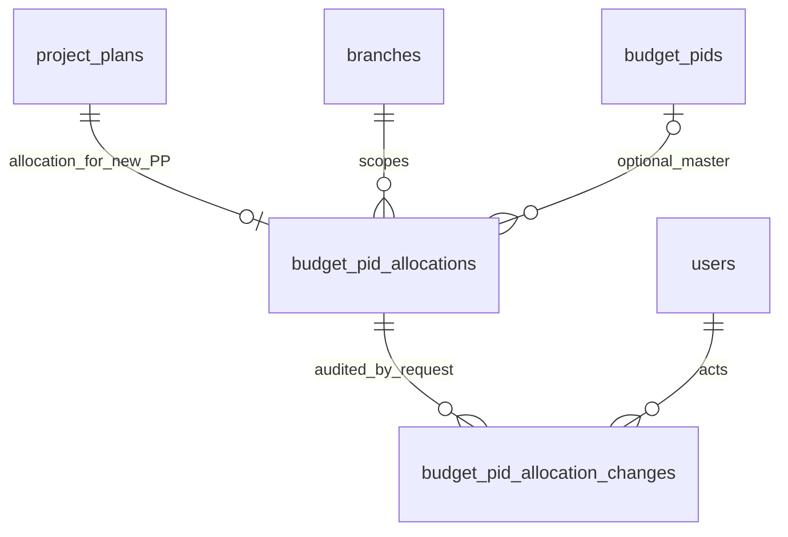
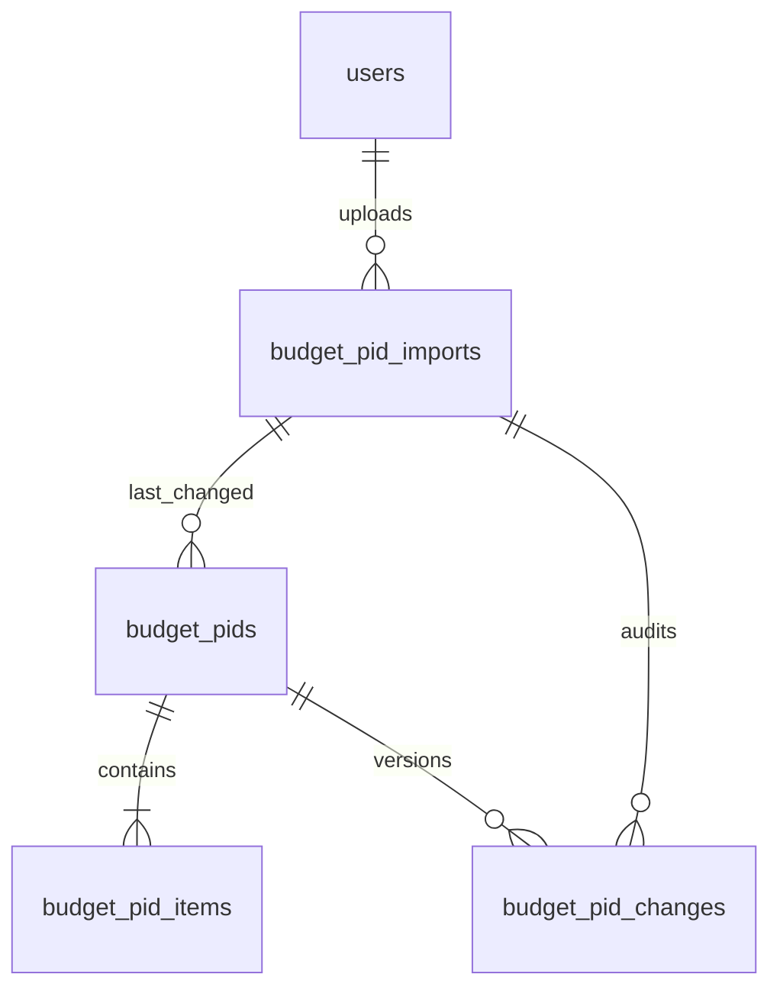

# Master Budgeting PID — 24 November 2026

## 25 November 2026 — Pagination dan pemetaan Branch otomatis saat impor

Permintaan terbaru menggantikan aturan24November “Rxxx tidak dapat menentukan Branch” **khusus saat impor eksplisit berikutnya**. Tidak menjalankan pemetaan massal/backfill pada data aktif atau mengubah PP lama saat halaman dibaca.

- PID dengan **satu kode `R` + tiga angka**, berakhir sebelum tanda `-` atau akhir PID, dicocokkan ke `branches.kode_branch` aktif/tidak terhapus. Contoh `26KT03R409-0001` → `R409` → YOGYAKARTA. Angka empat digit seperti R4099 tidak dianggap R409.
- Kode hilang/tidak dikenal/inaktif, lebih dari satu kode, atau kode katalog ambigu tetap **Belum dipetakan/Petakan manual**. Finance/Superadmin memakai Atur Branch seperti sebelumnya.
- Pemetaan yang **sudah tersimpan dipertahankan**, termasuk koreksi manual yang berbeda dari kode PID. PID lama yang belum dipetakan dapat dipetakan pada impor berikutnya setelah preview; tidak ada pengubahan dokumen/snapshot/alokasi PP historis.
- Tujuan otomatis harus ada dalam Branch penugasan aktif importer; kode dikenal di luar akses menghasilkan403 tanpa impor. Jika PID belum dipetakan tetapi alokasi reserved sudah berada di Branch berbeda, seluruh impor ditolak422; rekonsiliasi manual diperlukan. Tidak memindahkan pemakaian budget atau menghapus transaksi lunas.

Preview sekarang memuat kolom Branch dan ringkasan **Branch otomatis/Pemetaan manual**. Snapshot audit impor baru menambah `branch_id` pada before/after; existing snapshot lama tidak ditulis ulang. Perubahan pemetaan saja tercatat sebagai updated. Tetap satu receipt/version untuk seluruh impor, bukan memanggil satu perintah pemetaan untuk setiap PID. Riwayat Pemetaan tersendiri tetap untuk tindakan manual; perubahan otomatis dapat dilihat melalui Riwayat Impor.

HMAC preview mengikat actor/unit/file/version **dan rencana pemetaan**. Perubahan kode/aktivasi Branch setelah preview mengharuskan pemeriksaan baru; preview pra-update juga perlu diperiksa kembali. UUID replay impor yang benar-benar sudah committed tetap mengembalikan receipt lama. Master-control/actor dan katalog Branch aktif dikunci urut dalam transaksi, lookup konflik reserved per500PID, upsert existing100PID/50item. Tidak ada query perPID, schema/migration/API/dependency/poller baru.

Daftar PID, Riwayat Impor, Rincian Perubahan dan Riwayat Pemetaan memakai SQL pagination **10/20/50/100** baris (default20). Footer menampilkan **Total ... data** sebelum **Halaman X / Y**; total memakai COUNT dengan filter/unit/cakupan yang sama, bukan panjang halaman. Satu COUNT tambahan per daftar, detail item/pemakaian tetap batched. Ganti ukuran mereset halaman/pilihan; key respons mencakup ukuran dan request lama diabort. Preview file memakai pagination lokal yang sama, maksimum100DOM, bukan SQL paging karena metadata file sudah diterima.

Uji: full533PHP/16573assertions (XAMPP8.2.4 SQLite memory,126.322s/142.50MB),493frontend, TypeScript/Vite/assets49refs/40preloads×3/Pint/diffcheck. Fixture5192PID: preview49/commit780/list7HTTPqueries; halaman10–100 tetap≤8queries. Browser actualApp/mockedAPI137PID: ukuran10/20/50/100, halaman2=37 pada size100, pencarian total0, resetpage, riwayat/rincian/pemetaan/preview, YA-TIDAK,3widths2themes/0JSerror/overflow; screenshot diperiksa. Bukan physicalMariaDB/aaPanel/productionload/latencyfile40ribu. [Audit](qa/budgeting-pid-pagination-mapping-20261125.json).

**Penerapan:** source+build/checkassets, tidak ada migration baru/worker baru/perubahan ENV. Data aktif/server tidak diubah agen. Impor masih sinkron dengan timeout browser120detik; fitur ini belum mengatasi timeout besar melalui queue. Riwayat/UUID/atomicity tetap seperti penjelasan pemulihan di bawah. Semua bagian bertanggal lebih lama berikut adalah catatan historis bila bertentangan dengan aturan baru ini.

## Tahap 4 — Verifikasi MariaDB terisolasi dan perapian master

**Tahap 4 selesai untuk pengujian lokal terisolasi dan UI; belum deployment/UAT akun nyata di aaPanel.** MariaDB 10.4.28 dijalankan pada datadir/socket privat baru dengan networking dimatikan, bukan database `its` aplikasi. Seluruh akun, workbook, PP, identitas Mandor dan bukti transfer merupakan fixture buatan. Tidak menyalin/mengubah data aktif, `.env`, APP_KEY aplikasi, worker, server, Dompis atau histori pengguna.

Halaman sekarang memisahkan **Daftar PID** dan **Riwayat Impor**, dengan filter Unit/Pencarian/Cari/Reset/Muat ulang yang sejajar. PID dan nama kegiatan berada dalam satu kolom; empat kolom sisa menampilkan angka utama, Available Excel dan Terpakai. PID belum dipetakan tetap diberi label referensi Excel, bukan alokasi resmi. Catatan sumber diringkas pada baris dan diperinci dalam modal. Rincian menampilkan sumber Release/Commitment/Actual serta perbandingan Excel/alokasi/sisa. Pilih seluruh halaman, jumlah pilihan dan tombol Atur Branch berada dalam satu toolbar. Ikon rincian memiliki tooltip dan label aksesibel; pemetaan dan impor tetap YA/TIDAK. Tabel bergaris, angka rata kanan, warna putih bersih mengikuti light/dark, dan scroll horizontal hanya di tabel pada layar kecil.

Impor yang memilih Operation dari halaman Konstruksi sekarang kembali ke **riwayat Operation**, termasuk saat hasil belum pasti lalu memilih periksa riwayat. Tidak ada retry otomatis, perubahan UUID replay, pengurangan jumlah pemeriksaan server, pemetaan Rxxx, hak akses atau perubahan rumus budget. SQL halaman tetap20+1 dan DOM20; preview tetap metadata terbatasi/DOM20. Tidak ada SQL/API/schema/migration/dependency/poller baru pada runtime fitur ini.

### Bukti tahap 4

- MariaDB fisik:76 migration pada database kosong terisolasi, parse workbook→preview tanpa write→commit/replay, pemetaan eksplisit PID berkode R424 ke SURABAYA, dua PP dan batas atomik, return/resubmit mengganti sendiri, Cancel mengkreditkan sesuai guard.
- Dua proses pengajuan benar-benar bersamaan: satu200/satu409; retry eksplisit versi terbaru422 karena budget tidak cukup. Konsumsi tidak melebihi plafon. Ini satu workspace, bukan benchmark lintas workspace atau uji beban produksi.
- Dua koneksi REPEATABLE-READ: ordinary snapshot tetap7 setelah menunggu lock, tetapi production locking-read membaca11, tunggu330ms. Probe ledger ini fixture isolasi khusus, bukan keputusan/payment palsu.
- Konstruksi: lima keputusan paket nyata→BA RP Sah→BA PP Sah→kasbon privat→tujuh keputusan pembayaran nyata→unggah/proses bukti→Tandai Lunas dengan APM kosong. Alokasi sesudah paid identik dengan sebelumnya; pelepasan mengkreditkan hanya Jasa Owner sisa, Material/BOP tetap; PP lanjutan mendapat policy baru/draf nol.
- Operation: workbook dipilih unit Operation→mapping eksplisit→lima keputusan Operation sampai Sah, termasuk Region Mgr SS/GM; PID lintas unit ditolak dengan revision tetap. Rantai pembayaran Operation juga dicakup suite SQLite existing, bukan klaim uji pembayaran Operation fisik tambahan.
- Pengulangan `up()` tiga migration PID dengan data populated dan penolakan ketiga `down()`: hash24 tabel budget/workspace/paket/payment/approval/private/volume identik sebelum/sesudah.
- Suite PHP521tes/15278assertions (XAMPP PHP8.2.4, SQLite memory,114.356s/140.50MB); frontend484 lulus; TypeScript/Vite, asset49refs/40preload×3profile, Pint dan diffcheck lulus. Browser actual App dengan API buatan:375/768/1440 light/dark,20DOM, exact detail, mapping20, TIDAK0write, search/empty/retry, Operation import/history,0JSerror; screenshot desktop/mobile/modal diinspeksi.

[Audit lengkap dan batas](qa/budgeting-pid-stage4-20261124.json). Word/PDF tidak dirender ulang karena sumber/generator berkas tidak diubah. Tidak ada pengujian kapasitas produksi, MySQL8 fisik, versi/schema aaPanel, timeout server atau transfer bank nyata. Formula/cache workbook asli tetap kontrak tahap1; tidak mengimpor master-PID pengguna ke database aktif.

### Alat QA dan penerapan

`tools/qa_budget_pid_stage4.php` adalah **alat operator QA**, bukan endpoint atau perintah deployment. Hanya menerima realpath `/private/tmp/area3-pid-stage4-*` dengan marker tepat `area3-budget-pid-stage4-isolated`. Sebelum Laravel dibuka, PDO memakai socket absolut `<root>/mysql.sock` dan memeriksa datadir `<root>/mysql`, socket yang sama serta `skip_networking=1`. Path/marker salah ditolak sebelum membuka PDO. Konfigurasi/kunci/cache/storage QA berada dalam folder privat tersebut; konfigurasi database aplikasi tidak digunakan. Tidak menyediakan reset/drop/seed terhadap database aktif.

Untuk reproduksi, operator menyiapkan MariaDB baru **kosong/offline** pada datadir tersebut, database kosong bernama `its` pada instance itu saja, root folder0700, marker0600, kemudian menjalankan PHP script dengan argumen root dan fase: `migrate`, `scenario`, `concurrency`, `snapshot`, `settlement`, `operation`, `verify-schema`, terakhir `shutdown`. Fase stateful tidak untuk diulang sembarangan; periksa error/log sebelum melanjutkan, jangan mengubah status atau menandai approval manual. File hasil hanya fixture. Fase `shutdown` memeriksa identitas instance kembali sebelum mematikan instance QA; instance uji sesi ini sudah dihentikan. Standard PHPUnit tetap mewajibkan SQLite `:memory:`, tanpa melonggarkan guard tersebut.

**Deployment oleh operator:** backup terlebih dahulu; setelah kode tersedia di server jalankan `php artisan migrate --force` bila migration PID000001–000003 belum selesai, `npm run build`, `npm run check:assets`, lalu reload halaman dan lakukan smoke test Finance/Admin pada scope sah. Tidak ada migration tahap4 baru, import/seed otomatis, worker baru, atau kebutuhan restart worker khusus PID. Jangan memakai `migrate:fresh`, menghapus ledger/riwayat, generate ulang APP_KEY atau mengisi receipt migration manual. Perubahan PPh yang terpisah tetap mengikuti panduan deployment-nya sendiri. Data PP lama tetap dikecualikan dari kebijakan plafon PP baru.

## Tahap 3 — Alokasi dan batas budget PP baru (status terkini)

**Tahap 3 selesai di kode.** Referensi empat komponen sekarang menampilkan Available Excel, Alokasi PP Lain, Sisa untuk PP Ini, Nilai PP Ini dan Sisa Setelah PP Ini. Master Finance menampilkan sisa setiap komponen beserta angka Excel dan pemakaian aplikasi. Editor SPK menampilkan pemeriksaan budget sebelum Ajukan Paket untuk PP baru yang masuk kebijakan ini. Bagian tahap 1/2 di bawah tetap sebagai catatan historis; pernyataan “batas/reservasi belum aktif” pada bagian lama telah digantikan bagian ini.

**Keputusan pengguna terbaru: berlaku hanya untuk PP baru.** Semua PP yang sudah ada sebelum pembaruan, termasuk draf v3, revisi, menunggu approval, Sah dan paid, tidak diadopsi, dikurangi dari budget, atau ditahan dengan batas baru. Penandanya `budgetPidPolicy=pid-budget-v1`, dibuat server hanya ketika benar-benar menciptakan PP v3 baru. Tanggal Header yang dipilih Admin tidak menentukan keanggotaan kebijakan; backdate bukan pengecualian. Mengirim/menghapus marker dari klien tidak dapat mengubah kebijakan PP tersimpan. PP lanjutan yang baru dibuat sesudah pembaruan ikut kebijakan, walaupun induknya PP lama; induk/approval/pembayaran historis tetap.

Karena Excel belum mencakup transaksi aplikasi dan PP lama sengaja dikecualikan, **angka sisa ini merupakan plafon untuk PP baru dalam kebijakan, bukan rekonstruksi seluruh pemakaian historis PID**. Tidak ada migrasi saldo awal atau backfill PP lama. Rumus setiap batas:

`sisa untuk PP ini = available Excel − alokasi aktif PP baru lainnya`

| Batas | Kebutuhan PP saat pengajuan |
|---|---|
| TOTAL Level 02 | Material + Jasa BOQ TA–Owner |
| Material Level 04 | Total Material BOQ TA–Owner |
| Non Material Level 04 | Total Jasa BOQ TA–Owner |
| Operasional Level 04 | Total BOP PP |

BOP diuji sebagai batas sendiri dan tidak ditambahkan lagi ke Total BOQ Owner. Header/COGS/Mandor/Non Stock/PPh/net transfer bukan pengganti nilai Owner untuk plafon ini. Tenaga Kerja/Depresiasi tetap audit-only. Nilai kebutuhan disusun ulang oleh domain dari sumber BOQ dan rencana resmi; total/marker/harga pembanding klien bukan otoritas. Nilai sama dengan sisa diperbolehkan; kebutuhan melampaui salah satu batas menolak **seluruh pengajuan** dengan nama komponen, kebutuhan dan sisa. Nomor, status, manifest, approval, audit, volume dan revisi kembali seperti sebelum percobaan gagal.

### Siklus alokasi

- **Draf baru:** baris identitas/audit dibuat dengan nominal nol, tanpa mengambil budget. Draf berlebih tetap bisa disimpan untuk diperbaiki. Budget habis menahan pengajuan formal, bukan memaksa kehilangan draf.
- **Ajukan Paket PP + BA KH + SPK:** setelah validasi domain, batas diperiksa ulang dan alokasi dicatat atomik bersama submission, revision dan receipt. Standalone v3 baru yang memang memakai jalur kompatibel juga memakai guard yang sama; tidak ada bypass lewat nama command lain.
- **Dikembalikan/Revisi/reset persetujuan:** alokasi lama tetap ditahan. Menyimpan draf revisi tidak membebaskan budget. Pengajuan ulang mengganti alokasi sendiri dengan kebutuhan baru, bukan menambahkannya dua kali. Jika ID/Branch berubah pada revisi yang diizinkan, alokasi lama baru berpindah saat pengajuan baru benar-benar sukses.
- **Cancel:** hanya sesudah guard Cancel existing (Admin Area Konstruksi, Officer 1 Operation, scoped Superadmin; belum ada BA RP/pembayaran), alokasi menjadi nol/cancelled dengan audit. Tidak memberi tombol bebas-budget tersendiri atau melepas volume secara fiktif.
- **Approval/transfer/Tandai Lunas:** tidak menghapus alokasi. Konsumsi paid tetap terpakai, dan nominal kasbon/APM/bukti transfer maupun tujuh keputusan tidak diubah.
- **Pelepasan volume yang sah:** aturan BA PP Sah + Final/full actual approvals existing tetap. Hanya nilai Owner M/J dari volume sisa yang benar-benar dilepas, pada harga snapshot BOQ, yang mengurangi alokasi. Bagian accepted/paid tetap, BOP tidak otomatis dikreditkan. Pelepasan berulang memakai akumulasi yang sama, tidak mengkreditkan ulang.
- **PP lanjutan:** sumber PP/root/BA PP dan volume yang dilepas tetap wajib. Draf lanjutan belum mengambil budget; pengajuannya mereservasi nilai Owner subalokasi serta BOP-nya. Kredit pada induk dan beban lanjutan tidak dihitung ganda. PID, unit dan Branch lanjutan mengikuti sumber; tidak dapat dipindah ke budget PID lain.

PID belum terdaftar atau belum dipetakan tetap boleh manual sampai pengajuan sesuai izin sementara pengguna. **Alokasi PP baru tersebut tetap dicatat**, dengan master FK nullable dan identitas PID/unit/Branch. Saat master kemudian diimpor/dipetakan, pemakaian itu langsung terbaca tanpa menulis ulang PP atau pembayaran. Impor berkala tidak menghapus ledger; plafon yang turun di bawah konsumsi dapat menghasilkan sisa negatif dan menahan pengajuan baru, sementara paket berjalan tetap memakai snapshot/keputusan tersimpan.

Satu PID pada PP baru tidak boleh bercampur unit. Sebelum master terpetakan, draf manual pada Branch berbeda tetap mengikuti akses lama; tetapi pengajuan baru tidak boleh menyeberang Branch bila PID sudah mempunyai alokasi aktif di Branch lain. Pemetaan Finance ditolak bila mengabaikan alokasi aktif di Branch lain; draf nol tidak dianggap pemakaian. Rekonsiliasi ID/Branch diperlukan sebelum pemetaan yang bertentangan; sistem tidak memilih Branch dari Rxxx atau memindah paid history. Impor unit yang bertentangan dengan identitas PP baru aktif ditolak. Seluruh hak role/unit/Branch/Region, actual assignee, source UUID, private file, pending-upload, Head correction, calendar, harga, volume dan settlement existing tetap.

### Penyimpanan, akses dan konkurensi

Migration **`2026_11_24_000003_create_budget_pid_allocations`** menambah dua tabel; tidak mengubah baris PP atau struktur uang lama:

| Tabel | PK khusus | Fungsi |
|---|---|---|
| budget_pid_allocations | id_budget_allocation | Satu baris unik per SQL pp_id; PID/unit/Branch, master opsional, status draft/reserved/cancelled, nominal M/J/BOP/planned, source hash/revision dan timestamps |
| budget_pid_allocation_changes | id_budget_allocation_change | Audit before/after, action, actual actor, UUID request dan hash payload; request+allocation unik |

Nominal BIGINT nonpecahan, tidak ada konversi nilai lama. FK PP/Branch/master/actor melindungi hubungan. Index `budget_pid_usage_scope` pada PID/unit/Branch/status mendukung agregasi. Kedua tabel dibuat dengan recovery schema helper yang sama dan default timestamp eksplisit; rollback menolak sesudah ada alokasi/riwayat, termasuk draf, agar policy PP tidak tertinggal tanpa ledger.



Perintah memakai transaksi dan lock workspace existing, lalu singleton master control yang sama dengan impor/pemetaan. Setelah menunggu lock, ledger identitas/kapasitas dan item plafon dibaca dengan **current locking reads**; tidak memakai SUM dari snapshot REPEATABLE READ lama. Kapasitas untuk write diproses maksimal500 baris ledger per halaman, bukan seluruh graph BOQ/arsip. Pada tahap3 ini masih desain penguncian; tahap4 di atas kini mencatat uji fisik MariaDB terisolasi, tanpa klaim throughput produksi. Lock global sengaja menserialkan perubahan budget lintas PID saat impor/pemetaan; bukan klaim throughput tanpa bottleneck.

Domain guards selesai sebelum alokasi direncanakan; PP SQL ditulis sebelum ledger FK baru, lalu ledger/event/receipt diselesaikan dalam transaksi yang sama. Trigger kegagalan audit pada fixture membuktikan rollback termasuk data workflow. Retry request yang sudah berefek tidak menambah alokasi; actor dan payload diikat hash, termasuk result_id. Request baru untuk pengajuan ulang tetap merekam event walaupun nominal sama.

GET referensi memakai endpoint existing dengan opsional `pp_id` berisi **source UUID PP yang sedang diedit**, bukan SQL UUID. Server memeriksa exact PP pada workspace autentikasi + actual Branch/unit sebelum mengecualikan alokasinya. Response terikat PID/unit/Branch/pp_id; stale/aborted responses tidak mengisi form lain. Tidak ada first/sibling/Project-code fallback. Read bersifat advisory dan tidak mereservasi; submit selalu memeriksa ulang.

Master list menggunakan satu grouped query tambahan untuk maksimal20 PID, mempertahankan kolasi database pada join PID. Tidak membaca PP lama, arsip, profil Mandor atau berkas privat untuk menghitung budget. Tidak ada endpoint write/role/approval/poller/dependency baru. Pemeriksaan budget di SPK hanya untuk PP bertanda kebijakan; dokumen/Word/PDF tetap memakai template dan angka existing tanpa tabel referensi tambahan.

### Penerapan tahap 3

Backup database terlebih dahulu. Untuk workspace lokal yang sudah menerima kode, jalankan `php artisan migrate`, `npm run build`, `npm run check:assets`, lalu muat ulang halaman. Untuk server setelah kode tersedia/pull: `php artisan migrate --force` dan build/check aset. Pastikan Finance sudah mengimpor unit dan memetakan Branch. Tidak memakai fresh/seed/reset/rollback tabel berisi atau backfill PP lama. Tidak ada worker baru/restart khusus fitur budget ini. Agen belum menjalankan migration pada its aktif/lokal/server, mengimpor workbook live, atau push/deploy. [QA terbaru](LARAVEL_QA.md), [audit tahap 3](qa/budgeting-pid-stage3-20261124.json).

Kebijakan PP lama atau rekonsiliasi Excel yang kelak sudah mencakup transaksi aplikasi memerlukan keputusan dan implementasi terpisah; tidak diaktifkan diam-diam. Word/PDF visual, akun nyata, DDL/konkurensi/load MySQL/MariaDB dan aaPanel belum diuji pada tahap ini.

## Koreksi default TIMESTAMP lokal — 24 November 2026

Pengguna mengonfirmasi error berikut terjadi **di lokal**, dengan hasil `SHOW COLUMNS` untuk `budget_pid_imports.created_at`: `timestamp NOT NULL`, Default `current_timestamp()`, Extra `on update current_timestamp()`. Jadi pemeriksaan default versi awal terlalu ketat terhadap perilaku TIMESTAMP bawaan, bukan bukti nominal/data master berubah. Nilai server/aaPanel belum diperiksa.

Kedua migration PID kini memakai `DEFAULT CURRENT_TIMESTAMP` **secara eksplisit** pada timestamp tabel baru, tanpa `ON UPDATE`; ini menghindari default implisit pada kolom pertama serta zero-default kolom berikutnya. Untuk tabel lama, helper menerima hanya variasi `CURRENT_TIMESTAMP`, `CURRENT_TIMESTAMP()`, `CURRENT_TIMESTAMP(0)` pada created_at/updated_at MySQL/MariaDB dan default zero-date historis hanya pada updated_at. Variasi zero-date tersebut diterima sebagai metadata; isi tanggal lama tidak diperbaiki/dikonversi. Default literal arbitrer, tipe/nullability/key berbeda dan default kolom lain tetap ditolak. Tabel lama tanpa default juga tetap kompatibel. Tidak menjalankan ALTER timestamp pada tabel yang sudah ada atau mengubah setting database global.

Semua insert/import PID memasok tanggal aplikasi secara eksplisit. Karena tabel lama dapat mempunyai `ON UPDATE CURRENT_TIMESTAMP`, update Branch menetapkan `created_at=created_at, updated_at=updated_at` agar tanggal sumber tidak bergeser. Upsert impor menyertakan created_at lama pada daftar update; updated_at tetap waktu perubahan impor yang nyata. Tidak menambah lookup/query, tidak mengarang tanggal baru untuk data historis, tidak mengubah audit/UUID/budget/approval/workflow/ledger.

Rujukan perilaku database: [MariaDB TIMESTAMP](https://mariadb.com/docs/server/reference/data-types/date-and-time-data-types/timestamp), [MySQL automatic timestamp initialization/update](https://dev.mysql.com/doc/refman/8.4/en/timestamp-initialization.html). DefaultCURRENT dapat berasal dari pengaturan implicit timestamp; nilai variabel lokal belum dibaca sehingga penyebab setting tersebut merupakan inferensi. ON UPDATE sendiri dikonfirmasi oleh pengguna.

**Di lokal yang memakai workspace ini:** kode perbaikan sudah ada; jalankan ulang `php artisan migrate`. Untuk server yang kelak menerima kode ini, backup/push/pull lalu `php artisan migrate --force` sesuai panduan penerapan. Tidak perlu migration baru, fresh/drop/seed/manual receipt, build frontend atau restart worker khusus koreksi ini. Agen tidak mengeksekusi migration pada its aktif. [Audit pengujian/batas](qa/budgeting-pid-timestamp-20261124.json).

## Koreksi migration terputus — 24 November 2026

Error `Table 'budget_pid_controls' already exists` membuktikan tabel tersebut sudah ada sementara migration000001 masih pending. Penyebab awal dapat berupa DDL MySQL yang sempat berhasil sebagian sebelum error berikutnya, atau tabel dipulihkan tanpa catatan migration. Log ini sendiri belum membuktikan error awal/struktur server. Versi awal migration belum mendukung retry pada kondisi tersebut; kedua migration PID kini menggunakan `BudgetPidMigrationSchema` untuk melanjutkan struktur yang kompatibel.

Sebelum perubahan, seluruh struktur PID yang sudah ada diperiksa terhadap definisi migration: kolom/tipe/nullability/default, primary key, indeks, relasi dan InnoDB. Tipe FK akun/Branch eksternal diperiksa sebelum DDL; tipe identitas tabel pengguna tidak diubah otomatis. Missing secondary/unique index dan FK yang belum selesai dipasang dapat dilengkapi; key/kolom yang berbeda menghentikan proses dengan nama objek yang bermasalah. Kegagalan penambahan FK karena data orphan tidak diabaikan. Tabel/kolom lama tidak dihapus atau dikonversi agar tampak cocok.

Tabel lengkap yang kompatibel dipertahankan, termasuk UUID, nilai, versi control, riwayat impor dan pemetaan. Control kosong hanya diinisialisasi `id_budget_control=1, version=0` bila seluruh master/audit kosong; adanya riwayat tanpa control menahan migration, bukan menciptakan versi baru. Tahap2 dapat melanjutkan `branch_id` yang sudah terbentuk tetapi audit/FK/indeksnya belum ada. Runner Laravel mencatat migration selesai setelah seluruh `up()` berhasil; aplikasi tidak menulis catatan migration secara manual. Tidak ada nomor migration baru.

**Langkah operator setelah backup:** ambil kode perbaikan, lalu dari folder aplikasi jalankan `php artisan migrate --force`. Laravel melanjutkan migration yang pending; yang sudah tercatat selesai tidak dijalankan ulang. Jangan memakai `migrate:fresh`, menghapus tabel, atau memasukkan baris migrations secara manual untuk melewati pemeriksaan. Tidak perlu build frontend/restart worker khusus koreksi PHP migration ini; kebutuhan aset tahap2 tetap berlaku bila belum dibangun.

Jika berhenti karena struktur tidak cocok, simpan error baru dan periksa output baca-saja `SHOW CREATE TABLE` pada tabel yang disebut serta catatan `migrations`. Contoh diagnosis:

```sql
SHOW CREATE TABLE budget_pid_controls;
SHOW TABLES LIKE 'budget%';
SELECT migration, batch FROM migrations
WHERE migration LIKE '2026_11_24_00000%' ORDER BY migration;
```

Tidak meminta token/password atau snapshot data bisnis. Jangan mengubah tipe `users.id_user` atau menonaktifkan FK tanpa audit relasi menyeluruh. Pemulihan ini tidak menjamin semua schema impor kustom dapat diadopsi; struktur berbeda perlu diperiksa. DDL MySQL tidak menjadi transaksi atomik oleh koreksi ini: bagian yang selesai dapat tetap ada bila langkah berikutnya gagal, tetapi retry mengenalinya dan tidak mereset data. Pengujian memory dan mock metadata/grammar bukan pengujian DDL fisik pada MariaDB/server pengguna. [Audit koreksi](qa/budgeting-pid-migration-recovery-20261124.json).

## Tahap 2 — Referensi PP dan pemetaan Branch eksplisit

**Status terbaru:** tahap 1 dan 2 selesai di kode. PP baru dapat mencari PID, mengisi Nama Kegiatan dari master dan menampilkan empat referensi available cost. **Reservasi, sisa setelah PP lain dan blokir over-budget belum aktif; dikerjakan pada tahap 3.** Bagian tahap 1 di bawah merupakan catatan historis, bukan status integrasi terkini.

Pengguna mengonfirmasi kode Rxxx pada PID **tidak selalu menunjukkan Branch**. Karena itu tidak ada pemetaan berdasarkan prefix. Finance/Superadmin membuka Master Budgeting PID, memilih baris (maksimal 20 pada halaman), lalu **Atur Branch → Branch tujuan → Simpan → YA**. Pilihan Branch mengikuti penugasan aktif akun; unit mengikuti tab. API menerima maksimal 100 UUID per perintah. PID yang belum dipetakan tetap tampil sebagai belum dipetakan, tanpa nama/angka referensi pada form Admin. Pengisian manual sementara tetap diperbolehkan.

Pemetaan menyimpan audit sebelum/sesudah, actor, waktu, unit, Branch, versi dan UUID permintaan. Riwayat Pemetaan memiliki pagination 20+1. Satu kegagalan membatalkan seluruh pilihan. Versi master dipakai bersama impor sehingga perubahan serentak memerlukan muat ulang. Retry eksplisit atas hasil tidak pasti mempertahankan UUID; actor/payload berbeda tidak dapat memakainya. Pemetaan awal tidak mengubah PP historis. Pemindahan PID yang sudah dipetakan ke Branch lain ditolak bila ada PP pada unit tersebut dengan kode Project yang sama, termasuk PP lama. Impor Excel berikutnya mempertahankan Branch, identitas item dan audit pemetaan; impor yang menyentuh PID terpetakan di luar Branch akun ditolak seluruhnya.

Daftar master dan rincian perubahan impor dibatasi ke PID belum dipetakan atau Branch penugasan aktif. Ringkasan batch impor tetap mengikuti unit dan berisi metadata file/jumlah, tanpa nominal; detail PID/nominal mengikuti Branch. Finance/Superadmin tetap satu-satunya pengelola; endpoint referensi PP hanya untuk Admin Konstruksi/Admin Operation/Superadmin pada unit dan Branch yang diizinkan. Tidak memberikan penugasan baru melalui pemetaan.

Pada **Header PP**, isi ID Project dan pilih unit/Branch. Pencarian exact PID (trim dan kapitalisasi hanya untuk lookup) berjalan setelah jeda 350 ms. Nama PP baru otomatis mengikuti master yang cocok; respons lama dibatalkan/diabaikan bila PID/unit/Branch berubah. Referensi juga tampil di BOQ Plan dan Anggaran & Margin:

| Referensi Excel | Dibandingkan dengan |
|---|---|
| TOTAL Level 02 | Total Material + Jasa BOQ TA–Owner |
| Material Level 04 | Material BOQ TA–Owner |
| Non Material Level 04 | Jasa BOQ TA–Owner |
| Operasional Level 04 | BOP PP |

Selisih pada tabel adalah **available Excel dikurangi nilai PP ini**, belum sisa setelah seluruh alokasi aplikasi. Header Total Anggaran/COGS tidak diganti dengan Total BOQ Owner. Tenaga Kerja/Depresiasi tetap audit-only. Tidak ditemukan/tidak dipetakan tidak dianggap budget nol; nama manual diperbolehkan dan pengajuan tetap melewati validasi workflow biasa. PID pada unit/Branch lain menahan simpan tanpa mengungkap nama atau nominalnya. Gagal membaca referensi menampilkan retry; server tetap memeriksa identitas pada simpan baru.

PP lama dengan PID tetap mempertahankan nama tersimpan sampai Admin secara eksplisit memilih **Gunakan Nama Master → YA** pada PP yang masih dapat diedit. Perubahan PID pada PP editable juga diperiksa seperti sumber baru. PP Sah/menunggu approval dan PP lanjutan tidak diadopsi otomatis. Referensi tidak mengubah nilai, approval, ledger, jadwal, berkas, arsip, atau identitas bisnis kode Project tersimpan. Peringatan PID pernah dipakai menghitung PP unit sama dari data yang memang boleh dilihat akun; konfirmasi draf/pengajuan mengingatkan mandor berbeda, bukan membuktikan mandor sudah berbeda.

Simpan PP baru/adopsi/perubahan PID mengambil lock control master lalu baris PID dengan current locking read di dalam transaksi workspace yang sudah ada. Nama canonical diambil server; pilihan frontend mengikat PID/unit/Branch/import UUID dan ditolak 409 bila sumber berubah. Annotation pilihan bersifat sementara, dihapus dari state tersimpan; angka master tidak masuk snapshot PP pada tahap ini. PP lama dengan PID tetap tanpa adopsi tidak menambah query sumber. Lock ini mengoordinasikan identitas dengan impor/pemetaan, **belum merupakan ledger atau jaminan kapasitas budget**.

API baru: GET `/api/budgeting-pid/reference?pid=...&unit=...&branch=...` (60/menit), GET/POST `/api/budgeting-pid/branch` (30/menit), di bawah sesi aktif/CSRF dan respons private no-store. POST memakai `ids`, `unit`, `branch_id`, `version`, `request_id`. Tidak memuat katalog master pada boot/localStorage, tidak menambah poller/dependency; UI menggunakan pembatalan request dan key scope yang sama.

Migration **`2026_11_24_000002_map_budget_pid_branches`** menambah `budget_pids.branch_id` nullable, FK ke `branches.id_branch`, indeks unit/Branch/PID dan tabel audit `budget_pid_branch_changes` dengan PK unik bernama `id_budget_branch_change`. Tidak mengisi Branch otomatis. Rollback menolak data/riwayat terisi. Belum diterapkan agen pada its aktif/server.

Penerapan tahap 2: backup database, pull kode, jalankan `php artisan migrate --force`, `npm run build`, `npm run check:assets`, lalu muat ulang. Finance/Superadmin perlu melakukan pemetaan setelah migrasi. Tidak ada ENV/APP_KEY/seed/import/backfill atau worker baru; restart worker tidak diperlukan khusus tahap 2 (restart upload worker untuk pembaruan PPh sebelumnya adalah kebutuhan terpisah). Uji akun/Branch pada server sebelum melanjutkan tahap 3. [QA terbaru](LARAVEL_QA.md), [audit tahap 2](qa/budgeting-pid-stage2-20261124.json).

Tahap 3 masih harus mengimplementasikan ledger atomik lintas PP, batas Total/Material/Jasa/BOP, reservasi/revisi/Cancel/paid, kelanjutan dan perlakuan PP lama serta uji konkurensi. Excel belum mencakup transaksi aplikasi: konsumsi paid tetap terpakai dan tidak boleh dikurangi dua kali. Jangan menganggap referensi tahap 2 sebagai validasi over-budget yang sudah aktif.

## Tahapan dan keputusan pengguna

Tahap 1 mengimplementasikan master SQL, impor Excel, pemilihan unit, pratinjau, daftar/rincian dan riwayat perubahan. **Belum menghubungkan PP ke master, memblokir BOQ, mereservasi budget atau menghitung sisa setelah transaksi aplikasi.** Halaman menyebutkan batas tahap ini. Dokumen/approval/paid/ledger lama tidak diadopsi atau ditulis ulang.

Keputusan yang menjadi kontrak tahap berikutnya:

- Satu PID hanya milik Konstruksi atau Operation. Finance/Superadmin wajib menentukan unit saat impor; seluruh file menggunakan pilihan tersebut. File campuran harus dipisah. Kode/prefix PID tidak menentukan unit secara otomatis.
- Finance dan Superadmin saja yang dapat mengelola master. Mgr Finance & Settlement tidak mendapat hak unggah. Pembatasan unit akun tetap berlaku. Master ini administrasi unit, bukan penugasan Branch baru; izin PP/Branch/Region tidak berubah. Branch tidak ditebak/dibuat dari Title.
- Level 02 Title = PID; Description = Nama Kegiatan/LOP. Level 04 dihubungkan melalui Title induk (`PID-xx-xx`), bukan urutan baris. Available Excel = Release − Tot.cst.cm − Act.costs.
- Material Level 04 akan dibandingkan Material BOQ Owner; Non Material dengan Jasa BOQ Owner; Operasional dengan BOP PP. Total BOQ Owner (Material + Jasa) dibandingkan Available Level 02, bukan total Header/COGS. Tidak menjumlahkan induk dan rincian. Tenaga Kerja/Depresiasi tidak menjadi item validasi, tetapi tetap disimpan sebagai sumber audit dan pemeriksaan selisih.
- **Excel belum mencakup transaksi aplikasi.** Tahap berikutnya memerlukan ledger alokasi terpisah: available aplikasi = available Excel − alokasi PP lain. Draf simulasi; pengajuan atomik mereservasi; revisi menghitung selisih dan tidak mengurangi diri dua kali; Cancel melepaskan; paid tetap terpakai. Tidak boleh otomatis melepaskan karena pembayaran selesai. Update Excel tidak menghapus alokasi lokal. Aturan rekonsiliasi wajib dikonfirmasi ulang bila sumber Excel kelak mencakup transaksi aplikasi.
- PID tidak terdaftar: warning, manual nama kegiatan, sementara boleh sampai pengajuan. PID sudah digunakan: konfirmasi PP mandor berbeda dan sisa budget. Satu PID boleh banyak PP jika masih cukup; over-budget memblokir pengajuan, draf tetap dapat diperbaiki. Semua ini masih tahap integrasi berikutnya.

## Penggunaan tahap 1

Login Finance/Superadmin → **Master Budgeting PID** → **Import Excel** → pilih Unit Kerja → pilih `.xlsx` → Periksa File → YA → tinjau hasil → Simpan Impor → YA. Pratinjau belum menyimpan. Hasil dibedakan Tambah/Perbarui/Tetap, dengan nomor baris dan warning.

Daftar mempunyai pencarian PID/nama, filter unit sesuai akses dan pagination SQL 20+1. Rincian menampilkan Release, Tot.cst.cm, Act.costs dan Available untuk Total/Material/Non Material/Operasional. Riwayat Impor memuat setiap batch termasuk batch tanpa perubahan, pengunggah/waktu WIB/unit/nama file/ringkasan; buka batch untuk daftar PID berubah, lalu nilai sebelum/sesudah. PID yang tidak disertakan dalam unggahan baru **tetap disimpan**, tidak dihapus/dinonaktifkan.

Nilai defisit tidak diubah menjadi nol. Selisih Level 02 dengan jumlah lima rincian ditandai warning; angka sumber tetap. Tidak ada koreksi otomatis atau perhitungan alokasi aplikasi pada tahap ini.

## Kontrak workbook

Satu sheet; header baris 1 sesuai contoh `master-PID.xlsx`, kolom A:T. Wajib B=Level, C=Description, D=Title, I=Release, K=Tot.cst.cm, M=Act.costs; J/L/N berisi IDR. Kolom Budget/ProCstPlan/Act.revs tidak menggantikan Release atau rumus available. Wajib satu Level 02 dan lima Level 04 (Material, Non Material, Tenaga Kerja, Depresiasi, Operasional) per PID. Level numeric 2/4 dinormalisasi 02/04; Title dikapitalisasi untuk identitas konsisten.

Maksimal **20 MB / 60.000 baris data / 10.000 PID**. Batas ini khusus budgeting, tidak mengubah batas Designator/KHS 1.000 baris atau BOQ. Rupiah bulat bertanda, setiap nilai sumber maksimal absolut Rp1 triliun; pecahan/kosong/error/teks tak numerik ditolak tanpa pembulatan. Teks Description di-escape saat ditampilkan; karakter penghubung format Unicode dan simbol `<>` dalam nama asli diperbolehkan sebagai teks, bukan HTML.

Parser membaca row-wise dengan XMLReader dan DOM kecil per baris, shared strings/inline string, batas ZIP 300 bagian/96 MiB total/64 MiB per bagian, alamat sel dan jumlah PID. DTD/entity, macro, externalLinks, duplikat, orphan, kategori hilang, sheet/relasi rusak dan XML terpotong ditolak. Rumus hanya pada I/K/M dengan cache hasil angka valid; tidak mengevaluasi rumus atau membuka tautan luar. Workbook asli tidak diubah. Upload sementara tidak diarsipkan permanen; hash, sumber baris/kode dan snapshot angka disimpan dalam riwayat. Simpan file sumber sendiri untuk arsip administrasi.

## API, transaksi dan penyimpanan

GET `/api/budgeting-pid?unit=Konstruksi&page=1&q=...`; `history=1` menampilkan batch, `history=1&import_id=UUID` menampilkan PID berubah. Hanya Finance/Superadmin, unit diperiksa; response `private,no-store`, 120/menit. POST `/api/budgeting-pid/import`: multipart file/unit/stage preview atau commit; commit wajib version/preview_hash/request_id UUID, CSRF/sesi aktif, 10/menit. Format field mengikuti browser string; version dikonversi integer.

Parse file sebelum lock. Dalam transaksi, lock satu `budget_pid_controls` dan actor SQL aktif; role/assignment/unit diperiksa kembali. Preview menghasilkan HMAC berbasis actor/unit/SHA-256 file/version menggunakan APP_KEY tanpa menyimpannya. Commit memeriksa HMAC/version terbaru; perubahan setelah preview menghasilkan409 dan perlu periksa ulang. UUID batch mengikat actor, unit, file dan fingerprint; retry eksplisit yang identik mengembalikan hasil lama sebelum cek versi, tanpa menulis kedua kali. UUID berbeda/payload lain tidak dapat menggunakan receipt yang sama.

Import atomik: satu kegagalan membatalkan seluruh batch, termasuk versi/audit. PID yang sudah berada pada unit berbeda memblokir seluruh file sebelum penulisan. Identitas PID/item tetap pada update; hanya yang berubah di-upsert dan mendapat before/after audit. Batch tanpa perubahan tetap tercatat. Lock/version master ini terpisah dari workspace, sehingga tidak memuat graph workflow atau mengubah revision/arsip PP. Tidak ada delete/reassign-unit/restore/seed melalui fitur ini.

| Tabel | Primary key | Isi |
|---|---|---|
| budget_pid_controls | id_budget_control | Lock global dan versi impor |
| budget_pid_imports | id_budget_import | UUID permintaan/receipt, actor, unit, nama/hash file, HMAC, versi, ringkasan, waktu |
| budget_pids | id_budget_pid | PID unik global, nama, unit, batch perubahan terakhir |
| budget_pid_items | id_budget_item | Enam baris per PID: TOTAL dan lima kategori; kode/baris sumber, tiga nilai dan available |
| budget_pid_changes | id_budget_change | Batch/PID unik, aksi, snapshot sebelum/sesudah |

Semua identitas menggunakan UUID kecuali singleton control. FK melindungi actor/import/PID dan penghapusan. `budget_pids.pid` unik global; item unik PID+kategori; perubahan unik batch+PID. Uang memakai BIGINT signed agar defisit tetap tersimpan, tanpa perubahan kolom uang tabel lama.



## Optimasi dan pemulihan UI

Lookup existing PID/item per kelompok maksimal500, bukan perbaris; write buffer100PID/600item, upsert item50 dan audit100. Data tetap tidak ditulis ulang. Tidak membaca PP/approval/payment/workspace archive. Daftar20+1 SQL; item satu query batched untuk halaman yang tampil. Pratinjau menerima metadata semua PID terbatasi, DOM hanya20 dengan pagination lokal; ini bukan SQL pagination preview. Halaman lazy-loaded, tanpa poller baru dan tanpa katalog dimasukkan ke boot/localStorage.

GET abort ketika scope/filter/tab berubah, response terikat kunci unit/pencarian/halaman/mode/batch/refresh; data jenis tab sebelumnya tidak dirender sebagai jenis baru. Upload progress adalah byte transfer; validasi/simpan menunggu server, tidak ada persentase parsing fiktif atau worker BOQ yang dipakai. Impor sinkron, timeout klien120detik; sesuaikan batas PHP/server bila diperlukan, jangan mengklaim 100% byte sebagai data telah tersimpan.

Hasil network/5xx commit belum pasti: input file/unit dikunci, retry eksplisit memakai UUID yang sama; tidak ada retry otomatis. Bisa tutup dengan YA dan periksa Riwayat Impor.409 menghapus preview/UUID lama dan mengharuskan pemeriksaan baru. Semua periksa/simpan memakai YA/TIDAK; navigasi/pencarian/rincian langsung.

## Penerapan dan batas

Migration baru `2026_11_24_000001_create_budgeting_pid_master` hanya menambah lima tabel. Target guard MySQL/MariaDB database `its` atau SQLite memory testing. Rollback menolak bila sudah ada impor/PID agar riwayat tidak hilang. **Belum dijalankan pada database aktif/server oleh agen.**

Operator: backup database, pull kode, jalankan `php artisan migrate --force`, `npm run build`, `npm run check:assets`, lalu muat ulang halaman. PHP8.2+/Zip/DOM/XMLReader diperlukan sebagaimana pembacaan Excel. Tidak ada dependency baru, perubahan ENV/APP_KEY, seed/import otomatis atau worker baru; restart worker tidak diperlukan khusus fitur tahap1 ini. Batas upload PHP/web server tetap dapat lebih kecil dari20MB. Fitur tidak memindahkan transaksi historis atau memblokir PP lama.

Pengujian dan batas aktual tercatat di [LARAVEL_QA](LARAVEL_QA.md) dan [audit](qa/budgeting-pid-stage1-20261124.json). Tahap selanjutnya perlu implementasi ledger atomik, integrasi lookup/form/guard PP termasuk kelanjutan, update/cancel/revisi, concurrency dan aturan legacy; jangan menyatakan validasi budget aktif sebelum tahap tersebut selesai.
