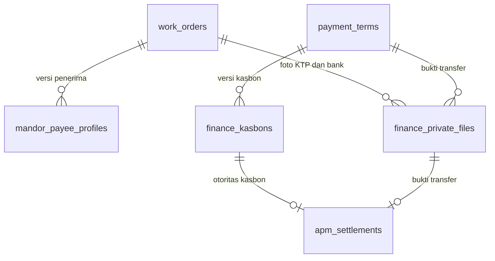

# Kasbon, data Mandor dan pembayaran — 11 November 2026

## 25 November 2026 — Unggah scan dikelola Finance

Latest user supersedes Admin-as-scan-uploader in historical sections below. Only Finance uploads/corrects signed payment scan, at its current6/7review turn or allowed completed/paidlate stages. PresenceOK is separate from fileverification and explicitFinance approval/settlement; no fake decision. OldAdminscans/history and issued/paid/private/ledger remain. [Current contract/tests/deployment](FINANCE_SCAN_UPLOAD.md).

## 25 November 2026 — Form dua komponen akun

Form baru memisahkan Jasa bersih dan Material, masing-masing No Akun/Nama Akun/Teks Keperluan, nominal readonly dan satu Total Pengajuan. Komponen nol disembunyikan. Typed row divalidasi terhadap quote canonical, lalu disimpan terenkripsi pada rows existing; rekening/identitas tetap dari payeeVersion yang dipilih. PPh hanya Jasa dan rumus terbaru tidak berubah. Baris typed muncul konsisten pada preview/Word/cetak/paket, sedangkan snapshot historis tidak ditulis ulang. Payload untyped lama tetap validasi total existing untuk kompatibilitas. [Aturan terkini, validasi dan penerapan](KASBON_PPH_PAYMENT_LIST.md).

## 16 November 2026 — Tandai Lunas dengan APM opsional

Finance dapat menekan Tandai Lunas setelah bukti transfer aktif selesai diunggah dan approval/review Finance lengkap, tanpa nomor APM. Upload sendiri tidak membayar otomatis. APM dapat diisi saat pelunasan atau ditambah/diedit sesudah lunas; format/keunikan dan konfirmasi YA/TIDAK tetap. Koreksi nomor menyimpan audit before/after/actor/waktu dan tidak mengubah nilai/tanggal/penerima/bukti/keputusan maupun menambah pembayaran kedua. Berlaku pada alur kasbon-v1/kasbon-settlement-v2; pra-kasbon historis tetap.

Nomor APM dipisahkan dari pelunasan; next-term/CLOSE/inbox/List Payment memakai settlement nyata. Migration nullable APM disiapkan tanpa rewrite data lama dan belum dijalankan pada its aktif. [Aturan, penyimpanan, query dan hasil verifikasi](PAYMENT_SETTLEMENT_OPTIONAL_APM.md).

## 16 November 2026 — Bukti transfer ditolak worker lokal lama

Dua task bukti transfer lokal ditolak dengan pesan kasbon belum disetujui Finance. Diagnosis baca-saja pada its menunjukkan flow kasbon-settlement-v2/version3, pengajuan Disetujui, Finance Diverifikasi dengan keputusan Setujui dan kasbonId cocok, belum APM/lunas; context task juga cocok. Worker PID23479 masih berjalan sejak15November16:41, sebelum handler/domain diperbarui16November04:48–04:51. Kode worker yang sudah dimuat berbeda dari kode web; tidak perlu mengubah approval atau status SQL.

Cache file/prefix/lokasi proyek diverifikasi sebelum queue:restart, lalu proses lama dikonfirmasi berhenti. Autostart lokal tetaptrue, worker pengganti mengikuti identitas OS web pada unggahan berikutnya. Pengguna mengonfirmasi unggahan baru berhasil. Task gagal tetap sebagai riwayat; tidak mengedit business rows, membayar, mengulang persetujuan, menghapus jobs, mengubah .env/izin privat atau menyentuh worker aplikasi lain. Setelah pembaruan handler/domain upload, restart worker proyek merupakan bagian penerapan kode; lihat UPLOAD_QUEUE_PERFORMANCE.

Sessionless worker Parsial/Final43query; tidak ada perubahan validator/bisnis/database. [Verifikasi](qa/transfer-worker-restart-20261116.json).

## 16 November 2026 — Label termin pada kasbon

Pembayaran pertama langsung Final (termNumber1/termTypeFinal) tidak menampilkan label Termin1. Pembayaran bertahap menampilkan hanya TerminN, termasuk termin terakhir, tanpa (Final)/(Parsial). Berlaku pada preview, HTML yang dicetak dan native Word melalui kasbonTermSuffix yang sama, untuk seluruh versi template. Nomor SPK dan metadata tersimpan tetap; nama file tetap memakai nomor termin untuk identifikasi. Tidak mengubah BARP, editor/daftar pembayaran, tujuh approval, cap, nominal net, ledger atau APM.

Tanpa perubahan database atau alur approval. [Verifikasi dan batas QA](qa/kasbon-term-label-20261116.json).

## 16 November 2026 — Slot TTD kasbon yang ditampilkan

Slot Memeriksa Admin Area dan Menyetujui Finance dihapus dari template3 preview/Word/print; susunan2/3/2 kini PM/pengaju, Support/Deployment/Head, Settlement/EVP. Admin Area dan Finance tetap approval aplikasi tahap2/7, riwayat dan haknya utuh. Tidak mengubah nominal, kasbon snapshot, pembayaran atau schema. [Aturan terbaru](BUNDLE_SETTLEMENT_APPROVAL.md), [bukti](qa/kasbon-signatures-20261116.json).

## 16 November 2026 — Kasbon/transfer bersih dan List Payment

Khusus penerbitan kasbon baru/ulang, Material tetap utuh dan Jasa Mandor dipotong2,5% sesuai konfirmasi pengguna. Kasbon/transfer/APM net; bruto tetap untuk rekonsiliasi. Tanpa rincian potongan pada form/preview/Word/cetak. Paid/riwayat/APM/next-term/outstanding/CLOSE memakai payable versioned; tidak mengubah kasbon terbit/paid lama. Halaman Pembayaran → List Payment hanya Finance/Settlement, Branch scoped dan bounded. [Aturan penyimpanan, akses, query, deploy dan verifikasi](KASBON_PPH_PAYMENT_LIST.md) menggantikan aturan full-gross kasbon di bawah untuk policy baru saja. Tidak ada migration baru/live rewrite.

## 15 November 2026 — Kasbon sebelum tujuh approval

Pengguna mengonfirmasi kasbon Admin diisi sebelum pengajuan pembayaran pertama. New kasbon-settlement-v2: PM → Admin Area → Project Support → Deployment → Head → Mgr Finance & Settlement → Finance7, lalu bukti transfer/APM. New template3 mengganti Business Support dengan akun Settlement terpilih aktif/Branch, tanpa TTD Mandor, cap keputusan terikat versi hanya preview dan native Word/PDF blank signature. Dokumen lama tetap alur/marker/identitas tersimpan. [Aturan, peran private, schema, deployment dan bukti](BUNDLE_SETTLEMENT_APPROVAL.md) menggantikan kasbon-setelah-Head hanya untuk dokumen baru. Migration role/order3 belum dijalankan agen pada its aktif/server.

## 15 November 2026 — Validasi Mandor dan worker lokal lama

Pesan “NIK pegawai hanya boleh berisi huruf...” berasal dari terjemahan regex generik untuk username, bukan aturan identitas Mandor. FinanceDocuments kini memakai label/pesan khusus: NIK KTP tepat16digit, rekening1–40digit tanpa pemisah; spasi tepi dibuang sebelum validasi, nol awal tetap disimpan sebagai teks. Tidak mengubah NIK akun/pegawai atau melonggarkan validasi identitas. Pengguna mengonfirmasi simpan berhasil setelah memasukkan16digit.

Unggah KTP/buku tabungan lokal ditolak oleh worker yang masih berjalan sejak7November, sebelum fitur dokumen privat ditambahkan11November. Pemeriksaan baca-saja dua task gagal menemukan akun aktif, roleSuperadmin, SPK valid dan Branch sesuai. Worker lama dihentikan lewat sinyal `queue:restart` pada cache file proyek ini; tidak mengubah task gagal/PII/transaksi. Autostart tetap memakai PHP XAMPP dan identitas OS web. Setelah muat ulang halaman dan upload baru, pengguna mengonfirmasi unggahan berhasil.

Retry privat membedakan task server yang sudah terminal `failed` dari hasil jaringan/polling yang belum pasti: percobaan eksplisit berikutnya memakai UUID baru hanya setelah failure terkonfirmasi. Hasil belum pasti tetap memakai UUID yang sama; tidak ada POST otomatis. Task lama tetap riwayat. Penolakan role/Branch kini mempunyai pesan khusus tanpa membocorkan identitas/dokumen Branch lain. Enkripsi, versi penerima, frozen kasbon, Finance/APM dan private paths tetap.

Tidak ada schema/migration/query/endpoint tambahan. Fixture worker tanpa sesi browser:39query per foto KTP/bank, batas75; payee read5query fixture.283PHP/5991assertions,291frontend/build/Pint/assets lulus. Pengguna menguji unggah KTP lokal; bank/worker isolation/retry/invalid NIK/Branch diverifikasi otomatis, bukan klaim load test atau pengujian server aaPanel. [Bukti](qa/mandor-upload-fix-20261115.json).

## Otoritas terbaru — Admin mengajukan kasbon, Finance mereview

**11 November 2026, perubahan berikutnya dari pengguna:** kasbon dibuat Admin Konstruksi setelah lima approval pembayaran sampai Head of PMO, lalu masuk review Finance. Finance tidak lagi menerbitkan kasbon baru. Default Surabaya/tanggal pengajuan dan dua pejabat fisik, preview berkas/BOQ Mandor serta inbox otomatis dijelaskan pada [ADMIN_KASBON_REVIEW_SYNC](ADMIN_KASBON_REVIEW_SYNC.md). Bank dan keputusan terikat versi yang ditampilkan. Snapshot lama tetap utuh. Bagian implementasi awal di bawah dipertahankan sebagai riwayat; pernyataan Finance sebagai pembuat kasbon telah digantikan.

## 11 November 2026 — Upload eviden sebelum migration kasbon

Laporan Server Error ditelusuri ke log lokal: SQLSTATE42S22/1054, kolom `upload_tasks.context_id` belum ada saat INSERT upload eviden. Kesalahan pada pembaruan kasbon: kolom baru ikut ditulis untuk semua jenis upload, termasuk `boq`/`evidence` yang tidak membutuhkannya. HTTP gagal sebelum task/job berhasil dibuat, bukan deteksi worker tidak aktif atau kesalahan isi PDF.

UploadQueue sekarang hanya menyertakan `context_id` pada `transfer-proof`. BOQ dan work evidence tetap menggunakan kolom sebelum kasbon (schema sampai 10 November), tanpa introspeksi schema, query migration tambahan atau retry INSERT otomatis. KTP/bank/transfer baru memerlukan migration kasbon selesai; satu query registry `migrations` memberi HTTP503 dengan pesan yang jelas sebelum staging/job dibuat jika masih tertunda. Keterikatan versi transfer proof tidak dikurangi atau diganti fallback.

Regresi mengembalikan schema hanya dalam SQLite memory sebelum kasbon (kolom dan tiga tabel private dihapus), lalu menguji BOQ26baris/evidenPDF end-to-end, UUID replay satu job, process dua kali tetap satu eviden, preview dan archive unchanged. Tiga upload privat ditolak503 tanpa bytes/job/revision/audit tambahan. Dua enqueue HTTP (BOQ+eviden) mencatat24query, budget50, dan dilarang menyebut context/schema/migration query pada jalur lama. Private readiness menambah1query per private enqueue saja; tidak mengklaim latensi global.

Tidak ada migration/ALTER runtime, perubahan .env/APP_KEY, transaksi its, PP/Final lama atau worker live. Operator tetap perlu migration untuk fitur kasbon lengkap, lalu memuat ulang worker its. Sebelum itu kode perbaikan mengembalikan upload lama; file yang gagal dapat diunggah ulang. Remote/server, upload browser dan beban produksi belum diverifikasi; lihat QA terbaru dan qa/evidence-schema-compatibility-20261111.json.


Pengguna menyetujui implementasi konsep SPK/KTP/rekening, lalu menyerahkan `Form Pengajuan kasbon Project.xlsx` dan menegaskan EVP serta Mgr Business Support **hanya penandatangan fisik**. Aturan ini menggantikan pengecualian khusus Parsial/penundaan kasbon 9 November **untuk alur baru `kasbon-v1`**. Lima approval aplikasi tetap PM → Admin Area → Mgr Project Support → Mgr Deployment → Head of PMO.

## Alur yang dijalankan

1. Admin menyimpan Draft SPK, melengkapi NIK KTP, nomor/nama pemilik rekening/nama bank, mengunggah foto KTP dan buku tabungan, memilih hasil upload lalu **Simpan Data Mandor**. Semua menggunakan rekening aktual; angka nol awal dipertahankan. Foto JPEG/PNG/WebP maksimal 10 MB. Pengesahan SPK baru membutuhkan data lengkap dan kedua file privat.
2. Pengajuan baru v3 otomatis memakai `kasbon-v1`, termasuk dari SPK historis. Pilihan Parsial menampilkan **Ajukan Termin**, Final **Ajukan Payment**. Keduanya masuk lima approval yang sama. Finance melihat pengajuan di inbox sejak diajukan dengan status menunggu approval; belum dapat menerbitkan kasbon atau membayar sebelum Head selesai.
3. Setelah lima keputusan pengguna terpilih lengkap, Finance meninjau identitas/foto/rekening Mandor, mengisi referensi akuntansi resmi dan menerbitkan kasbon. Tidak perlu pengajuan kedua oleh Admin. Kasbon dan penerima dibekukan sebagai versi tersimpan.
4. Finance **Approve Payment**, mengunggah bukti transfer PDF/JPEG/PNG/WebP maksimal 10 MB, lalu mencatat APM. APM unik melunasi **seluruh tagihan termin saat ini** secara atomik bersama receipt/audit dan referensi kasbon/bukti transfer. Aplikasi tidak melakukan transfer bank.
5. Parsial **dan Final** boleh dibayar saat scan TTD belum ada. Status Berkas `NOK` bila belum ada scan, `OK` bila sudah diunggah; itu berbeda dari status verifikasi Finance. Jika scan sudah tersedia sebelum approval Finance/APM, Finance harus memverifikasinya terlebih dahulu. Scan yang menyusul setelah lunas tetap dapat diunggah Admin dan diperiksa Finance tanpa mengubah pembayaran/otoritas APM.
6. Termin berikutnya tetap membutuhkan approval lengkap, APM valid dan lunas pada termin sebelumnya; maksimal tiga termin, termin ketiga Final, tidak ada pengajuan setelah Final. Harga, volume, BA PP, release dan deduplikasi root tidak berubah.

Kembalikan Kasbon wajib catatan. Admin memperbaiki data Mandor bila perlu, Finance menerbitkan versi kasbon baru dan menyetujui kembali; lima approval pekerjaan tetap. Kasbon lama, keputusan Finance, penerima lama dan pembayaran tidak ditimpa. Penolakan approval pekerjaan tetap mengikuti APPROVAL_RESUBMISSION dan mulai ulang dari PM.

## Form dan pemetaan template

| Bagian template | Sumber aktual |
|---|---|
| Unit | Unit PP + Branch PP |
| Total Nilai / Grand Total | Volume aktual termin × harga kesepakatan; pembulatan kanonis per baris |
| Cost Center, WBS, Jenis Kegiatan | Finance; tidak menebak WBS dari ID Project |
| Rincian No Akun, Nama Akun, Teks, Amount | Finance, 1–20 baris; jumlah tepat sama dengan tagihan, tanpa potongan/nilai tambahan |
| Pengajuan Sebesar | Terbilang dari total, termasuk sen |
| Tempat/tanggal | Dikonfirmasi Finance ketika menerbitkan; historis tidak memakai tanggal hari ini |
| Nama Penerima, rekening, bank | Versi data Mandor tersimpan pada SPK |
| Deployment, Project Support, PM, Head | Nama/ID dari keputusan aktual kelima assignee pada termin |
| Membuat | Akun Finance yang menerbitkan |
| EVP, Mgr Business Support | Nama pejabat fisik diisi Finance, tanpa role/approval digital tambahan |

Preview/cetak A4 portrait mengadaptasi struktur template: metadata, tabel rincian, terbilang, penerima dan tujuh ruang TTD fisik kosong. Logo yang sama dengan SPK, tanpa nama/rekening/angka/tanda tangan contoh workbook. Nama Maker menggunakan peran Finance yang diketahui aplikasi, tidak menebak jabatan kepegawaian. Preview/print browser tersedia; tidak mengklaim hasil native XLSX/DOCX atau kesamaan piksel dengan Excel. Sumber Downloads tidak diperlukan ketika aplikasi berjalan.

## Penyimpanan, privasi dan relasi



- `mandor_payee_profiles.id_payee`: versi data NIK/rekening/bank dan pilihan file, FK SPK, pembuat/waktu/request UUID/hash input. Data pribadi dienkripsi dengan Laravel APP_KEY pada `private_data`.
- `finance_private_files.id_finance_file`: tipe, path `finance-private/{workspace}/{document}/{uuid}.{ext}`, MIME/ukuran/SHA256/uploader. Tepat satu relasi SPK (KTP/bank) atau termin (transfer), tidak ada public storage URL. Nama file asli sensitif tidak disalin ke daftar antrean/audit; label generik digunakan.
- `finance_kasbons.id_kasbon`: snapshot terenkripsi per versi, FK termin, total, penerbit/waktu/request UUID/hash. Merekam penerima/pejabat pada saat terbit; perubahan akun/rekening selanjutnya tidak menulis ulang dokumen.
- `apm_settlements`: dua FK komposit baru `(term_id,kasbon_id)` dan `(term_id,transfer_file_id)` melarang referensi lintas termin. CHECK/trigger mempertahankan tepat satu otoritas: scan historis, request Parsial historis, atau kasbon **bersama** transfer.
- Snapshot workflow publik hanya menyimpan marker/versi/ID/status/nominal/keputusan, bukan NIK Mandor, nomor rekening, path, foto atau isi kasbon. Bootstrap, CSV dan backup workspace tidak mengambil tabel pribadi. Pembacaan PII/file hanya Admin Konstruksi, Superadmin dan Finance pada Branch PP yang ditugaskan. Approver lain tidak mendapat akses file/endpoint meskipun mengetahui UUID.
- Data PII hanya berada di state komponen selama halaman aktif, tidak di localStorage. POST privat hash-bound dan UUID stabil untuk retry manual setelah hasil jaringan belum pasti; tidak ada POST auto-retry. File antrean memiliki idempotensi/hash/owner, revalidasi akun/role/Branch/status di worker dan cleanup privat yang sama dengan infrastruktur upload lama.

APP_KEY harus dipertahankan dan dicadangkan secara aman bersama database/storage. Jangan menjalankan `key:generate` saat pull/deploy atau memindahkan ciphertext tanpa kunci yang sesuai. Isi dokumen/foto tetap membutuhkan pemeriksaan manusia Finance; aplikasi memvalidasi format/keterkaitan, tidak memverifikasi KTP/rekening terhadap layanan eksternal.

## Riwayat dan kompatibilitas

GET tidak menambah marker, memperbarui rekening, mengganti assignee atau mengadopsi pengajuan lama. Semua pengajuan v3 yang **baru dibuat** otomatis memakai marker baru server-owned. Save/submit generik tidak dapat menghapus marker untuk memperoleh pembayaran melalui request Parsial lama. SPK baru yang disimpan lewat endpoint generik juga diberi marker finansial; flag kesiapan dari klien diabaikan.

Draft v3 lama diadopsi saat Admin mengajukan dari editor terkini. Pengajuan v3 lama yang telah disetujui, belum dibayar, memiliki lima assignee Project Support dan belum punya request Payment lama dapat dipindahkan secara eksplisit lewat **Gunakan Alur Kasbon**, tanpa mengganti keputusan pekerjaan. Request Parsial lama yang sudah berjalan, pembayaran lama dan v1/v2 tetap menggunakan otoritas historis. Tidak ada migrasi/backfill transaksi live. SPK Terbit/Sah lama dapat dilengkapi lampiran finansial versi baru untuk kasbon mendatang; isi inti/signer/nomor/tanggal SPK tidak ditulis ulang.

## Arsitektur dan query

`FinancePaymentWorkflow`/`finance-payment.ts` menjaga aturan marker, approval Finance dan APM bersama domain lama. `FinanceDocuments` menangani akses SQL minimal, validasi berkas/penerima, enkripsi dan issuance; semua mutasi menggunakan lock workspace dan internal command untuk revision/receipt/audit atomik. Perintah internal tidak tersedia melalui command HTTP umum. Upload memakai database tasks/jobs dan worker yang sudah ada, bukan daemon kedua. Bukti transfer baru hanya diunggah setelah Approve Payment. Setiap task mengikat versi kasbon pada `upload_tasks.context_id`; worker menolak task versi lama. Revisi kasbon mengarsipkan bukti lama dan mewajibkan bukti baru; tidak dapat memakai bukti rekening sebelum koreksi. Pemrosesan bukti transfer diblokir setelah APM; upload pending untuk termin itu menghalangi pencatatan APM.

Metadata payee dibaca dari tiga query service (otorisasi/scoping, profil terbaru, berkas terbatas), ditambah account context query. Fixture yang menyertakan pengambilan workspace mencatat **5 query**. HTTP satu PP/SPK/termin mencatat **47 query** pada issuance dan **44 query** pada APM, masing-masing dibatasi 75. Regresi issuance melarang penulisan ulang PP/BOQ/actual/approval/file lama/volume. Referensi file diambil sekali per pasangan, kasbon 10 versi dan daftar berkas 10–20 hasil; tidak ada query per baris rincian. Picker menambah proyeksi status JSON ke query yang sudah ada, tanpa query tambahan. Full aggregate command/boot dan katalog referensi lama masih dimuat; ini bukan benchmark MySQL/multiuser atau janji latensi konstan.

## Deploy dan batas verifikasi

Migration baru: `2026_11_11_000001_create_finance_kasbon_workflow`. Belum dijalankan pada its aktif oleh agen. Setelah backup database, private storage dan kunci aplikasi pada server, gunakan PHP situs yang benar di `/www/wwwroot/itsy`, lakukan deploy dalam maintenance window:

```sh
php artisan down
php artisan migrate --force
npm run build
npm run check:assets
php artisan optimize:clear
php artisan queue:restart
php artisan up
```

Jalankan command aplikasi sebagai user situs, mengikuti SERVER_UPLOAD_WORKER. Jika memilih Supervisor, restart hanya program **area3-uploads**, bukan semua worker/daemon atau aplikasi Dompis. Pastikan cache/restart worker menggunakan user/PHP/config situs yang sama. Jangan mengganti APP_KEY, menjalankan `migrate:fresh`, reset/seed, mengosongkan antrean, atau mengaktifkan ulang storage archive. Karena build diabaikan Git, pull saja tidak cukup.

Uji memakai SQLite `:memory:` fail-closed dan disk privat palsu. Migrasi/constraint SQLite, API/worker nyata di test, snapshot terenkripsi/rollback/replay/Branch dan domain PHP/TS diperiksa. Belum menjalankan migrasi pada engine MySQL/MariaDB produksi, autentikasi browser/responsif/keyboard, cetak fisik, transfer bank, atau server worker aaPanel untuk fitur ini. Hasil akhir ada di LARAVEL_QA dan `qa/finance-kasbon-20261111.json`.


## 16 November 2026 — Penandatangan Mgr Finance pada kasbon lama

Pengguna mengonfirmasi bahwa preview yang masih menampilkan Mgr Business Support berasal dari pembayaran lama. Pull/migration sebelumnya tidak mengganti snapshot historis tersebut. Kini Admin Konstruksi, Superadmin atau Finance dapat membuka **Preview Kasbon** versi aktif, memilih akun aktif **Mgr Finance & Settlement** pada Branch PP yang sama, lalu **Simpan Penandatangan** dengan konfirmasi YA/TIDAK. Preview, cetak dan Word menggunakan nama akun yang dipilih serta jabatan Mgr Finance & Settlement Area Jawa Bali. Pilihan ini hanya penandatangan fisik; tidak membuat cap/keputusan approval baru atau memindahkan keputusan Business Support ke Finance.

Berlaku untuk kasbon-v1 berstatus Disetujui, termasuk yang telah lunas. Versi arsip, pengajuan berjalan yang belum Disetujui dan alur tujuh approval tidak dapat dialihkan melalui kontrol ini. Snapshot asli finance_kasbons tetap terenkripsi dan tidak ditulis ulang; annotation server-owned kasbonPrintSigners per UUID kasbon dan kasbonPrintSignerHistory before/after/pelaku/waktu disimpan dalam payment_terms.document_data melalui lock/revision/receipt/audit yang sudah ada. Nominal bruto/net, paid, APM, penerima/rekening, bukti transfer, approval dan prototype_workspaces.state tetap. Versi kasbon baru tidak mewarisi pilihan versi sebelumnya. Nama yang telah dipilih tidak berubah otomatis ketika akun diganti namanya. Pembuatan kasbon baru tetap mengikuti tujuh approval yang berlaku; teks bantuan form kini membedakan template baru dan historis.

Implementasi menggunakan users/Branch/relasi yang sudah dimuat, satu lookup per koleksi saat aksi, tanpa query per baris rincian atau endpoint/schema/migration baru. Lazy private read tetap3query; metadata-only HTTP fixture35query (batas50), tanpa write finance_kasbons/APM/approval/actual/volume/PP. Full aggregate/reference loading pada command tetap ada; angka ini bukan benchmark beban MySQL. Simpan menunggu konfirmasi server dan memuat ulang dokumen privat sebelum preview/unduh ditampilkan kembali.

Verifikasi:306PHP/6887assertions,313frontend,TypeScript/Vite,assets36manifest/28preload×3profil dan Pint scoped lulus. Regresi paid/unpaid, role/Branch/akun nonaktif, stale revision/UUID replay, versi arsip/reissue, Head lock, larangan alur tujuh approval, original ciphertext/settlement/archive unchanged serta HTML/Word memakai identitas yang sama tanpa approval palsu. Dua DOCX sintetis untuk template lama penerbit Finance dan Admin lulus ZIP/CRC/XML independen, render1halaman masing-masing; seluruh PNG diperiksa dan PDF render berisi. Interaksi akun browser/server aaPanel, fresh browser print, Microsoft Word desktop dan cetak fisik belum diverifikasi. Backup SQLite demo dibuat privat sebelum perubahan; its aktif/.env/Dompis/server tidak diubah. [Bukti QA](qa/legacy-kasbon-signer-20261116.json).

Penerapan perubahan ini sendiri tidak memerlukan migration baru. Setelah kode diterapkan dan frontend dibangun ulang pada server, buka pembayaran lama melalui akun berwenang dan pilih penandatangan pada preview kasbon aktif. Tidak ada penggantian otomatis massal pada pembayaran yang telah tersimpan.


## 16 November 2026 — Alihkan payment lama dari Finance ke Mgr Finance

Pengguna meminta pengajuan lama yang belum disetujui Finance dipindahkan dahulu ke inbox Mgr Finance. Finance/Superadmin kini dapat memilih maksimal50 kasbon-v1 yang memenuhi syarat melalui tombol **Alihkan Payment Lama ke Mgr Finance** pada Inbox Approval, mencari ID Project/LOP/PP/Branch (20baris/halaman), memilih akun aktif yang mencakup semua Branch, lalu konfirmasi YA/TIDAK. Pemindahan atomik dan eksplisit; tidak otomatis saat deploy. Lima approval pekerjaan/SQL lama tetap, sementara review tambahan kasbon aktif harus disetujui akun Manager yang dipilih sebelum Finance dapat melanjutkan approve/upload transfer/APM/lunas. Kasbon dikembalikan dengan catatan wajib ke Admin dan versi baru memerlukan review Manager kembali, tanpa mengulang lima approval pekerjaan historis.

Metadata penugasan/keputusan aktual dan riwayat disimpan server-side pada payment_terms.document_data melalui lock/revision/receipt/audit. Inbox/count, List Payment, timeline dan kasbon aktif mengikuti marker; cap Manager hanya dari keputusan nyata dengan UUID kasbon cocok, Word/cetak TTD tetap kosong. Original ciphertext/rekening/nominal/paid/APM/proof/approval_runs/steps/decisions/volume/archive tidak diubah. Tolak status/version/Branch/role/nonaktif/duplikasi/Head lock, pengajuan tujuh approval, Finance sudah Setujui, proof/APM/pembayaran dan queued proof. Tidak ada migration baru/live its/.env/Dompis/server write. [Aturan, data, deployment dan query](LEGACY_FINANCE_ROUTING.md).


Verifikasi akhir alih inbox:310PHP/7137assertions,318frontend,TypeScript/Vite,Pint dan assets36manifest/28preload×3profil lulus; satu DOCX/1halaman dirender/diperiksa, cap hanya preview. Query single36/batch8=51, batas50/120; list tetap4query. Tidak ada private_data query per target atau perubahan proyeksi lima approval/ledger/nominal lama. Browser akun/server/MySQL load/Word desktop/cetak fisik belum diverifikasi. [Bukti](qa/legacy-finance-routing-20261116.json), [catatan QA](LARAVEL_QA.md).


## 16 November 2026 — Paket dokumen dan ringkasan alur terbaru

Lihat [DOCUMENT_PACKAGE](DOCUMENT_PACKAGE.md): BA PP Sah menyediakan satu Word/PDF PP–Lampiran BA PP termasuk kasbon aktif setiap pembayaran. Timeline/detail menampilkan alur aktual5/7approval, scan terpisah dan APM opsional; riwayat/otorisasi/pembayaran tetap. List Payment memakai banner putih solid tanpa gradient. Shared Lampiran SPK Word memperlebar TotalVol6%→8% (Uraian23%→21%) agar digit total tidak turun sendiri. Current-only kasbon tetap lazy/UUID-bound/3query tanpa file catalog atau dekripsi arsip; tidak ada migration/data live rewrite. Bukti dan batas pengujian dicatat pada [QA](qa/document-package-20261116.json).


## 17 November 2026 — Keterangan PPh dan label pembayaran Final satu kali

UI Kasbon Admin/Finance kini menjelaskan PPh2,5% khusus Jasa Mandor (Material tidak dipotong) dengan bruto, potongan dan nilai bersih. Kasbon terbit memakai policy/quote tersimpan; historis tidak dihitung ulang. Berkas preview/Word/cetak tetap net-only tanpa rincian PPh. Pembayaran pertama langsung Final menggunakan label Pembayaran Final/Total Pembayaran; kolom Termin editor disembunyikan, sedangkan Parsial1/Final2/3 tetap bernomor. Label dibagi untuk list/inbox/review/BA PP/dashboard/laporan; nama Word kasbon Final1 memakai _Final. Panel Finance historis tetap tersedia walau card Termin Berikutnya disembunyikan. Tidak ada SQL/API/schema/migration/workflow/live data write baru; helper O(1) dan gross panel dihitung sekali. 311 PHP/7241 assertions,345frontend,TypeScript/Vite/assets serta browser sintetis6viewport/theme dan interaksi lulus. Server/akunlive/Word-render/cetakfisik belum diuji ulang. [Perilaku dan batas](KASBON_PPH_PAYMENT_LIST.md), [QA](qa/payment-presentation-20261117.json).


## 18 November 2026 — Cap tanpa tanggal dan cap otomatis pengaju/EVP kasbon

Tanggal cap PP/kasbon tidak ditampilkan. Pengaju kasbon otomatis ditandai setelah penerbitan UUID tercatat; EVP kasbon hanya setelah persetujuan nyata Manager untuk UUID aktif dengan assignee sesuai. Dua cap administratif terpisah dari keputusan, Word/cetak tetap kosong; tanggal/audit/tahapan dan uang tidak diubah. Ini menggantikan batas lama lima cap preview kasbon saja: kini lima keputusan nyata + dua otomatis, tanpa menambah approval aplikasi. PP EVP tetap memakai aturan PP sebelumnya. Rincian gate/version/legacy, kinerja dan verifikasi aktual ada pada [KASBON_PREVIEW_STAMPS](KASBON_PREVIEW_STAMPS.md).

## 18 November 2026 — Operation

Alur Operation kini dihubungkan secara eksplisit untuk role bawaan Officer 1 SS/Manager SS dan role Operation lainnya. Paket memakai lima approver Operation, kasbon tujuh dengan Settlement/Finance, GM menggantikan Head dalam template dan identitas/jabatan aktual. Scope unit per PP dan Branch/Region akun berlaku; data serta rantai historis tetap. Katalog role tambahan lain belum memberi otoritas otomatis. Detail migration, kompatibilitas dan hasil QA ada di [OPERATION_WORKFLOW](OPERATION_WORKFLOW.md).

## 18 November 2026 — BA PP sejak BA RP disimpan

Pengguna menegaskan BA PP dapat disahkan sebelum seluruh approval, sejak BA RP Final disimpan. Final pada alur baru/diadopsi eksplisit memakai source BARP server-owned dan menahan pengajuan pembayaran sampai BA PP Sah; perubahan BARP memerlukan pengesahan ulang. Dokumen utama/lampiran BA PP Sah dapat Word/print lebih awal, ruang TTD kosong; tujuh approval/ledger/release dan full-package export gate tetap. Tidak ada migration atau perubahan massal data lama. Lihat [BAPP_BEFORE_PAYMENT](BAPP_BEFORE_PAYMENT.md) untuk cakupan, data historis, query, QA dan deploy.
