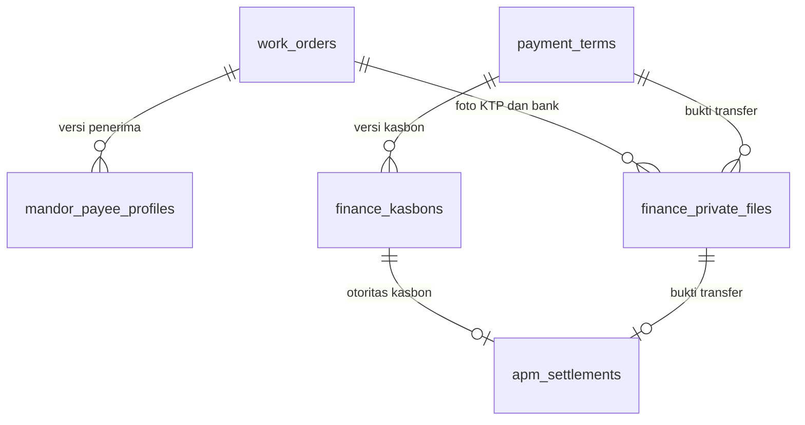

# Kasbon, data Mandor dan pembayaran — 11 November 2026

## Otoritas terbaru — Admin mengajukan kasbon, Finance mereview

**11 November 2026, perubahan berikutnya dari pengguna:** kasbon dibuat Admin Konstruksi setelah lima approval pembayaran sampai Head of PMO, lalu masuk review Finance. Finance tidak lagi menerbitkan kasbon baru. Default Surabaya/tanggal pengajuan dan dua pejabat fisik, preview berkas/BOQ Mandor serta inbox otomatis dijelaskan pada [ADMIN_KASBON_REVIEW_SYNC](ADMIN_KASBON_REVIEW_SYNC.md). Bank dan keputusan terikat versi yang ditampilkan. Snapshot lama tetap utuh. Bagian implementasi awal di bawah dipertahankan sebagai riwayat; pernyataan Finance sebagai pembuat kasbon telah digantikan.

## 11 November 2026 — Upload eviden sebelum migration kasbon

Laporan Server Error ditelusuri ke log lokal: SQLSTATE42S22/1054, kolom `upload_tasks.context_id` belum ada saat INSERT upload eviden. Kesalahan pada pembaruan kasbon: kolom baru ikut ditulis untuk semua jenis upload, termasuk `boq`/`evidence` yang tidak membutuhkannya. HTTP gagal sebelum task/job berhasil dibuat, bukan deteksi worker tidak aktif atau kesalahan isi PDF.

UploadQueue sekarang hanya menyertakan `context_id` pada `transfer-proof`. BOQ dan work evidence tetap menggunakan kolom sebelum kasbon (schema sampai 10 November), tanpa introspeksi schema, query migration tambahan atau retry INSERT otomatis. KTP/bank/transfer baru memerlukan migration kasbon selesai; satu query registry `migrations` memberi HTTP503 dengan pesan yang jelas sebelum staging/job dibuat jika masih tertunda. Keterikatan versi transfer proof tidak dikurangi atau diganti fallback.

Regresi mengembalikan schema hanya dalam SQLite memory sebelum kasbon (kolom dan tiga tabel private dihapus), lalu menguji BOQ26baris/evidenPDF end-to-end, UUID replay satu job, process dua kali tetap satu eviden, preview dan archive unchanged. Tiga upload privat ditolak503 tanpa bytes/job/revision/audit tambahan. Dua enqueue HTTP (BOQ+eviden) mencatat24query, budget50, dan dilarang menyebut context/schema/migration query pada jalur lama. Private readiness menambah1query per private enqueue saja; tidak mengklaim latensi global.

Tidak ada migration/ALTER runtime, perubahan .env/APP_KEY, transaksi its, PP/Final lama atau worker live. Operator tetap perlu migration untuk fitur kasbon lengkap, lalu memuat ulang worker its. Sebelum itu kode perbaikan mengembalikan upload lama; file yang gagal dapat diunggah ulang. Remote/server, upload browser dan beban produksi belum diverifikasi; lihat QA terbaru dan qa/evidence-schema-compatibility-20261111.json.


Pengguna menyetujui implementasi konsep SPK/KTP/rekening, lalu menyerahkan `Form Pengajuan kasbon Project.xlsx` dan menegaskan EVP serta Mgr Business Support **hanya penandatangan fisik**. Aturan ini menggantikan pengecualian khusus Parsial/penundaan kasbon 9 November **untuk alur baru `kasbon-v1`**. Lima approval aplikasi tetap PM → Admin Area → Mgr Project Support → Mgr Deployment → Head of PMO.

## Alur yang dijalankan

1. Admin menyimpan Draft SPK, melengkapi NIK KTP, nomor/nama pemilik rekening/nama bank, mengunggah foto KTP dan buku tabungan, memilih hasil upload lalu **Simpan Data Mandor**. Semua menggunakan rekening aktual; angka nol awal dipertahankan. Foto JPEG/PNG/WebP maksimal 10 MB. Pengesahan SPK baru membutuhkan data lengkap dan kedua file privat.
2. Pengajuan baru v3 otomatis memakai `kasbon-v1`, termasuk dari SPK historis. Pilihan Parsial menampilkan **Ajukan Termin**, Final **Ajukan Payment**. Keduanya masuk lima approval yang sama. Finance melihat pengajuan di inbox sejak diajukan dengan status menunggu approval; belum dapat menerbitkan kasbon atau membayar sebelum Head selesai.
3. Setelah lima keputusan pengguna terpilih lengkap, Finance meninjau identitas/foto/rekening Mandor, mengisi referensi akuntansi resmi dan menerbitkan kasbon. Tidak perlu pengajuan kedua oleh Admin. Kasbon dan penerima dibekukan sebagai versi tersimpan.
4. Finance **Approve Payment**, mengunggah bukti transfer PDF/JPEG/PNG/WebP maksimal 10 MB, lalu mencatat APM. APM unik melunasi **seluruh tagihan termin saat ini** secara atomik bersama receipt/audit dan referensi kasbon/bukti transfer. Aplikasi tidak melakukan transfer bank.
5. Parsial **dan Final** boleh dibayar saat scan TTD belum ada. Status Berkas `NOK` bila belum ada scan, `OK` bila sudah diunggah; itu berbeda dari status verifikasi Finance. Jika scan sudah tersedia sebelum approval Finance/APM, Finance harus memverifikasinya terlebih dahulu. Scan yang menyusul setelah lunas tetap dapat diunggah Admin dan diperiksa Finance tanpa mengubah pembayaran/otoritas APM.
6. Termin berikutnya tetap membutuhkan approval lengkap, APM valid dan lunas pada termin sebelumnya; maksimal tiga termin, termin ketiga Final, tidak ada pengajuan setelah Final. Harga, volume, BA PP, release dan deduplikasi root tidak berubah.

Kembalikan Kasbon wajib catatan. Admin memperbaiki data Mandor bila perlu, Finance menerbitkan versi kasbon baru dan menyetujui kembali; lima approval pekerjaan tetap. Kasbon lama, keputusan Finance, penerima lama dan pembayaran tidak ditimpa. Penolakan approval pekerjaan tetap mengikuti APPROVAL_RESUBMISSION dan mulai ulang dari PM.

## Form dan pemetaan template

| Bagian template | Sumber aktual |
|---|---|
| Unit | Unit PP + Branch PP |
| Total Nilai / Grand Total | Volume aktual termin × harga kesepakatan; pembulatan kanonis per baris |
| Cost Center, WBS, Jenis Kegiatan | Finance; tidak menebak WBS dari ID Project |
| Rincian No Akun, Nama Akun, Teks, Amount | Finance, 1–20 baris; jumlah tepat sama dengan tagihan, tanpa potongan/nilai tambahan |
| Pengajuan Sebesar | Terbilang dari total, termasuk sen |
| Tempat/tanggal | Dikonfirmasi Finance ketika menerbitkan; historis tidak memakai tanggal hari ini |
| Nama Penerima, rekening, bank | Versi data Mandor tersimpan pada SPK |
| Deployment, Project Support, PM, Head | Nama/ID dari keputusan aktual kelima assignee pada termin |
| Membuat | Akun Finance yang menerbitkan |
| EVP, Mgr Business Support | Nama pejabat fisik diisi Finance, tanpa role/approval digital tambahan |

Preview/cetak A4 portrait mengadaptasi struktur template: metadata, tabel rincian, terbilang, penerima dan tujuh ruang TTD fisik kosong. Logo yang sama dengan SPK, tanpa nama/rekening/angka/tanda tangan contoh workbook. Nama Maker menggunakan peran Finance yang diketahui aplikasi, tidak menebak jabatan kepegawaian. Preview/print browser tersedia; tidak mengklaim hasil native XLSX/DOCX atau kesamaan piksel dengan Excel. Sumber Downloads tidak diperlukan ketika aplikasi berjalan.

## Penyimpanan, privasi dan relasi



- `mandor_payee_profiles.id_payee`: versi data NIK/rekening/bank dan pilihan file, FK SPK, pembuat/waktu/request UUID/hash input. Data pribadi dienkripsi dengan Laravel APP_KEY pada `private_data`.
- `finance_private_files.id_finance_file`: tipe, path `finance-private/{workspace}/{document}/{uuid}.{ext}`, MIME/ukuran/SHA256/uploader. Tepat satu relasi SPK (KTP/bank) atau termin (transfer), tidak ada public storage URL. Nama file asli sensitif tidak disalin ke daftar antrean/audit; label generik digunakan.
- `finance_kasbons.id_kasbon`: snapshot terenkripsi per versi, FK termin, total, penerbit/waktu/request UUID/hash. Merekam penerima/pejabat pada saat terbit; perubahan akun/rekening selanjutnya tidak menulis ulang dokumen.
- `apm_settlements`: dua FK komposit baru `(term_id,kasbon_id)` dan `(term_id,transfer_file_id)` melarang referensi lintas termin. CHECK/trigger mempertahankan tepat satu otoritas: scan historis, request Parsial historis, atau kasbon **bersama** transfer.
- Snapshot workflow publik hanya menyimpan marker/versi/ID/status/nominal/keputusan, bukan NIK Mandor, nomor rekening, path, foto atau isi kasbon. Bootstrap, CSV dan backup workspace tidak mengambil tabel pribadi. Pembacaan PII/file hanya Admin Konstruksi, Superadmin dan Finance pada Branch PP yang ditugaskan. Approver lain tidak mendapat akses file/endpoint meskipun mengetahui UUID.
- Data PII hanya berada di state komponen selama halaman aktif, tidak di localStorage. POST privat hash-bound dan UUID stabil untuk retry manual setelah hasil jaringan belum pasti; tidak ada POST auto-retry. File antrean memiliki idempotensi/hash/owner, revalidasi akun/role/Branch/status di worker dan cleanup privat yang sama dengan infrastruktur upload lama.

APP_KEY harus dipertahankan dan dicadangkan secara aman bersama database/storage. Jangan menjalankan `key:generate` saat pull/deploy atau memindahkan ciphertext tanpa kunci yang sesuai. Isi dokumen/foto tetap membutuhkan pemeriksaan manusia Finance; aplikasi memvalidasi format/keterkaitan, tidak memverifikasi KTP/rekening terhadap layanan eksternal.

## Riwayat dan kompatibilitas

GET tidak menambah marker, memperbarui rekening, mengganti assignee atau mengadopsi pengajuan lama. Semua pengajuan v3 yang **baru dibuat** otomatis memakai marker baru server-owned. Save/submit generik tidak dapat menghapus marker untuk memperoleh pembayaran melalui request Parsial lama. SPK baru yang disimpan lewat endpoint generik juga diberi marker finansial; flag kesiapan dari klien diabaikan.

Draft v3 lama diadopsi saat Admin mengajukan dari editor terkini. Pengajuan v3 lama yang telah disetujui, belum dibayar, memiliki lima assignee Project Support dan belum punya request Payment lama dapat dipindahkan secara eksplisit lewat **Gunakan Alur Kasbon**, tanpa mengganti keputusan pekerjaan. Request Parsial lama yang sudah berjalan, pembayaran lama dan v1/v2 tetap menggunakan otoritas historis. Tidak ada migrasi/backfill transaksi live. SPK Terbit/Sah lama dapat dilengkapi lampiran finansial versi baru untuk kasbon mendatang; isi inti/signer/nomor/tanggal SPK tidak ditulis ulang.

## Arsitektur dan query

`FinancePaymentWorkflow`/`finance-payment.ts` menjaga aturan marker, approval Finance dan APM bersama domain lama. `FinanceDocuments` menangani akses SQL minimal, validasi berkas/penerima, enkripsi dan issuance; semua mutasi menggunakan lock workspace dan internal command untuk revision/receipt/audit atomik. Perintah internal tidak tersedia melalui command HTTP umum. Upload memakai database tasks/jobs dan worker yang sudah ada, bukan daemon kedua. Bukti transfer baru hanya diunggah setelah Approve Payment. Setiap task mengikat versi kasbon pada `upload_tasks.context_id`; worker menolak task versi lama. Revisi kasbon mengarsipkan bukti lama dan mewajibkan bukti baru; tidak dapat memakai bukti rekening sebelum koreksi. Pemrosesan bukti transfer diblokir setelah APM; upload pending untuk termin itu menghalangi pencatatan APM.

Metadata payee dibaca dari tiga query service (otorisasi/scoping, profil terbaru, berkas terbatas), ditambah account context query. Fixture yang menyertakan pengambilan workspace mencatat **5 query**. HTTP satu PP/SPK/termin mencatat **47 query** pada issuance dan **44 query** pada APM, masing-masing dibatasi 75. Regresi issuance melarang penulisan ulang PP/BOQ/actual/approval/file lama/volume. Referensi file diambil sekali per pasangan, kasbon 10 versi dan daftar berkas 10–20 hasil; tidak ada query per baris rincian. Picker menambah proyeksi status JSON ke query yang sudah ada, tanpa query tambahan. Full aggregate command/boot dan katalog referensi lama masih dimuat; ini bukan benchmark MySQL/multiuser atau janji latensi konstan.

## Deploy dan batas verifikasi

Migration baru: `2026_11_11_000001_create_finance_kasbon_workflow`. Belum dijalankan pada its aktif oleh agen. Setelah backup database, private storage dan kunci aplikasi pada server, gunakan PHP situs yang benar di `/www/wwwroot/itsy`, lakukan deploy dalam maintenance window:

```sh
php artisan down
php artisan migrate --force
npm run build
npm run check:assets
php artisan optimize:clear
php artisan queue:restart
php artisan up
```

Jalankan command aplikasi sebagai user situs, mengikuti SERVER_UPLOAD_WORKER. Jika memilih Supervisor, restart hanya program **area3-uploads**, bukan semua worker/daemon atau aplikasi Dompis. Pastikan cache/restart worker menggunakan user/PHP/config situs yang sama. Jangan mengganti APP_KEY, menjalankan `migrate:fresh`, reset/seed, mengosongkan antrean, atau mengaktifkan ulang storage archive. Karena build diabaikan Git, pull saja tidak cukup.

Uji memakai SQLite `:memory:` fail-closed dan disk privat palsu. Migrasi/constraint SQLite, API/worker nyata di test, snapshot terenkripsi/rollback/replay/Branch dan domain PHP/TS diperiksa. Belum menjalankan migrasi pada engine MySQL/MariaDB produksi, autentikasi browser/responsif/keyboard, cetak fisik, transfer bank, atau server worker aaPanel untuk fitur ini. Hasil akhir ada di LARAVEL_QA dan `qa/finance-kasbon-20261111.json`.
