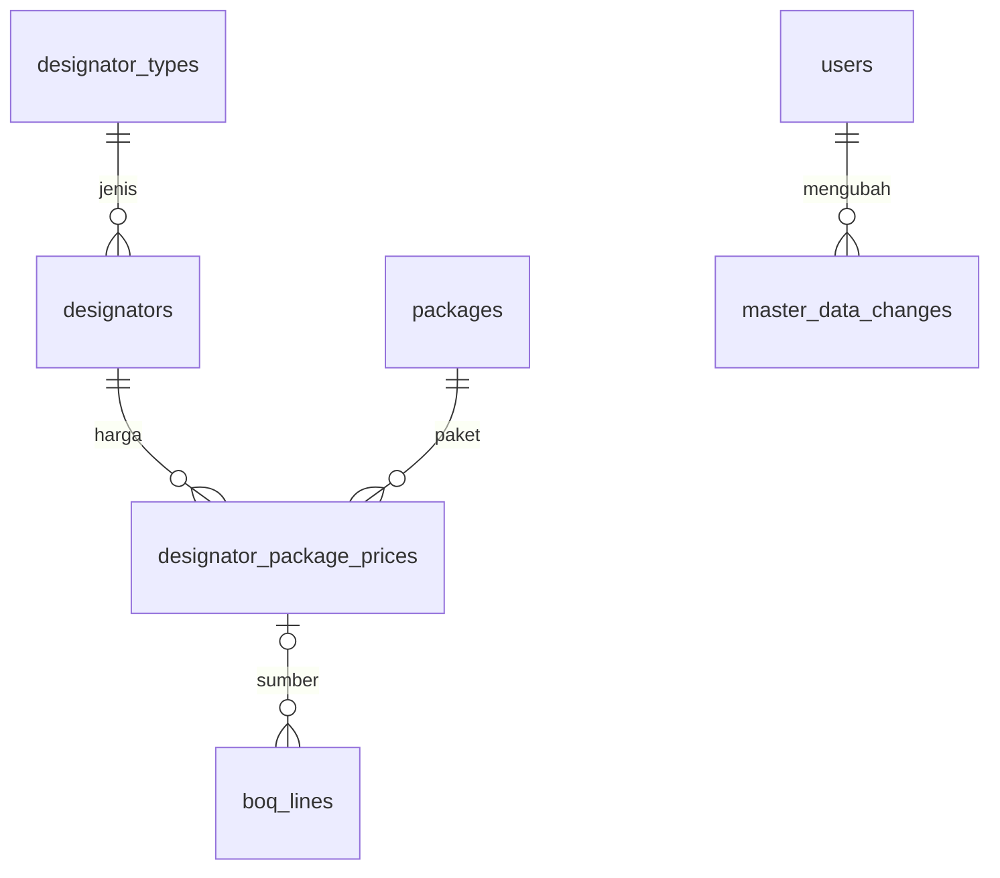

# Master Designator dan Mgr Project Support — 6 November 2026

Pembaruan 6 November: approver keempat PP/Pembayaran baru menjadi **Mgr Project Support**; penutup PP baru memakai empat jabatan baku. Assignment/keputusan Business Support historis tetap berlaku. Aturan terkini: [PROJECT_SUPPORT_APPROVAL](PROJECT_SUPPORT_APPROVAL.md). Penjelasan sebelumnya di bawah bersifat historis bila berbeda.

Menu induk **Master Designator** menggantikan Master KHS, dengan tiga submenu:

| Submenu | Data MySQL aktif | Isi |
|---|---|---|
| Designator | `designators` → `designator_types` | Kode, uraian pekerjaan, satuan dan jenis designator |
| KHS | `designator_package_prices` → designator/paket | Satu harga satuan per pasangan designator dan paket; Material/Jasa mengikuti jenis 1/2 sumber |
| Paket KHS | `packages` | Kode, nama dan keterangan paket |

Semua akun aktif dapat melihat master. **Superadmin** dapat tambah, edit dan hapus, dengan ikon dan tooltip pada tombol aksi. Tersedia pencarian, filter paket di KHS, halaman 30 baris dan tombol muat ulang. Tiga submenu mempunyai tautan langsung `/master-designator/designator`, `/master-designator/khs`, `/master-designator/paket-khs`; URL lama `/master-khs` tetap membuka daftar harga KHS. Jumlah menu induk tetap sembilan; warna dan komponen aplikasi tetap digunakan.

## Bulk Import

Submenu Designator dan KHS menyediakan **Download Template** Excel serta **Bulk Import** khusus Superadmin. Template terpisah memiliki sheet Data kosong, panduan dan referensi aktif. Preview wajib di layar sebelum Simpan impor; mode bawaan tambah baru, pilihan update eksplisit, 1000 baris/5 MB, satu transaksi dengan penolakan seluruh batch bila salah. Guard identitas terpakai/arsip/harga/role dan audit tetap berlaku. Tidak ada perubahan schema atau impor contoh ke database pengguna. Panduan lengkap: [MASTER_BULK_IMPORT](MASTER_BULK_IMPORT.md).

## Peran pengguna

`MGR_PROJECT_SUPPORT` / **Mgr Project Support** tersedia dalam Kelola akun dan login username. Peran mengikuti `users.role` yang konsisten dengan `roles` serta penugasan Branch. Peran baru mempunyai akses lihat sesuai Branch; pengelolaan akun/master tetap Superadmin. Tidak ada akun atau password bawaan yang dibuat.

Urutan approval tetap **PM → Admin Area → Mgr Deployment → Mgr Bussiness Support → Head of PMO**, kemudian Finance setelah scan untuk pembayaran. Menambah peran ini tidak menyisipkan approver atau mengganti keputusan lama.

## Aturan data dan riwayat

- Semua aksi akun login memakai SQL asli, bukan `updateKhs` demo. Endpoint GET `/api/masters` memerlukan akun aktif; POST `/api/masters/{designator|khs|paket-khs}` hanya Superadmin, dengan CSRF, pembatasan request, UUID dan revisi workspace.
- Laravel memvalidasi referensi, kode unik, field wajib, harga tidak negatif maksimal dua desimal (`DECIMAL(15,2)`). Nol tetap nol; tidak ada komponen rekaan. Jenis selain Material/Jasa dapat dicatat pada Designator, tetapi tidak dijadikan harga BOQ dalam alur yang saat ini hanya mendukung jenis 1/2.
- Relasi pasangan pada harga KHS yang sudah tersimpan dikunci. Pasangan baru dibuat sebagai record baru. Kode dan pasangan yang diarsip tetap unik; tidak didaur ulang atau dipulihkan otomatis.
- Hapus adalah pengarsipan melalui `deleted_at`, sehingga ID, relasi dan snapshot historis tidak hilang. Hapus dahulu harga KHS aktif sebelum menghapus designator atau paket yang memakainya. Arsip tidak muncul di daftar master aktif dan tidak dapat dipilih untuk BOQ baru.
- Identitas designator (kode/uraian/satuan/jenis) dan kode/nama paket yang sudah digunakan BOQ tidak boleh diganti; buat identitas baru. Keterangan paket tetap dapat diperbarui. Hal ini menjaga label dokumen lama yang masih mengacu katalog.
- Perubahan harga/label/status menaikkan versi acuan lokal, bukan nomor kontrak KHS resmi. BOQ file yang perlu penyesuaian harus direview pada harga/versi terkini. Harga dan komponen pada dokumen lama tidak ditulis ulang; pengesahan/ledger tetap memakai snapshot dokumen.
- Mutasi master dan workflow memakai kunci workspace yang sama. Konflik revisi menolak seluruh perubahan. Tutup form dan muat ulang sebelum mengedit ulang data terbaru. UUID mencegah eksekusi ganda pada pengulangan request yang sama.
- Mutasi menyimpan sebelum/sesudah, akun dan waktu ke `master_data_changes`, serta audit dan receipt. Pembaruan referensi hanya mengubah metadata katalog, tidak menulis ulang tabel dokumen, nomor, volume atau arsip `prototype_workspaces.state`.

## Tambahan tabel

`master_data_changes` menggunakan PK **id_master_change** (UUID). `entity`, `record_id`, `action` mengidentifikasi perubahan designator/KHS/paket; `before_data` dan `after_data` menyimpan snapshot SQL; `actor_user_id` berelasi ke `users.id_user`; `request_uuid` unik untuk deduplikasi; `created_at` adalah waktu kejadian. `record_id` bersifat polimorfik sesuai `entity`, bukan satu FK ke tiga tabel. Riwayat perubahan tersimpan di SQL; belum tersedia layar riwayat master khusus. Katalog/buku saku database bertanggal 5 November belum memuat tabel tambahan ini.

Migration: `2026_11_06_000001_enable_master_designator_management`. Menambah satu role dan satu tabel audit tanpa mengganti akun/penugasan atau mengimpor ulang master. Rollback ditolak setelah role/riwayat dipakai. Database aktif tetap `its` dan target guard tetap berlaku. Definisi `khs_price_lists`/`khs_prices` yang belum menjadi sumber runtime tidak dijadikan master kedua yang terpisah.

## Verifikasi dan batas

145 pengujian PHP / 2.644 assertions, 113 pengujian frontend, TypeScript/Vite build dan scoped Pint lulus. Semua pengujian framework memakai SQLite `:memory:` dengan bootstrap fail-closed. Cakupan mencakup provisioning/login role baru, seluruh CRUD SQL, otorisasi/CSRF, harga nol/desimal, konflik/duplikasi/replay, pengarsipan berurutan, preservasi snapshot dan arsip, serta review ulang file BOQ setelah edit harga melalui API baru. Frontend memverifikasi pencarian/filter/identitas SQL, form relasi terkunci serta ikon dengan label dan tooltip.

Tidak ada transaksi, akun uji atau harga contoh ditambahkan ke database pengguna. Pemeriksaan tampilan browser, tooltip interaktif, mobile/dark mode belum diulang setelah izin browser sebelumnya ditolak; pengujian markup tidak menyatakan verifikasi visual. Fitur master akun login tersambung ke MySQL; jalur offline/demo tetap terpisah dan tidak dapat mengganti master aktif. Integrasi kontrak KHS resmi/masa berlaku tetap belum tersedia karena datanya belum diberikan.

## Penerapan pada its

Migration sudah diterapkan pada 6 November 2026 (58 migration). Role baru memakai `id_role=10`; tabel audit masih kosong. Backup sebelum: `storage/app/private/backups/its-before-master-designator-20261106-052659.sql` (1.047.622 byte; SHA-256 `fc7c8c3e387cb911a8ce1247b3e1b2f4de9bafed80852e8c0d2544a38b5f1970`). Pembandingan INSERT dari backup sebelum/sesudah membuktikan data pada 37 tabel yang berisi record tetap identik, dengan pengecualian perubahan tabel migrations dan penambahan role yang memang dimaksudkan. Role lama tetap identik; 14 akun, 724 designator, 1.030 harga sumber dan seluruh transaksi tetap utuh. Tidak ada seeding/uji mutasi langsung pada MySQL pengguna. Bukti: [QA deployment](qa/master-designator-20261106.json).
