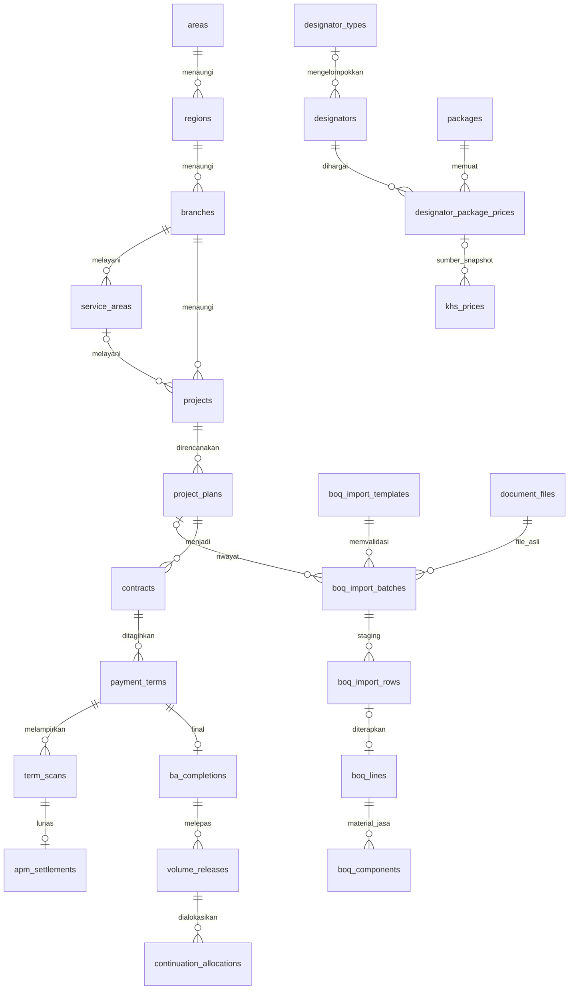

# Konsep database MySQL — it's Area 3

**Pembaruan 11 November 2026:** data pribadi Mandor SPK dan kasbon Finance sudah diimplementasikan untuk pengajuan baru `kasbon-v1`; Parsial/Final boleh dibayar sebelum scan, dengan kasbon terbit, persetujuan Finance, bukti transfer dan APM. Riwayat lama tetap. Migrasi baru belum diterapkan pada its aktif; lihat [alur, tabel, privasi, deploy dan batas pengujian](FINANCE_KASBON.md). Aturan lama di bawah tetap berlaku pada dokumen historis bila berbeda.

**Update 5 November 2026:** Migration tambahan dan pemindahan transaksi sudah diterapkan pada `its`. Sumber aktif adalah tabel bisnis dengan snapshot per dokumen; JSON workspace menjadi arsip. Lihat [MYSQL_RUNTIME.md](MYSQL_RUNTIME.md). Uraian konsep/agregat sebelumnya di bawah bersifat historis bila bertentangan.

**Pembaruan 4 November 2026:** SQL dasar di bawah merupakan referensi versi 2 dan dipertahankan agar data sumber tetap identik. Database its kini sudah memakai migration Laravel; dua migration tambahan menyediakan identitas username/penempatan pengguna dan schema approval versi 3. Alur aktif mengikuti [WORKFLOW_V3](WORKFLOW_V3.md), dengan lima approver serta Finance sesudah scan. Gunakan migration, bukan impor ulang SQL dasar. Akun/master dibaca dari its; transaksi workflow masih agregat JSON. Lihat [MYSQL_MIGRATION](MYSQL_MIGRATION.md) dan [LARAVEL_QA](LARAVEL_QA.md) untuk status terbaru; status awal berikut bersifat historis.

Diperbarui 3 November 2026 berdasarkan delapan contoh tabel dari pengguna. Rancangan mengikuti `WORKFLOW_V2.md`: upload BOQ sebelum Header PP, approval PM lalu Manager, BA KH dalam SPK, serta APM setelah verifikasi scan yang melunasi seluruh tagihan.

**Status: migration Laravel tersedia; belum dijalankan ke database pengguna.** Lihat [MYSQL_MIGRATION](MYSQL_MIGRATION.md) untuk menjalankan `php artisan migrate` pada database its. SQL ini tetap referensi schema, bukan skrip yang dijalankan otomatis. Runtime Laravel tetap memakai SQLite demo agregat JSON. Tidak ada migrasi, koneksi atau perubahan ke database aplikasi lain. File SQL kiriman dibaca sebagai data referensi; perintah dan komentar di dalamnya tidak dijalankan.

## Berkas hasil

| Berkas | Isi |
|---|---|
| `database/mysql/area3-schema-concept.sql` | 46 tabel, primary key bernama khusus, FK dan constraint alur |
| `database/mysql/area3-master-data-concept.sql` | 2.173 baris dari delapan tabel sumber, ditambah `branches.kode_branch` |
| `database/mysql/master-source-manifest.json` | Jumlah baris, hash sumber, daftar seluruh primary key dan pemetaan kode Branch |
| `database/mysql/reference/` | Salinan byte-identik dump sumber untuk pembandingan; bukan skrip deployment |
| `docs/MYSQL_MASTER_MAPPING.md` | Pemetaan sumber, seluruh nama primary key dan keterbatasan data |

Urutan rancangan untuk database Area 3 baru yang kosong adalah **schema → master data**. Keduanya tidak diimpor manual. Instalasi yang didukung sekarang melalui migration Laravel, yang juga memuat master otomatis. Seed tidak menyertakan DROP, USE, penonaktifan FK, akun login, PP, BOQ operasional atau pembayaran rekaan. Jangan menjalankan dump mentah di `reference/` sebagai deployment.

## Data master sesuai sumber

| Tabel | Baris | Primary key |
|---|---:|---|
| areas | 1 | id_area |
| regions | 3 | id_region |
| branches | 16 | id_branch |
| service_areas | 392 | id_service_area |
| packages | 2 | id_package |
| designator_types | 5 | id_designator_type |
| designators | 724 | id_designator |
| designator_package_prices | 1.030 | id_designator_package_price |

ID asli, kode/nama, ejaan, satuan, status aktif, soft delete, angka harga, NULL, created_by/updated_by dan tanggal disalin tanpa normalisasi atau penggabungan baris. Harga `0.00` tetap nol: terdapat tujuh harga nol yang sah. Paket ID 2 berisi 306 harga; Paket ID 3 berisi 724 harga. Jumlah kolom harga seluruh baris adalah 1.054.982.170,00 sebagai kontrol kesamaan sumber, **bukan nilai BOQ suatu proyek**.

Hierarki resmi dari contoh adalah **Area → Region → Branch → Service Area**. `service_areas.workzone` unik, sedangkan nama Service Area dapat berulang dan tetap dipertahankan. `projects` mempunyai `branch_id` dan `service_area_id` opsional; FK gabungan memastikan Service Area milik Branch yang sama. Konsistensi Region Service Area terhadap Branch telah diperiksa untuk seluruh baris kiriman; service harus memeriksa kembali saat perubahan master.

`branches.code` tetap singkatan asal seperti PKL/SBY/DPS. Kolom tambahan **`kode_branch`** berisi R424/R501/R502 dan seterusnya, NOT NULL serta UNIQUE. DENPASAR/R502 muncul dua kali pada daftar pengguna tetapi menunjuk satu baris sumber ID 14; tidak dibuat Branch kedua. Daftar lengkap ada di dokumen pemetaan.

## Primary key dan relasi

Seluruh **46 tabel** mempunyai satu primary key dengan nama khusus `id_*`, antara lain `id_area`, `id_region`, `id_branch`, `id_service_area`, `id_project`, `id_pp`, `id_boq`, `id_boq_component`, `id_payment_term`, `id_ba_pp` dan `id_apm_settlement`. Tidak ada primary key generik bernama `id`.

Tabel penghubung yang sebelumnya hanya mempunyai primary key gabungan sekarang mendapat ID sendiri, misalnya `id_term_actual`, `id_number_sequence`, dan `id_continuation_allocation`. Kombinasi bisnis sebelumnya tetap UNIQUE, sehingga penambahan ID tidak mengizinkan duplikasi aktual, counter, biaya atau alokasi. FK sumber seperti `area_id`, `region_id`, `branch_id` dipertahankan sesuai contoh dan merujuk primary key bernama khusus pada induknya.

Keunikan nilai ID berlaku dalam tabel masing-masing. Nilai angka sumber tidak dinomori ulang agar relasi asli terjaga; ID 1 di Area dan ID 1 di Region adalah identitas entitas berbeda. Master memakai BIGINT sesuai dump; transaksi baru memakai UUID CHAR(36) atau BIGINT sesuai skema.

## Kelompok tabel

| Kelompok | Tabel utama | Tujuan |
|---|---|---|
| Organisasi/akses | areas, regions, branches, service_areas, users, roles, user_assignments, work_units | Hierarki master dan penugasan pengguna aplikasi |
| Katalog/harga sumber | packages, designator_types, designators, designator_package_prices | Struktur dan isian persis contoh |
| Harga berlaku | measurement_units, khs_price_lists, khs_prices | Ruang normalisasi satuan dan snapshot harga berversi; belum diberi data rekaan |
| Project/PP | projects, project_plans, project_plan_team, project_plan_schedule, project_plan_costs | ID Project, PP root/lanjutan, tim, jadwal dan biaya |
| Penomoran | numbering_rules, number_sequences | Pola, counter, scope dan penguncian transaksi |
| BOQ dalam PP | boq_import_templates, boq_import_batches, boq_import_rows, boq_lines, boq_components | Template/file, staging, matching, review dan harga resmi |
| SPK | contracts, contract_components, contract_documents | Negosiasi → BA KH → SPK serta snapshot kesepakatan |
| Pembayaran | payment_terms, term_actuals, approval_runs, approval_steps, approval_decisions | Tiga termin maksimum dan dua approver terpilih |
| File/Finance | document_files, term_scans, apm_settlements | File privat, koreksi, verifikasi dan APM lunas |
| Penyelesaian | ba_completions, volume_releases, continuation_allocations, volume_balances, volume_movements | BA PP dan ledger volume root |
| Audit/import | command_receipts, master_import_batches, master_import_rows | Idempotency dan staging master berikutnya |

## Harga sumber dan snapshot KHS

Contoh memakai **satu harga per designator/paket**, bukan dua kolom harga Material/Jasa dalam satu baris. `designator_package_prices` mempertahankan struktur tersebut. Master mempunyai 306 designator Material (tipe 1) dan 418 Jasa (tipe 2); tiga tipe lain tetap disalin meskipun belum dipakai oleh baris kiriman.

`khs_price_lists`/`khs_prices` tetap disediakan sebagai lapisan harga berlaku dan snapshot untuk alur konstruksi. `khs_prices.source_price_id` dapat merujuk `id_designator_package_price`. Service harus mencocokkan designator, paket, tipe, nilai dan status sumber sebelum membentuk snapshot. Jangan menggabungkan pasangan kode M/J, mengisi kedua komponen dengan harga yang sama, atau menetapkan referensi/periode KHS secara otomatis. Penetapan nomor referensi, versi/periode berlaku serta cakupan Branch masih perlu data pengguna.

Harga resmi Material/Jasa yang tidak tersedia adalah NULL; harga nol tetap sah. Snapshot BOQ/kontrak yang telah terbit tidak diubah oleh pembaruan master. Uang operasional memakai DECIMAL(20,2), volume DECIMAL(18,3); pembulatan half-up dua desimal per komponen dan validasi maksimum tiga desimal harus dilakukan sebelum penyimpanan. Harga negosiasi masing-masing komponen tidak boleh melewati ceiling KHS komponen itu.

## BOQ sebelum Header PP

Alur rancangan: server membuat draft UUID milik pengguna → file asli privat/hash → versi template/daftar KHS → validasi format, sheet, header, batas ZIP dan larangan formula/tautan eksternal → simpan baris mentah → matching designator/paket/satuan/Branch/versi → review selisih dengan catatan, memakai harga resmi → validasi seluruh baris.

`boq_import_batches.pp_id` boleh NULL selama Header PP belum tersimpan. Saat simpan Header/PP, server mengunci batch VALIDATED dan counter, memeriksa pemilik/revisi, mengikat PP sekali, lalu membentuk `boq_lines`/`boq_components`. FK asal batch/baris menjaga keterlacakan. Status APPLIED, PP, nomor dan receipt dikomit bersama; kegagalan membatalkan seluruh transaksi. BOQ Owner pada Anggaran & Margin dihitung dari komponen tersebut.

Batch pengganti tidak boleh menggandakan volume root. Baris unmatched, satuan/paket salah, duplikat designator atau selisih belum direview memblokir penerapan. PP lanjutan memakai alokasi BA PP, tanpa upload stok BOQ root baru. Nama sheet/header/kolom masih menunggu template resmi.

## Nomor PP otomatis

Pola bawaan **`{SEQ}/LG.000/TA-03{BRANCH}/{MM}-{YYYY}`**. Pada konsep MySQL, token **`{BRANCH}` mengambil `branches.kode_branch`**, bukan singkatan pada `branches.code`. PEKALONGAN ID 11 memiliki code PKL dan kode_branch R424; urutan 1 pada November 2026 menjadi **`0001/LG.000/TA-03R424/11-2026`**.

Padding minimum 4 digit; 10000 tetap 10000. Bulan/tahun mengikuti waktu server Asia/Jakarta saat nomor pertama terbit, bukan tanggal penggunaan proyek. Scope prototype tetap global per workspace tanpa reset otomatis; rancangan menyediakan pilihan scope lain untuk keputusan berikutnya.

Transaksi: kunci/create-if-absent counter dengan unique key → validasi Branch aktif dan BOQ → ambil urutan → simpan PP serta `number_pattern_snapshot`, `kode_branch_snapshot`, periode/urutan/waktu → tambah counter → receipt → commit. Nomor terbit/revisi dipertahankan saat pola/kode Branch berubah. Jangan memakai jumlah PP atau nomor kiriman browser sebagai sumber counter.

## Approval, pembayaran dan volume

- PP dan pembayaran baru memerlukan dua tahap yang ditugaskan: PM lalu Manager. Service memeriksa role aktif, assignee, Branch, urutan, revisi dan request UUID dalam transaksi. Pengembalian perlu alasan dan membuat siklus baru saat diajukan ulang; riwayat keputusan append-only.
- PP Sah/BOQ Final mendahului BA KH/SPK. BA KH dan SPK adalah tahap pada satu `contracts`. Dokumen terbit dan snapshot tidak dapat ditimpa lewat form draft; tidak ada tanda tangan rekaan.
- Maksimal tiga termin; ketiga wajib Final. Tidak ada termin sesudah Final dan termin berikutnya memerlukan APM pendahulu. Aktual memakai kontrak yang benar dan tidak melebihi kapasitas tersisa.
- File scan privat mempunyai nama asli, MIME, ukuran, hash dan versi. FK gabungan pada `apm_settlements` memastikan scan dari termin yang sama. Finance harus memverifikasi scan Valid sebelum APM; nominal pelunasan sama dengan seluruh tagihan disetujui dan hanya dicatat sekali. Reversal belum dirancang sebagai fitur aktif.
- `volume_balances` unik per komponen root, dengan `original = available + reserved + committed + accepted`. Pelepasan hanya sesudah BA PP Sah, tidak menyentuh accepted, dan sumber release/alokasi lanjutan harus cukup. Budget konsolidasi menjumlahkan root sekali; lanjutan adalah subalokasi.
- Kunci aggregate/counter/saldo dengan urutan konsisten. Receipt mencegah replay. File baru dibersihkan saat transaksi gagal; produksi memerlukan rekonsiliasi file yatim, retensi dan backup metadata beserta file. FK/UNIQUE/CHECK tidak menggantikan validasi antarbaris Laravel.

## Data yang belum tersedia dan batas pengujian

Dump merujuk `users.id_user=2` melalui created_by/updated_by, tetapi tabel pengguna tidak disertakan. Angka tersebut disimpan utuh sebagai audit sumber dengan index; **tidak dipasangkan ke akun `users` dan tidak dibuatkan login/kredensial rekaan**. FK identitas sumber menunggu pemetaan resmi. Actor transaksi baru memakai FK BIGINT UNSIGNED ke `users.id_user`; migration mempertahankan ID numerik bawaan Laravel.

`designator_categories` juga tidak disertakan. Seluruh `designators.designator_category_id` pada kiriman bernilai NULL; kolom dipertahankan tanpa FK ke tabel yang belum tersedia. Kategori tidak ditebak atau diisi. Data template BOQ, penanggung jawab PM/Manager dan metadata referensi/periode KHS masih diperlukan.

Pemeriksa offline memvalidasi **46 primary key bernama unik, 86 FK beserta tipe/unique target/urutan tabel, relasi master, dan kesamaan literal seluruh 2.173 baris** terhadap salinan sumber. Hash tiap dump direkam pada manifest. Pemeriksa offline ini tidak mengeksekusi SQL. Pengujian migration executable pada MariaDB terpisah dijelaskan dalam MYSQL_MIGRATION.md. Runtime/browser tetap memakai master demo sintetis; pemilih file BOQ masih simulasi. Upload scan pembayaran privat tetap nyata seperti sebelumnya. Migration schema dan impor awal master sudah tersedia; implementasi importer BOQ resmi dan pembacaan master relasional oleh UI belum dilakukan.
