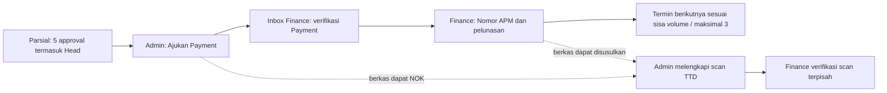
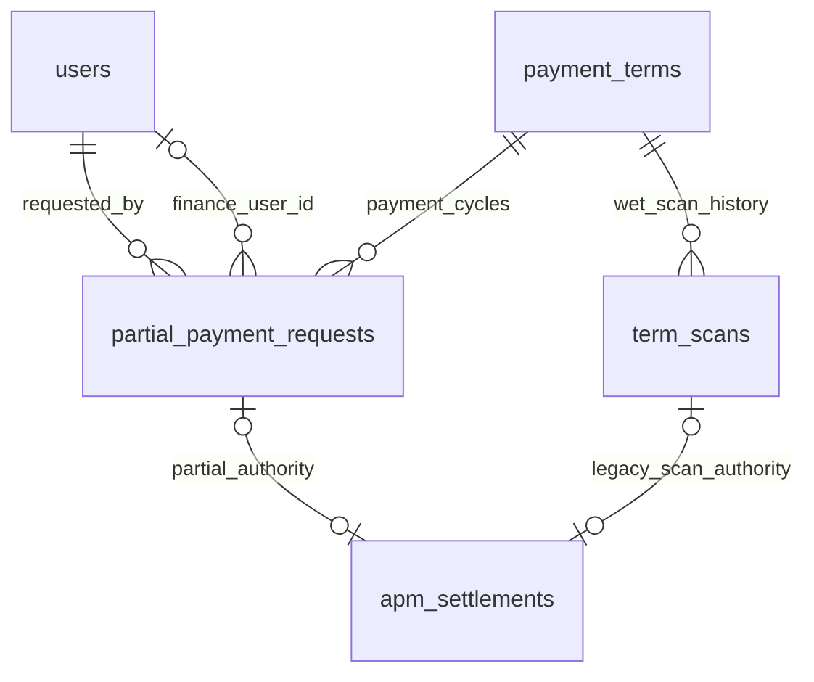

# Payment Termin Parsial sebelum kelengkapan scan — 9 November 2026

Permintaan terbaru menambah jalur Payment untuk **Termin Parsial v3** yang telah disetujui kelima approver sampai Head of PMO. Admin dapat mengirim Payment ke Finance tanpa scan TTD. Finance harus memverifikasi Payment sebelum mencatat APM sebagai pelunasan penuh. **Format/form kasbon ditunda secara eksplisit oleh pengguna; tidak dibuat isian, perhitungan atau kewajiban kasbon rekaan.** Pengguna akan memberikan formatnya kemudian.

## Alur pengguna



1. Lima approval dokumen tetap PM → Admin Area → Project Support → Deployment → Head, sesuai pengguna terpilih/snapshot. PP/SPK/volume aktual/harga dan tagihan tidak berubah.
2. Pada detail Termin Parsial yang Disetujui dan belum dibayar, **Ajukan Payment** tersedia untuk Admin Konstruksi/Superadmin. Nominal diambil dari tagihan aktual saat ini, bukan input client atau nominal kumulatif. Pengajuan tidak membayar, membuat APM atau menganggap scan sudah ada.
3. Finance sesuai akses Branch melihat pengajuan pada **Menunggu Saya** meskipun belum ada scan. Tombol **Setujui & Verifikasi Payment** mencatat akun, waktu dan catatan Finance. Kolom APM baru tersedia setelah verifikasi. Finance dapat mengembalikan Payment dengan alasan wajib.
4. Finance mengisi Nomor APM lalu **Catat APM & Bayar Termin** dan mengonfirmasi bahwa pembayaran telah dilakukan. APM unik, pembayaran tepat seluruh tagihan, request berstatus Dibayar, receipt/audit dan proyeksi SQL dicatat atomik. Invalid/duplikat APM atau kegagalan SQL tidak menyisakan status dibayar, pembayaran parsial atau receipt sukses.
5. Termin berikutnya tetap membutuhkan approval lengkap, **APM valid dan Payment lunas**. Berkas Parsial NOK tidak menghalangi gerbang ini. Maksimal tiga termin, termin ketiga wajib Final, sisa volume dan larangan termin setelah Final tetap berlaku.
6. Admin tetap dapat mengunggah scan TTD untuk jalur ini setelah pembayaran. Finance dapat memverifikasi/mengembalikan scan tersebut meskipun APM sudah valid. Tindakan berkas tidak mengulang pembayaran, memindahkan otoritas settlement ke scan belakangan, menghapus keputusan Payment atau mengubah volume/approval dokumen. Scan Valid tetap terkunci; penggantian scan yang perlu koreksi mempertahankan riwayat.

Pengembalian **Payment oleh Finance** adalah koreksi pengajuan keuangan setelah dokumen Disetujui. Admin harus menekan Ajukan Payment lagi; siklus Payment lama tetap disimpan dan lima keputusan dokumen tidak diulang. Ini berbeda dengan Tolak/Kembalikan **approval pekerjaan/PP**, yang tetap mengikuti APPROVAL_RESUBMISSION dan memulai lima approval dari PM.

## Status Berkas dan daftar pembayaran

- Kolom **Pembayaran** menampilkan Lunas/Sebagian/Belum Dibayar, nilai terbayar dan keterangan **Termin N · Parsial/Final** saat ada pembayaran.
- Kolom **Status Berkas**: **NOK** bila snapshot server belum mempunyai scan TTD; **OK** bila scan telah diunggah melalui endpoint privat. Status tidak berasal dari checkbox/flag client atau dari eviden pekerjaan biasa.
- OK berarti file scan tersedia pada metadata upload, bukan otomatis disetujui Finance. Scan Perlu Koreksi tetap mempunyai file/OK dengan keterangan koreksi terpisah. Akses/keberadaan byte tetap diperiksa pada endpoint berkas; daftar tidak melakukan pemeriksaan disk per baris.
- Jika belum lengkap, catatan **Berkas belum lengkap** ditampilkan saat pengajuan/verifikasi/pembayaran. Snapshot request membekukan `documentsAtRequest` dan `documentsAtPayment`, sehingga berkas yang disusulkan tidak menulis ulang fakta NOK saat dibayar. Status Berkas daftar selalu mengikuti scan saat ini.
- Inbox, penghitung menu, timeline dan laporan performa Finance memakai status Payment baru. Setelah pembayaran tanpa scan, Payment keluar dari tugas Finance; scan yang diunggah belakangan masuk sebagai tugas verifikasi berkas. Keputusan Finance Payment dan keputusan scan dicatat terpisah; waktu respon Payment dihitung dari requestedAt sebenarnya.

## Batas versi dan otoritas

Jalur diaktifkan **hanya melalui perintah Admin** pada Parsial v3 yang sudah Disetujui, belum dibayar dan mempunyai lima keputusan sesuai akun terpilih. Server menetapkan `paymentFlow=partial-payment-v1`, ID request, siklus, nominal dan identitas/waktu. Client tidak dapat memasang marker/request/keputusan melalui saveTerm. API tetap memeriksa sesi, role SQL aktif dan Branch PP yang sebenarnya.

Tidak ada penulisan ulang PP/keputusan lama, perubahan approver atau adopsi saat GET. Pengajuan v1/v2, Termin Final, APM/scan historis dan jalur scan lengkap yang sudah ada tetap mengikuti aturan sebelumnya. Parsial v3 yang belum mengadopsi request Payment juga mempertahankan jalur scan lengkap sebagai kompatibilitas; setelah Admin mengajukan Payment, verifikasi scan saja tidak dapat menggantikan verifikasi request Payment. Tidak ada pengecualian untuk Final atau signature/approval rekaan.

Eviden pekerjaan untuk penilaian lima approver tetap berkas privat tersendiri dan hanya dapat dikoreksi saat draft/returned sesuai aturan sebelumnya; tidak diberi status OK sebagai pengganti scan TTD. Kewajiban menunggu upload pending saat pengajuan approval tetap. Progres upload scan/eviden yang sudah dibuat tetap digunakan.

## SQL dan relasi

Migration **2026_11_09_000002_enable_partial_payment_requests** menambah `partial_payment_requests` dengan PK unik **id_payment_request**. Runtime dokumen tetap `payment_terms.document_data`; tabel baru menjadi proyeksi transaksional, bukan sumber global tanpa scope atau fallback arsip.

| Kolom / relasi | Isi |
|---|---|
| id_payment_request | UUID SQL deterministik dari workspace dan ID request yang dibuat server |
| term_id | FK payment_terms.id_payment_term, pengajuan keuangan untuk satu termin |
| cycle_no | Siklus unik per termin; request lama tidak ditimpa saat Admin mengajukan ulang |
| status / amount | WAITING, VERIFIED, RETURNED, PAID; nominal tagihan aktual positif |
| requested_by / requested_at | FK users.id_user dan waktu Admin |
| finance_user_id / finance_decided_at / finance_note | FK akun Finance dan keputusan/catatan sebenarnya |
| documents_at_request / documents_at_payment | Fakta OK/NOK pada dua titik waktu, bukan status file saat ini |
| request_data | Snapshot request/keputusan/identitas dan metadata pembayaran lengkap |



`apm_settlements.verified_scan_id` menjadi nullable dan ditambah `payment_request_id`. CHECK **settlement_authority** mewajibkan **tepat satu** referensi: scan terverifikasi lama atau request Payment Parsial. Kedua FK komposit menyertakan term_id, sehingga request/scan termin lain tidak dapat dipakai. Unik APM, unik settlement per termin dan amount positif tetap. Laravel memeriksa status verifikasi/versi/jenis/nominal; FK/CHECK menjaga struktur referensinya. Settlement baru dibayar tanpa scan tidak diubah ke referensi scan saat berkas disusulkan.

Tabel tidak menyimpan password/akun uji atau kolom kasbon yang belum disepakati. Rollback menolak bila ada riwayat request atau settlement tanpa scan. Migration tidak meng-update/backfill transaksi lama; proyeksi hanya ditulis oleh perintah yang tervalidasi. Arsip prototype_workspaces.state tetap tidak berubah.

## Arsitektur dan tinjauan query

Perintah **requestPartialPayment**, **verifyPartialPayment**, **payPartialPayment** melewati validasi controller, AuthenticatedWorkspace/Branch, workspace lock/revision, domain dan RelationalWorkflowStore bersama receipt/audit. Finance Payment terpisah dari financeApproval/financeHistory scan. Bukti kasbon yang belum tersedia tidak diisi otomatis.

RelationalWorkflowStore mengindeks snapshot termin sebelumnya dan hanya membangun ulang proyeksi aktual, lima approval, file/scan serta eviden bila bagiannya berubah. Request/siklus diindeks sekali; hanya request baru/berubah ditulis. Ini menghindari penulisan ulang rincian BOQ/actual/approval/berkas ketika hanya melakukan Payment. Ledger tetap dihitung dari snapshot validated dan saldo yang tidak berubah tidak ditulis.

Pada fixture **1 PP/1 termin**, termasuk GET revisi: request **54 query**, verifikasi **55**, pembayaran **57**, dibatasi **75** per aksi; dua pembacaan katalog harga yang sudah ada, tanpa write ulang actual/approval/scan/ledger pada tiga aksi ini. Daftar Pembayaran mengindeks PP/SPK/BA KH sekali, memoisasi kalkulasi tagihan dan membatasi DOM **20 baris/halaman**; fixture1000 pengajuan melarang repeated collection find. Pengajuan Baru melewati kalkulasi tabel yang tidak diperlukan. Picker SQL tetap memakai query batch2/4 yang sama, hanya menambah dua proyeksi metadata JSON; tidak membaca request table per baris.

Ini bukan klaim semua query konstan atau load test MySQL. Aggregate/reference boot dan command validation global tetap ada. Riwayat scan masih diproyeksikan melalui jalur lama saat berubah; tidak mengklaim optimasi seluruh upload/file. Pagination tabel ini dilakukan pada state yang sudah diotorisasi, bukan pagination SQL seluruh runtime.

## Deployment dan bukti

**Migration belum diterapkan agen pada its lokal/server aktif.** Setelah deploy kode ke folder aplikasi, gunakan PHP CLI/user OS situs yang sesuai:

```sh
php artisan migrate --force
npm run build
php artisan queue:restart
```

Tidak memakai migrate:fresh, seed, reset atau activate-storage ulang. Queue restart mengikuti runbook worker yang ada; tidak menambah worker/queue baru atau mengubah aplikasi Dompis Prov.

Cadangan its sebelum perubahan: `storage/app/private/backups/its-before-partial-payment-20261109-083829.sql`, **2.084.634 byte**, SHA-256 **27d2d620179800cd7dbd82fa5839e2b033ab8f3ea6915802209ecbbf26a643bc**. Percobaan sandbox0byte ditandai.failed; kredensial sementara tidak dicetak dan dibersihkan. Tidak ada .env/permission/master/akun/transaksi live yang diubah.

Hasil akhir dan batas: [LARAVEL_QA](LARAVEL_QA.md) dan [qa/partial-payment-20261109.json](qa/partial-payment-20261109.json). MariaDB10.4 sementara memakai socket privat/skip-networking dan data kosong (0users) berhasil menjalankan63 migration serta pengulangan tanpa perubahan. Ini verifikasi DDL/schema, bukan simulasi transfer atau pengujian alur pembayaran pada database aktif. HTTP/SQL transaksi nyata diuji pada SQLite memory fail-closed; browser autentikasi/responsif/keyboard/cetak/load dan integrasi bank/ERP belum diuji. APM merupakan pencatatan Finance, bukan perintah transfer bank. Kasbon tetap menunggu format pengguna.
