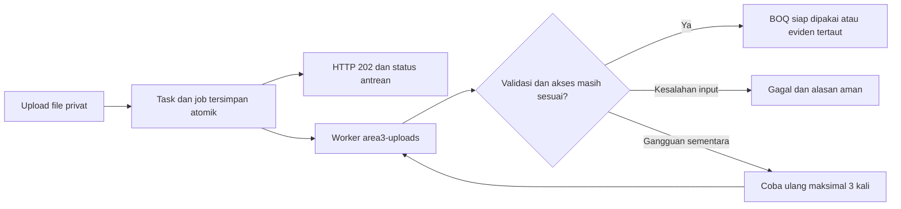

# Antrean upload dan optimasi aplikasi — 6 November 2026

## 11 November 2026 — Upload eviden sebelum migration kasbon

Laporan Server Error ditelusuri ke log lokal: SQLSTATE42S22/1054, kolom `upload_tasks.context_id` belum ada saat INSERT upload eviden. Kesalahan pada pembaruan kasbon: kolom baru ikut ditulis untuk semua jenis upload, termasuk `boq`/`evidence` yang tidak membutuhkannya. HTTP gagal sebelum task/job berhasil dibuat, bukan deteksi worker tidak aktif atau kesalahan isi PDF.

UploadQueue sekarang hanya menyertakan `context_id` pada `transfer-proof`. BOQ dan work evidence tetap menggunakan kolom sebelum kasbon (schema sampai 10 November), tanpa introspeksi schema, query migration tambahan atau retry INSERT otomatis. KTP/bank/transfer baru memerlukan migration kasbon selesai; satu query registry `migrations` memberi HTTP503 dengan pesan yang jelas sebelum staging/job dibuat jika masih tertunda. Keterikatan versi transfer proof tidak dikurangi atau diganti fallback.

Regresi mengembalikan schema hanya dalam SQLite memory sebelum kasbon (kolom dan tiga tabel private dihapus), lalu menguji BOQ26baris/evidenPDF end-to-end, UUID replay satu job, process dua kali tetap satu eviden, preview dan archive unchanged. Tiga upload privat ditolak503 tanpa bytes/job/revision/audit tambahan. Dua enqueue HTTP (BOQ+eviden) mencatat24query, budget50, dan dilarang menyebut context/schema/migration query pada jalur lama. Private readiness menambah1query per private enqueue saja; tidak mengklaim latensi global.

Tidak ada migration/ALTER runtime, perubahan .env/APP_KEY, transaksi its, PP/Final lama atau worker live. Operator tetap perlu migration untuk fitur kasbon lengkap, lalu memuat ulang worker its. Sebelum itu kode perbaikan mengembalikan upload lama; file yang gagal dapat diunggah ulang. Remote/server, upload browser dan beban produksi belum diverifikasi; lihat QA terbaru dan qa/evidence-schema-compatibility-20261111.json.


**Pembaruan 11 November 2026:** data pribadi Mandor SPK dan kasbon Finance sudah diimplementasikan untuk pengajuan baru `kasbon-v1`; Parsial/Final boleh dibayar sebelum scan, dengan kasbon terbit, persetujuan Finance, bukti transfer dan APM. Riwayat lama tetap. Migrasi baru belum diterapkan pada its aktif; lihat [alur, tabel, privasi, deploy dan batas pengujian](FINANCE_KASBON.md). Aturan lama di bawah tetap berlaku pada dokumen historis bila berbeda.


**Pembaruan 9 November 2026 — progres upload:** seluruh upload nyata kini menampilkan persentase byte pengiriman dan konfirmasi server. BOQ/eviden memperlihatkan fase antrean/worker terpisah; scan/impor tetap sinkron, preview master tetap belum menyimpan. Tidak ada persentase pemrosesan rekaan, endpoint/query/migration baru atau perubahan batas/izin/approval. Banyak eviden mempunyai progres per file. [Arti angka, arsitektur dan hasil uji](UPLOAD_PROGRESS.md). Catatan sebelumnya tetap riwayat sesuai tanggalnya.

**Tambahan server 9 November 2026:** [SERVER_UPLOAD_WORKER.md](SERVER_UPLOAD_WORKER.md) menyediakan setup aaPanel `/www/wwwroot/itsy` dan generator `area3:supervisor-config --user=...`. Ini konfigurasi Supervisor untuk perintah worker yang sama, bukan perubahan queue/timeout/SQL/privasi. Generator 0 SQL/0 process dan belum memasang layanan remote; server memakai autostart web false dan user OS PHP-FPM, bukan root SSH. Catatan pengujian/deployment lokal lama di bawah tetap riwayat tanggal masing-masing.

Upload pada layar PP dan eviden pembayaran sekarang memakai antrean database Laravel bernama `area3-uploads`. Server menerima dan menyimpan file privat, mengembalikan HTTP 202, lalu worker memproses isinya. Transfer file dari browser tetap memerlukan waktu sesuai ukuran/koneksi; pembacaan Excel dan pemrosesan lampiran berlangsung di luar permintaan upload.

## Cara menggunakan

Pada BOQ Plan, pilih Excel seperti biasa. Status tampil **Dalam antrean → Sedang diproses → Selesai** atau **Gagal**. BOQ lama baru diganti setelah pemrosesan berhasil. Jika halaman ditutup setelah file diterima, pekerjaan server tetap berjalan. Pada PP yang sama, daftar antrean menyediakan **Gunakan hasil** untuk mengambil kembali BOQ selesai. Data Header yang sedang diisi tetap dipertahankan. Form PP baru tetap bersih dan tidak otomatis mengambil BOQ dari PP lain.

Pada eviden pembayaran, PDF dan foto JPG/JPEG/PNG/WebP mengikuti antrean yang sama. Lampiran baru masuk dokumen setelah worker memeriksa file dan menyimpannya secara atomik bersama audit. Setelah selesai, data halaman diperbarui. Preview dan unduhan tetap privat dan mengikuti Branch. Upload gagal menampilkan alasan; pengguna dapat memperbaiki dan mengunggah ulang. Maksimal tetap 10 MB per file dan 10 eviden aktif; file yang masih antre ikut dihitung dalam batas tersebut.

PP atau termin dengan upload terkait yang masih antre tidak dapat diajukan untuk approval. Draf Header PP tetap bisa disimpan. File gagal tidak mengganti data BOQ lama. Approval, pencetakan, scan TTD basah, Finance/APM, batas harga dan ledger tetap mengikuti aturan sebelumnya.

## Antrean dan worker



Koneksi antrean khusus `uploads` memakai tabel `jobs` pada koneksi database aplikasi **its**, terlepas dari default antrean aplikasi. Tidak membutuhkan Redis. Task dan job dibuat dalam satu transaksi pada database yang sama, sehingga file tidak dinyatakan antre tanpa job tersimpan. UUID, hash file dan kepemilikan mencegah pengulangan request yang sama menambah pekerjaan ganda. Hasil BOQ memakai ID task yang tetap; attach eviden memakai ID tetap dan receipt/audit workflow.

Untuk XAMPP lokal (`APP_ENV=local`), `uploads.autostart` aktif secara default. Setelah menerima upload, aplikasi memulai worker menggunakan PHP CLI dengan identitas OS yang sama dengan proses web. Ini mempertahankan izin file privat milik Apache; tidak membuka izin file untuk umum atau mengganti konfigurasi Apache. Worker memakai lock proses eksklusif. Status membaca heartbeat; bila worker berhenti, file tetap tersimpan dalam antrean dan tombol **Lanjutkan antrean** dapat meminta worker dimulai lagi. Peluncuran proses tidak dijalankan pada pengujian.

Perintah operasional, dijalankan dari folder proyek **dengan pengguna OS yang mempunyai akses file privat aplikasi**, adalah:

```sh
/Applications/XAMPP/xamppfiles/bin/php artisan area3:work-uploads
```

Worker mempunyai timeout 90 detik, batas retry database 180 detik, maksimal tiga percobaan dengan jeda 5/20/45 detik, dan batas memori 256 MB. Perlindungan overlap mempunyai expiry 150 detik. Pemrosesan mahal tidak memegang lock workspace; attach eviden memegang lock hanya ketika memvalidasi dan menyimpan perubahan. Worker membaca ulang akun aktif, role, Branch dan status termin saat eksekusi, memakai revisi terbaru untuk append lampiran tanpa menimpa edit lain. Pengajuan approval tetap diblokir selama upload terkait masih pending.

Untuk server produksi gunakan pengelola proses (misalnya Supervisor/systemd) dengan pengguna OS aplikasi yang benar, dan set `AREA3_UPLOAD_AUTOSTART=false`. Jalur PHP dapat diatur melalui `AREA3_WORKER_PHP`. Autostart lokal bukan layanan yang otomatis hidup saat komputer boot. Bila `proc_open`/PHP CLI tidak tersedia, status worker akan menunjukkan belum aktif; antrean tidak dialihkan diam-diam ke pemrosesan sinkron.

## Penyimpanan dan endpoint

| Komponen | Lokasi / aturan |
|---|---|
| Task upload | `upload_tasks`, PK unik `id_upload_task` (UUID) |
| Task → workspace | `workspace_id` → `prototype_workspaces.id` |
| Task → pengunggah | `user_id` → `users.id_user` |
| Payload kerja | `jobs`; kegagalan retry teknis tercatat oleh Laravel pada `failed_jobs` |
| File menunggu | `storage/app/private/upload-queue/{workspace}/{task}/source` |
| BOQ selesai | `prototype-boq/{workspace}/{task}/source.xlsx` dan `manifest.json` pada disk privat; pemetaan SQL dokumen mengikuti BOQ lama saat PP disimpan |
| Eviden selesai | `work-evidence/{workspace}/{term}/{task}.pdf/jpg/png/webp`; path SQL tetap pada `document_files.storage_key` dan `term_work_evidence` |
| Pemantauan worker | Heartbeat dan lock pada `storage/app/private/`, log `storage/logs/uploads-worker.log` |

`upload_tasks` menyimpan jenis, konteks dokumen, pemilik, UUID, nama, path staging, MIME, ukuran/hash, status, percobaan, error aman dan waktu proses. Path staging tetap menjadi catatan historis setelah staging dibersihkan; hasil akhir memakai lokasi privat di atas. `document_id` bersifat konteks sumber PP/termin, bukan FK universal ke dua tabel. Daftar/detail task hanya dapat dibaca pemilik yang login; eviden juga memerlukan Branch saat ini. Approver melihat lampiran melalui endpoint preview dokumen setelah berhasil tertaut, bukan melalui task privat milik pengunggah.

Layar aktif menggunakan POST `/api/uploads/boq` dan `/api/uploads/payments/{term}/evidence`; GET `/api/uploads` serta `/api/uploads/{task}` untuk status/hasil, dan POST `/api/uploads/{task}/resume` untuk meminta worker lokal dilanjutkan. CSRF, sesi aktif, pembatasan upload dan otorisasi tetap diterapkan. Endpoint upload sinkron lama dipertahankan untuk kompatibilitas; tampilan yang sudah dimuat ulang menggunakan endpoint antrean baru. Polling status berhenti ketika selesai, melambat saat tab tersembunyi, mencegah permintaan tumpang tindih dan dibatalkan saat komponen ditutup.

## Optimasi yang diterapkan

- Penyimpanan workflow membandingkan dokumen sebelum/sesudah. Hanya PP/kontrak/SPK/termin/BA PP yang berubah ditulis; perubahan SPK tetap memperbarui proyeksi kontrak terkait. Data perencanaan PP tidak dibangun ulang untuk perubahan approval saja. Pemanggil migrasi/fixture tanpa state sebelumnya tetap dapat melakukan penyimpanan penuh.
- Ledger dihitung pada root yang terdampak. Balance yang tidak berubah dilewati; perubahan balance dan event ditulis secara batch. Ketepatan volume dan receipt/movement tetap diuji.
- Index katalog menggantikan pencarian linear berulang per baris BOQ; ID pengguna dimemoisasi selama satu penulisan. Pencocokan koleksi Branch dan aktivitas memakai himpunan ID.
- Respons sukses memakai state tervalidasi yang baru disimpan, tanpa membaca ulang seluruh dokumen. Worker attach tidak membangun respons workspace penuh. Preview eviden/unduhan BOQ membaca dokumen yang diminta melalui SQL, bukan memuat seluruh workflow.
- Pembacaan state layar dibatasi di SQL menurut Branch PP dan relasi turunannya. `project_plans.branch_id` merupakan proyeksi dari snapshot PP sendiri, karena satu ID Project dapat memiliki PP di Branch berbeda. Snapshot dokumen tidak ditulis ulang. Indeks `(workspace_id, branch_id, position)` mendukung pembacaan tersebut.
- Indeks antrean mendukung task per dokumen/status, pemilik/status, daftar terbaru per konteks, serta pemilihan job siap proses.
- React memuat modul halaman melalui lazy loading; dashboard tidak harus mengunduh sekaligus kode editor PP, kontrak, pembayaran, master dan laporan.

Pada fixture terisolasi **20 PP**, perubahan pengaturan membutuhkan **8 query** melalui jalur inkremental dibandingkan **1.330 query** melalui jalur tulis penuh. Ini perbandingan jenis penyimpanan tersebut, bukan klaim pengurangan waktu semua aksi. Bundle JavaScript utama turun dari sekitar **465,91 kB menjadi 339,86 kB** (sekitar 27%; gzip 139,36 → 106,71 kB); halaman yang dibuka akan memuat chunk tambahannya.

Arsitektur perintah masih membaca graph workflow untuk validasi lintas dokumen. Metadata katalog dan daftar aktivitas masih ada dalam state layar. Optimasi ini bukan pengganti pagination seluruh transaksi, uji beban pengguna serentak atau pemisahan aggregate untuk data berskala besar. Tidak ada cache lintas akun yang dapat menyajikan izin/harga lama.

## Verifikasi

Pengujian framework memakai SQLite `:memory:` yang fail-closed. Termasuk antrean database nyata dengan eksekusi worker satu job pada pengujian, parser workbook asli, metadata/path PDF, replay/konflik, validasi gagal/cleanup, akses pemilik/Branch, akun dicabut, status termin berubah, pengajuan terblokir saat pending dan pemisahan Branch pada PP yang berbagi ID Project. Pengujian browser langsung dan uji beban banyak pengguna belum diulang. Tidak ada akun, PP, task upload contoh atau transaksi uji ditambahkan ke its.

Migration tambahan `2026_11_06_000002_create_upload_tasks_table` menambah tabel, indeks dan proyeksi Branch PP. Tabel/kolom baru ini merupakan tambahan pada buku saku database bertanggal 5 November; dokumen tersebut tetap merupakan snapshot tanggal pembuatannya. Backup sebelum perubahan tersedia pada `storage/app/private/backups/its-before-upload-queue-20261106-055100.sql`, 1.049.284 byte, SHA-256 `fb87d6ba0fbd71318474032ddc8b10aacf934d0f8be1dc04949689f9dcb8d9e9`.


## Hasil penerapan

Migration sudah diterapkan ke **its** (total 59 migration). Fingerprint 61 tabel lama tetap sama setelah mengabaikan kolom proyeksi baru `project_plans.branch_id`; nilai proyeksi tersebut diperiksa terhadap snapshot Branch masing-masing PP. Snapshot dokumen, pengguna, master, nomor, approval dan nilai transaksi tidak diganti. Tabel task dan jobs kosong setelah penerapan; tidak ada data uji yang ditanam. Autostart lokal aktif dan executable PHP worker tersedia. Worker akan dimulai ketika upload pengguna berikutnya diterima; autostart Apache belum diuji dengan file produksi pengguna.

Hasil akhir: **156 PHP tests / 2.729 assertions**, **116 frontend tests**, TypeScript/Vite build dan scoped Pint lulus. Semua pengujian framework menggunakan database memori; satu job dijalankan melalui worker database Laravel dalam pengujian. Bukti deployment: [upload-queue-deployment-20261106.json](qa/upload-queue-deployment-20261106.json). Bukti pengujian/ukuran bundle: [upload-queue-performance-20261106.json](qa/upload-queue-performance-20261106.json).


## Perbaikan autostart Apache tanpa terminal — 6 November 2026

Laporan pengguna menunjukkan `php artisan queue:work --tries=1 --timeout=600` memantau queue **default**, sedangkan upload masuk ke koneksi **uploads**, queue **area3-uploads**. Selain itu, log `uploads-worker.log` mengonfirmasi `nohup: can't detach from console: Inappropriate ioctl for device`; autostart sebelumnya gagal di Apache macOS tanpa terminal. Launcher kini mengabaikan SIGHUP lewat shell dan mengarahkan stdin/stdout/stderr sebelum menjalankan worker di latar belakang, tanpa `nohup`. Identitas OS web dan lock worker tetap dipertahankan.

Gunakan worker khusus `php artisan area3:work-uploads` untuk memilih antrean/koneksi dan memperbarui heartbeat sekaligus. Worker generik yang menjalankan queue lain tidak membuat indikator upload aktif. Pada XAMPP, tombol **Lanjutkan antrean** menjalankan worker sebagai pengguna Apache sehingga file privat hasil upload dapat diakses; jangan menjalankan worker manual dengan akun OS yang tidak memiliki akses file tersebut. Tidak perlu mengunggah ulang file yang masih berstatus antre.

Perbaikan diverifikasi melalui 159 PHP tests / 2.733 assertions, 116 frontend tests, build dan scoped Pint. Tiga regresi launcher memakai Process facade palsu: shell tanpa ketergantungan console, guard testing/autostart/heartbeat, dan kegagalan startup yang dicatat aman. Tidak ada worker terpisah, task uji atau perubahan database pengguna dijalankan pada pemeriksaan ini. Startup Apache yang baru tetap perlu diamati melalui tombol Lanjutkan antrean pada file pengguna.
