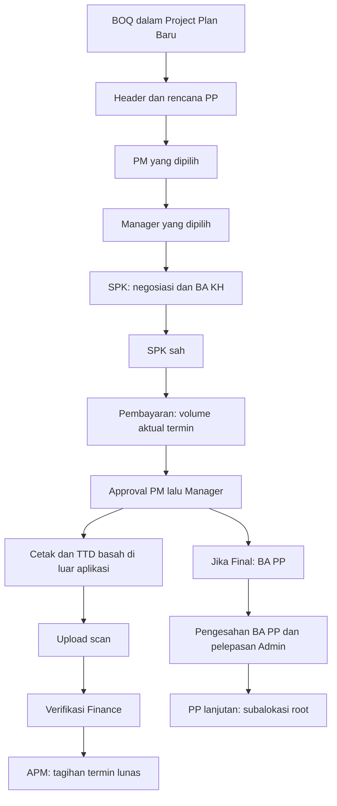

# Alur it's Area 3 — 3 November 2026

Dokumen ini merekam versi 2. Untuk dokumen baru setelah pembaruan username/five approvals, gunakan [WORKFLOW_V3](WORKFLOW_V3.md); versi 1/2 tersimpan tetap dipertahankan.

Permintaan perubahan 3 November menggantikan alur 11 menu dan approval pembayaran tiga tingkat untuk dokumen baru.

## Navigasi dan Project Plan

Sidebar memiliki sembilan menu: Dashboard, Project Plan, SPK, Pembayaran, BA PP, Inbox Approval, Master KHS, Laporan, Pengaturan. BOQ menjadi langkah pertama PP; BA KH berada di proses SPK. URL lama tetap tersedia agar tautan riwayat tidak putus.

Form PP memiliki tujuh langkah: BOQ Plan → Header PP → Pendahuluan & Tim → Jadwal → Anggaran & Margin → Risiko & Kualitas → Preview & Pengajuan. BOQ tetap berasal dari **upload file Excel sesuai template**, bukan input designator satu per satu. Alur yang dirancang: upload → matching designator/paket/satuan → review selisih → validasi → Header PP. Pilihan file pada prototype masih simulasi dan tidak membaca isi file; tombol contoh sintetis ditampilkan terpisah. Pemetaan sheet/kolom menunggu template resmi. BOQ memakai designator aktif, volume positif maksimal tiga desimal, dan harga resmi KHS. Server mengambil ulang harga dan versi master; harga kiriman browser tidak menjadi otoritas. BOQ Owner adalah jumlah volume × harga Material/Jasa yang tersedia. Komponen yang tidak tersedia tetap N/A.

Header berurutan: ID Project, Branch, Unit Kerja (Konstruksi/Operation), No PP otomatis, lalu informasi proyek dan pilihan PM/Manager. Format nomor ada di Pengaturan → Penomoran PP. Token yang didukung: `{SEQ}`, `{BRANCH}`, `{YYYY}`, `{MM}`, `{UNIT}`. Format bawaan `{SEQ}/LG.000/TA-03{BRANCH}/{MM}-{YYYY}`, contoh `0001/LG.000/TA-03R424/11-2026` untuk kode branch R424. Urutan minimal empat digit terus bertambah dalam workspace akun bersama tanpa reset bulan/tahun/Branch; tanggal menggunakan waktu server Asia/Jakarta. Nomor diberikan saat simpan pertama, dipertahankan saat revisi, dan tidak dipengaruhi nomor yang dikirim client.

Admin menyimpan draft atau mengajukan PP. Pengajuan mengunci PP dan masuk ke PM terpilih, kemudian Manager terpilih. Hanya kedua pengguna aktif tersebut dapat menyetujui. PP menjadi Sah setelah keduanya menyetujui; BA KH/SPK ditolak server jika PP belum Sah. Pengembalian membutuhkan alasan, memungkinkan perbaikan, dan memulai ulang approval; riwayat keputusan tetap tersimpan. Penolakan terminal.

## Pembayaran

Pengajuan volume aktual mengikuti SPK sah, maksimal tiga termin, termin ketiga wajib Final, dan tidak ada termin setelah Final. Pengajuan baru memakai snapshot penugasan PM/Manager dari PP. Setelah dua persetujuan, aktual terkunci dan berkas siap dicetak. Finance memverifikasi bukti scan; Finance tidak menjadi approval ketiga pada alur baru.

Upload benar-benar menyimpan PDF/JPG/PNG pada disk lokal privat, maksimal 10 MB pada validasi aplikasi. Batas PHP/web server dapat lebih kecil. Tipe isi diperiksa dengan fileinfo; file HTML yang diganti ekstensi ditolak. File diberi ID server, metadata ukuran/hash, dan hanya dapat diunduh oleh akun login dengan penugasan Branch yang mencakup dokumen tersebut. Input metadata scan melalui endpoint perintah umum ditolak.

Scan dapat dikembalikan Finance dengan alasan. Unggahan koreksi mempertahankan metadata dan file sebelumnya. Setelah scan Valid, Finance mencatat nomor APM unik. Dalam satu transaksi, APM Valid mencatat seluruh sisa tagihan sebagai terbayar; pengulangan request tidak menggandakan pembayaran. Ini pencatatan manual, tanpa transfer bank atau verifikasi eksternal APM. APM lunas mengizinkan termin Parsial berikutnya. Koreksi/reversal pembayaran yang sudah dicatat belum tersedia.

Penerimaan volume terjadi setelah dua persetujuan, bukan ketika dibayar. BA PP berasal dari Final approved; pengesahan BA PP dan pelepasan volume Admin tetap terpisah. PP lanjutan memakai nomor otomatis serta subalokasi volume dan budget root yang dilepas.

## Data lama dan batas demo

Data workspace yang sudah disimpan tidak direset atau diberi keputusan/tanda tangan baru. Normalisasi menambahkan versi alur dan konfigurasi yang belum ada; format bawaan lama diganti sekali tanpa mereset counter, sedangkan format kustom dipertahankan; riwayat, nilai, volume, dan pembayaran lama dipertahankan. Dokumen pembayaran versi 1 tetap memakai aturan historis tiga approval dan pencatatan pembayaran terpisah. Untuk membuat pembayaran versi 2 dari PP lama, Admin menetapkan PM/Manager di detail PP terlebih dahulu. Penugasan terkunci setelah pembayaran baru dibuat. Draft PP lama dapat dilengkapi melalui wizard baru.

Checkpoint demo menetapkan pilihan PM/Manager sintetis agar alur baru dapat dicoba. Pembayaran checkpoint yang sudah selesai tetap menjadi riwayat versi 1. Skenario D menyediakan SPK untuk mencoba dua approval, scan, dan APM baru; Skenario A membuka draft PP untuk BOQ terintegrasi.

Pemilih peran dan pengguna masih simulasi. Belum ada login/RBAC produksi, validasi keaslian TTD, OCR, integrasi bank/APM, atau import master/Excel bebas. Master di runtime masih contoh. Delapan dump master sudah dipetakan pada konsep MySQL dan seed, termasuk Area/Region/Branch/Service Area dan kode_branch; belum diimpor ke workspace SQLite. Template BOQ serta metadata referensi/periode KHS dan penanggung jawab masih diperlukan. Scan adalah unggahan file nyata; keaslian dokumen diperiksa manual oleh Finance. Cetak memakai HTML/browser.

Konsep MySQL ada di `docs/MYSQL_CONCEPT.md` dan `database/mysql/area3-schema-concept.sql`. Runtime tetap SQLite demo agregat JSON; SQL konsep belum diterapkan.

## Identitas akun dan master SQL — 4 November 2026

Login memakai users.id_user serta roles/user_assignments; satu peran per akun dan Branch yang ditugaskan. Tidak ada pemilih peran/reset skenario pada workspace login. Uji approval dengan keluar lalu masuk sebagai akun PM, Manager dan Finance. PP/scan/CSV/cadangan dibatasi Branch; PM/Manager harus dipilih dari akun aktif pada Branch PP. Superadmin membuat akun dan mengatur format nomor global. Workspace akun dimulai kosong, dibagikan antar pengguna, dan dipilih server; transaksi masih agregat JSON MySQL, sedangkan Branch/designator/paket/harga dibaca dari master relasional. Checkpoint sintetis di atas tetap fixture pengujian terpisah, tidak dimuat ke workspace pengguna. Penyiapan Superadmin pertama hanya dari localhost, memakai email/kata sandi pilihan sendiri.
